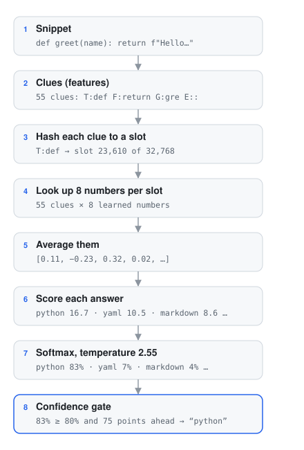
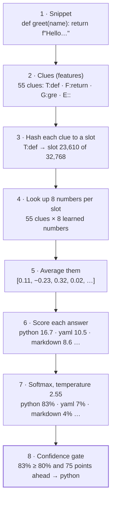
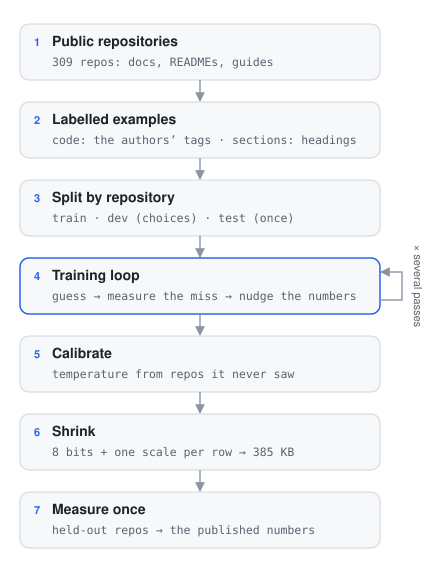
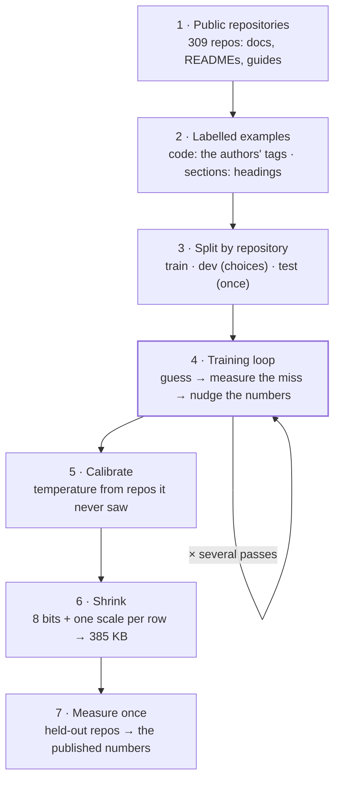

# How the two models work

Marksage ships two tiny models of its own: one names the **language of a code block** (21 answers, from
TypeScript to "not code"), the other names the **type of a document section** for the Outline (10 types,
plus "other"). They share one design, one file format and one training recipe.

> This page assumes no machine-learning background. Every term is explained the first time it appears,
> and there's a glossary at the end. The numbers in the examples are real: they come from the model files
> the app downloads. For what the models are *for* and how they're measured, see
> [How Smart Assist works](SMART-ASSIST.md).

---

## 1. What a classifier is

Both models are **classifiers**: they read a piece of text and pick one answer from a fixed list, saying
how sure they are about each one. They don't write text, chat or "understand" anything. Think of a very
fast, very narrow expert that has seen tens of thousands of examples and learned which small details go
with which answer.

```text
"def greet(name): …"  →  python 83% · yaml 7% · markdown 4% · ruby 3% · …
```

They learn by **supervised learning**: you show them many examples whose answer is already known (a
*labelled* example) and let them adjust themselves until their guesses match the labels. Nobody writes the
rules — "a line ending in `:` after `def` means Python" is something the model works out from the data.

Why not just write rules? Marksage does, and the rules (the *heuristics*) are precise — but they stay quiet
on about three blocks in four, because writing a rule for every pattern of 21 languages is endless. Why not
a large language model? It would be hundreds of megabytes, slow on a laptop, and a hosted one would mean
sending your text away. A purpose-built classifier is about **385 KB**, decides in about **0.1 ms**, and
never leaves the page.

## 2. One decision, step by step

Here is everything the language model does with a two-line snippet:

```python
def greet(name):
    return f"Hello, {name}!"
```

<!-- diagram: inference -->


<details>
<summary>The same diagram in Mermaid</summary>



</details>

The next sections take these steps one at a time.

### 2.1 Text becomes clues (features)

A model can only do arithmetic, so text first has to become something countable. Marksage breaks a snippet
into small **clues** — in machine-learning terms, **features**. For code, there are seven kinds:

| Kind | What it captures | From the example |
|---|---|---|
| `T:` token | every word and symbol | `T:def`, `T:return`, `T:(` |
| `B:` pair | two neighbouring tokens on a line | `B:def greet`, `B:) :` |
| `F:` first token | how a line starts | `F:def`, `F:return` |
| `P:` first pair | the first two tokens of a line | `P:return f` |
| `E:` last character | how a line ends | `E::`, `E:"` |
| `I:` indentation | tabs, 2, 4 or 8+ spaces | `I:4` |
| `G:` trigram | three-letter pieces of longer words | `G:gre`, `G:ree`, `G:eet` |

Our snippet produces **55 clues**. A clue counts once, however often it appears, so a long block doesn't
drown out a short one. The trigrams help with names the model has never seen: `greet` is new, but `gre` and
`eet` show up in many words.

The section model reads prose instead of code, so its clues are different. It uses words and word pairs
(lower-case, accents removed, so *instalação* and *instalacao* are the same clue), the first word of each line,
the words inside code blocks and the language of each code block. It also reads the *shape* of the section:
does it have a table, a list, a shell prompt, a version number, a date, an issue reference? "Before you begin" sections, for
example, are full of `W:need`, `W:install` and `C:node`.

### 2.2 Clues become slot numbers (the hashing trick)

The training data contains about **840,000 different clues** for code. Keeping a dictionary of all of them
would make the model huge, and a clue it has never seen would have no entry at all.

Instead, each clue is put through a **hash function** — a quick calculation that turns any text into a big
number, always the same number for the same text. Marksage uses FNV-1a and keeps the remainder after dividing
by 32,768:

```text
"T:def"  →  hash 774,298,682  →  774,298,682 mod 32,768  =  slot 23,610
```

So every clue lands in one of **32,768 slots**. That means about 26 different clues share each slot — a
*collision*. That sounds bad, but it works: most clues are rare, the useful ones (`T:def`, `E:;`, `F:$`)
appear thousands of times and dominate their slot, and training learns around the noise. In exchange the
model has a fixed size, needs no dictionary file, and new words still land somewhere.

### 2.3 Each slot holds 8 numbers (an embedding)

Every slot owns a short list of **8 numbers**, called its **embedding** or vector. Here is the slot of `T:def`
as stored in the file:

```text
T:def → [−2.21, −2.61, 0.92, 1.87, −3.01, 3.90, −1.66, 0.52]
```

The numbers mean nothing one by one — nobody chose them. They started random and training moved them until
clues that point to the same answer ended up with similar lists. You can picture each list as a point in an
8-dimensional space: Python-ish clues end up in one region, SQL-ish clues in another.

### 2.4 Average the clues

The snippet's 55 lists are **averaged** into one list of 8 numbers:

```text
[0.114, −0.234, 0.322, 0.023, −0.301, 0.209, −0.068, 0.058]
```

This is the whole "understanding" the model has of the snippet. Averaging ignores the order of the clues (the
pairs and first-token clues keep a little local order), which keeps the model tiny and fast. This design comes
from **fastText**, a well-known approach to fast text classification.

### 2.5 Score every answer (the linear layer)

For each of the 21 answers, the model has 8 **weights** and one **bias**. An answer's score is the bias plus
each of the 8 averaged numbers times its weight:

```text
score(python) = bias + w₁·0.114 + w₂·(−0.234) + … + w₈·0.058
```

These raw scores are called **logits**. For our snippet:

| Answer | Score |
|---|---|
| python | 16.66 |
| yaml | 10.51 |
| markdown | 8.64 |
| ruby | 8.17 |
| bash | 6.89 |
| … | … |
| c | −13.89 |

That's the entire network: 32,768 × 8 numbers in the slots plus 8 × 21 weights and 21 biases —
**262,333 numbers** in all. (For comparison, the small open "decision model" originally considered had 322–421
million.)

### 2.6 Scores become probabilities (softmax and temperature)

Scores aren't percentages yet. **Softmax** turns them into probabilities that add up to 100%: raise *e*
(≈ 2.718) to each score and divide each result by the total. Big gaps between scores become very lopsided
probabilities:

```text
softmax at temperature 1:     python 99.7% · yaml 0.2% · …
```

99.7% sounds great, but models trained this way are **overconfident**: when they say 99%, they're right much
less often than 99% of the time. So the scores are divided by a **temperature** first. A temperature above 1
pulls the probabilities closer together:

```text
softmax at temperature 2.55:  python 82.7% · yaml 7.4% · markdown 3.6% · ruby 3.0% · …
```

The temperature isn't guessed. It's **calibrated**: chosen so that "80% sure" really means right about 8 times
in 10 (section 4.3 explains how). The code model has two temperatures — 1.85 for longer snippets and 2.55 for
short ones (3 lines or fewer), because short snippets are easier to over-trust. The section model uses 1.6.

### 2.7 The confidence gate

Last, the same rule as every Smart Assist suggestion: show it only if the top answer is at least **80%** and
at least **20 points** ahead of the second. Python at 82.7% against YAML at 7.4% passes, so the editor offers
"Add language `python`". The answer "not code" is never suggested, and when the model isn't sure, two extra
rules can still help:

- **Agreement:** if the heuristics are confident *and* their answer is the model's own first pick, the
  suggestion is shown. Two independent methods agreeing adds suggestions without adding mistakes.
- **Two options:** if the top two answers together hold at least 85% (and the second at least 20%), you're
  offered both — JavaScript or TypeScript, C or C++.

For the Outline, the gate is the same, but because a type badge changes nothing in your document, a section
model answer between 60% and 80% is still shown, marked as "probably".

## 3. How the models learned

<!-- diagram: training -->


<details>
<summary>The same diagram in Mermaid</summary>



</details>

### 3.1 Examples with known answers

**Code model.** Documentation is full of fenced code blocks whose authors already wrote the language:
` ```python `. Those tags are free labels. Marksage collected about 270,000 blocks from 309 public
repositories (docs, READMEs and guides, Portuguese ones included), plus windows of real source files for
rarer languages. Training used 63,751 of them, at most 6,000 per language so the common ones don't dominate:

| Language | Blocks | Language | Blocks | Language | Blocks |
|---|---|---|---|---|---|
| Python | 6,000 | PHP | 2,843 | CSS | 1,365 |
| Bash | 6,000 | Go | 2,749 | Ruby | 1,132 |
| JavaScript | 6,000 | Rust | 2,582 | Diff | 1,083 |
| TypeScript | 6,000 | Java | 2,238 | Markdown | 944 |
| YAML | 4,525 | C | 2,172 | Dockerfile | 566 |
| SQL | 4,428 | C# | 2,070 | | |
| JSON | 3,127 | C++ | 1,938 | | |
| Not code | 3,112 | HTML | 2,877 | | |

**Section model.** Here nobody wrote labels, so they come from headings: a section headed "Installation" is
a setup section. Only headings that clearly name one type are used (about 26,000 sections). The trick is that
the model **never sees the heading** — only the text under it. That's what lets it type a section whose
heading says nothing, like "Before you begin". Labels made this way are called *weak labels*: mostly right,
not hand-checked.

It also learns an eleventh answer, **other**, from sections whose heading names no type ("Arrays", "Amazon
S3"). Most real sections are just topics; without "other", the first version forced a type on every one of
them, and only about 2 in 3 of its confident answers on such sections were right. With "other" it can decline,
and that went up to about 9 in 10.

### 3.2 The training loop

Training starts with all the numbers random, then repeats one small step for every example:

1. **Guess.** Run the example through steps 2.1–2.6.
2. **Measure the miss.** The **loss** is −log(probability given to the right answer). Gave the right answer
   90%? Loss 0.11. Gave it 30%? Loss 1.20. Gave it 1%? Loss 4.6. Confident mistakes cost the most.
3. **Nudge the numbers.** Work out which direction each number should move to make the loss a little smaller
   (the **gradient**), and move it a little that way.

For this kind of model the direction is surprisingly simple. For each answer, take *its probability minus 1 if
it's the right answer, or minus 0 if not*. Right answer at 30% → −0.7: its score should go up. A wrong answer
at 50% → +0.5: its score should go down. Each answer's 8 weights, its bias, and the 8 numbers of every clue in
the example all move in proportion to that.

How far each step moves is the **learning rate**: it starts at 0.4 and shrinks steadily to zero, so early
steps make big changes and late steps fine-tune. This is **stochastic gradient descent** (SGD): stochastic
because it learns from one example at a time, in a shuffled order.

One pass over all examples is an **epoch**. The code model trains for 8 epochs — about 15 seconds in plain
TypeScript (with the five extra calibration models of section 4.3, about a minute) — and its average loss
falls like this:

| Epoch | 1 | 2 | 3 | 4 | 5 | 6 | 7 | 8 |
|---|---|---|---|---|---|---|---|---|
| Loss | 1.31 | 0.40 | 0.23 | 0.15 | 0.10 | 0.08 | 0.06 | 0.06 |

Two more details:

- **Rare languages count more.** There are 6,000 Python blocks and 566 Dockerfiles. Each example's push is
  multiplied by (6,000 ÷ its language's count)^0.5, so a Dockerfile counts about 3.3 times as much as a Python
  block. Without it the model would learn to just say the common languages.
- **Reproducible.** The shuffling uses a fixed random seed, so training the same data again produces the very
  same file, byte for byte.

## 4. Keeping the numbers honest

A model can look great on the examples it learned from and still fail on new ones. Most of the work behind
these models is making sure the published numbers describe *new* documents.

### 4.1 Split by repository

Blocks from the same project look alike — same variable names, same style. If some of a project's blocks were
used for training and others for testing, the model could pass the test by remembering the project. So whole
repositories go to exactly one of three sets:

- **Train** — what the model learns from;
- **Dev** — used to make choices (model size, number of epochs, which rules to keep);
- **Test** — held out and run **once**, at the end, for the published numbers.

A leak guard also removes any training block whose text, or first three lines, also appears in a test set. And
after the first test set had been seen, a second, fresh one was built from 72 repositories used nowhere else.

### 4.2 Overfitting

Training loss always goes down; that doesn't mean the model is getting better. An early section model, with
twice as many slots, twice the numbers per slot and 10 epochs, reached a training loss of 0.05 — nearly
perfect. Yet it agreed with headings on new repositories only 57% of the time, in a 1.3 MB file. It had started memorising its
examples instead of learning patterns: **overfitting**. A smaller model trained for 3 epochs did as well or
better on dev in a third of the size, so that's what ships.

### 4.3 Calibration on repositories the model never saw

The temperature (section 2.6) is fitted where the model is honest: on predictions for repositories it didn't
train on. For the code model, the training repositories are split into 5 groups; 5 extra models each train on
4 groups and predict the fifth (*cross-validation*). That gives about 7,600 out-of-repository predictions.
Then the temperature is raised until, at the app's gate, 95% of those predictions would have been right.

The effect on the dev set — same trained numbers, only the temperature changed:

| | Suggestions shown (of 280) | Right when shown |
|---|---|---|
| No calibration (temperature 1) | 210 | 87.6% |
| Calibrated (shipped) | 157 | 94.9% |

Fewer suggestions, but the ones you see are right more often — the trade Smart Assist always makes. On the
fresh held-out set, confidence and correctness line up like this:

| The model said | Blocks | Actually right |
|---|---|---|
| 90–100% | 120 | 93% |
| 80–90% | 38 | 87% |
| 70–80% | 21 | 86% |
| 50–70% | 40 | 55% |
| under 50% | 65 | 40% |

### 4.4 What gets measured

- **Accuracy** — how often the top answer is right, shown or not;
- **Shown** — how many answers pass the gate;
- **Right when shown** (precision) — of the suggestions you actually see, how many are right. This is the one
  that matters most: a missing suggestion costs nothing, a wrong one costs trust.

On 284 fresh code blocks from 67 repositories it had never seen, the code model shows a suggestion for 158
(56%), right 92% of the time — more than twice as many useful suggestions as the heuristics (70, 93% right).
The section model, on 133 held-out repositories, types 15% of sections confidently and agrees with the heading
91.5% of the time. Full tables: [How Smart Assist works](SMART-ASSIST.md), section 4.

## 5. Making it small: 8-bit numbers

262,144 slot numbers stored the usual way (4 bytes each) take 1 MB. Each slot's 8 numbers are instead stored
as **8-bit integers** (−127 to 127) plus one shared **scale** — *quantization*:

```text
stored:    [−72, −85, 30, 61, −98, 127, −54, 17]   scale 0.03067
restored:  [−2.21, −2.61, 0.92, 1.87, −3.01, 3.90, −1.66, 0.52]
```

The largest number in the row becomes ±127 and the rest are rounded in proportion. The rounding barely moves
the scores, and the published numbers are measured on the 8-bit file, not the original.

The file (394,280 bytes) is laid out like this:

| Part | Size |
|---|---|
| Signature "MSLM", version, header length | 12 bytes |
| Header (answers, sizes, temperatures, which clue reader) | ~300 bytes |
| Slot numbers, 8 bits each | 256 KB |
| One scale per slot | 128 KB |
| Weights and biases of the 21 answers | ~0.7 KB |

A third of the file is scales — one of the next things to shrink. The app downloads it once (only after you
pick *Local model* and confirm), keeps it in the browser's cache, and runs everything in plain JavaScript: no
machine-learning library, no GPU, no background worker. Each decision is a few thousand multiplications.

## 6. Limits, honestly

- **One-liners.** Short snippets carry few clues, and the model can't say "too short to tell". `x = 1` comes
  out as Python at 97% (it's also valid Ruby, JavaScript…), and `void main() { printf("hi"); }` as C++ at 81%
  (it's also valid C). A "too short to judge" rule is the obvious next step.
- **Labels have quirks.** Authors tag `dotnet build -c Release` as C#, terminal sessions as `text`. The model
  learns their habits, and some of its "mistakes" are really disagreements with a label.
- **Order mostly ignored.** Averaging clues loses most of the order; a model that reads sequences would catch
  more, at many times the size.
- **Patterns, not meaning.** With 8 numbers per clue, it recognises the look of a language or a section. It
  doesn't know what the code does or what the section says. It also can't explain its answer.
- **Some types are weak.** "Guide" sections read a lot like setup or examples; the section model rarely labels
  them confidently.

## 7. Glossary

| Term | Meaning |
|---|---|
| **Bias** | A per-answer number added to its score, whatever the input. |
| **Calibration** | Adjusting confidence so that "80% sure" means right about 80% of the time. |
| **Classifier** | A model that picks one answer from a fixed list. |
| **Collision** | Two different clues landing in the same hash slot. |
| **Cross-validation** | Splitting the training data into groups and predicting each group with a model trained on the others. |
| **Dev set** | Examples used to make choices while building; never used for training. |
| **Embedding** | The list of learned numbers (here 8) that stands for a clue. |
| **Epoch** | One pass over every training example. |
| **Feature** | A clue extracted from the input (`T:def`, `E:;`). |
| **Gradient** | The direction each number should move to reduce the loss. |
| **Hashing trick** | Mapping clues to a fixed number of slots with a hash function instead of a dictionary. |
| **Held-out / test set** | Examples kept aside and run once, for the reported numbers. |
| **Label** | The known right answer for a training example. |
| **Learning rate** | How big each training step is. |
| **Logit** | An answer's raw score, before softmax. |
| **Loss** | How wrong a guess was: −log(probability of the right answer). |
| **Overfitting** | Memorising training examples instead of learning patterns that carry over. |
| **Parameter** | One of the learned numbers (this model has 262,333). |
| **Precision** | Of the answers shown, the share that are right. |
| **Quantization** | Storing numbers with fewer bits (here 8 instead of 32). |
| **SGD** | Stochastic gradient descent: learning from one example at a time, nudging numbers along the gradient. |
| **Softmax** | Turns scores into probabilities that add up to 100%. |
| **Temperature** | A divisor applied to scores before softmax; higher means less confident. |
| **Weak label** | A label produced by a rule (here: the heading) rather than checked by hand. |

---

The training code, data sources and every result are in the repository on
[GitHub](https://github.com/PabloFLPs/Marksage) — the `training` folder has its own README.
