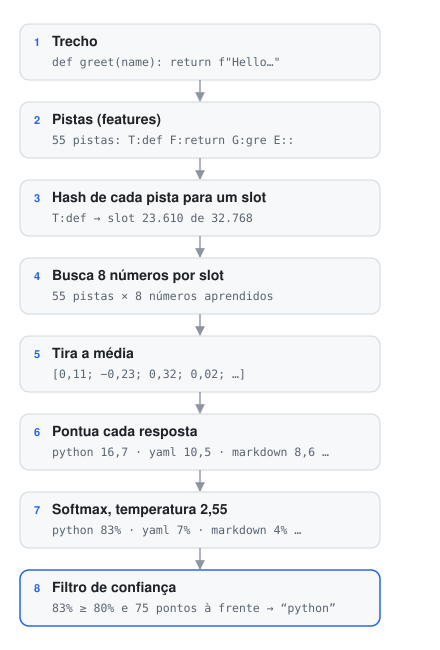
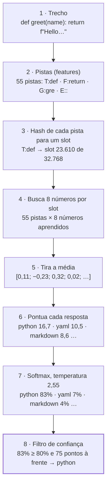
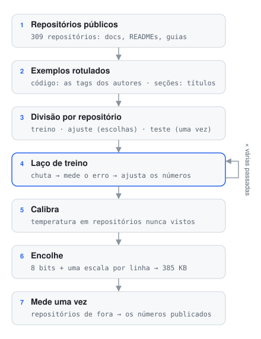
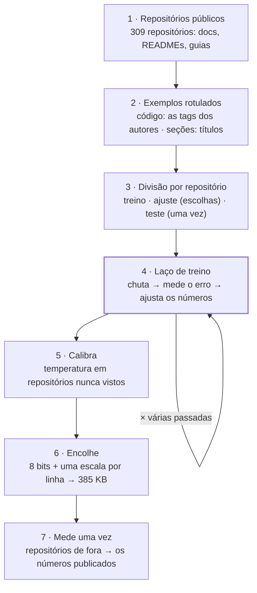

# Como os dois modelos funcionam

O Marksage traz dois modelos minúsculos próprios. Um identifica a **linguagem de um bloco de código** (21
respostas, de TypeScript a "não é código"); o outro identifica o **tipo de uma seção** do documento para a
Estrutura (10 tipos, mais "outro"). Os dois compartilham o mesmo desenho, o mesmo formato de arquivo e a mesma
receita de treino.

> Esta página não pressupõe nenhum conhecimento de aprendizado de máquina. Cada termo é explicado na primeira
> vez que aparece, e há um glossário no fim. Os números dos exemplos são reais: vêm dos arquivos de modelo que
> o app baixa. Para *para que* servem os modelos e como são medidos, veja
> [Como o Smart Assist funciona](SMART-ASSIST.pt-BR.md).

---

## 1. O que é um classificador

Os dois modelos são **classificadores**: leem um trecho de texto e escolhem uma resposta de uma lista fixa,
dizendo o quanto têm certeza de cada uma. Eles não escrevem texto, não conversam e não "entendem" nada. Pense
num especialista muito rápido e muito específico, que viu dezenas de milhares de exemplos e aprendeu quais
detalhes pequenos combinam com qual resposta.

```text
"def greet(name): …"  →  python 83% · yaml 7% · markdown 4% · ruby 3% · …
```

Eles aprendem por **aprendizado supervisionado**: você mostra muitos exemplos cuja resposta já é conhecida (um
exemplo *rotulado*) e deixa o modelo se ajustar até os palpites baterem com os rótulos. Ninguém escreve as
regras — "uma linha terminando em `:` depois de `def` é Python" é algo que o modelo descobre sozinho a partir
dos dados.

Por que não escrever regras? O Marksage escreve, e as regras (as *heurísticas*) são precisas — mas ficam em
silêncio em cerca de três blocos a cada quatro, porque escrever uma regra para cada padrão de 21 linguagens não
tem fim. Por que não um grande modelo de linguagem? Teria centenas de megabytes, seria lento num notebook, e um
hospedado significaria mandar seu texto para fora. Um classificador feito para a tarefa tem cerca de **385 KB**,
decide em cerca de **0,1 ms** e nunca sai da página.

## 2. Uma decisão, passo a passo

Isto é tudo o que o modelo de linguagens faz com um trecho de duas linhas:

```python
def greet(name):
    return f"Hello, {name}!"
```

<!-- diagram: inference -->


<details>
<summary>O mesmo diagrama em Mermaid</summary>



</details>

As próximas seções percorrem esses passos um a um.

### 2.1 O texto vira pistas (features)

Um modelo só faz contas, então o texto primeiro precisa virar algo contável. O Marksage quebra um trecho em
**pistas** pequenas — em termos de aprendizado de máquina, **features**. Para código, há sete tipos:

| Tipo | O que captura | No exemplo |
|---|---|---|
| `T:` token | cada palavra e símbolo | `T:def`, `T:return`, `T:(` |
| `B:` par | dois tokens vizinhos na linha | `B:def greet`, `B:) :` |
| `F:` primeiro token | como a linha começa | `F:def`, `F:return` |
| `P:` primeiro par | os dois primeiros tokens da linha | `P:return f` |
| `E:` último caractere | como a linha termina | `E::`, `E:"` |
| `I:` indentação | tabs, 2, 4 ou 8+ espaços | `I:4` |
| `G:` trigrama | pedaços de três letras de palavras longas | `G:gre`, `G:ree`, `G:eet` |

Nosso trecho gera **55 pistas**. Uma pista conta uma vez só, não importa quantas vezes apareça, para que um
bloco longo não abafe um curto. Os trigramas ajudam com nomes que o modelo nunca viu: `greet` é novo, mas `gre`
e `eet` aparecem em muitas palavras.

O modelo de seções lê texto corrido em vez de código, então as pistas dele são outras. Ele usa palavras e pares
de palavras (em minúsculas e sem acentos, então *instalação* e *instalacao* são a mesma pista), a primeira
palavra de cada linha, as palavras dentro de blocos de código e a linguagem de cada bloco. Também lê o *formato*
da seção: tem tabela, lista, prompt de terminal, número de versão, data, referência a issue? Seções "Antes de começar", por
exemplo, são cheias de `W:need`, `W:install` e `C:node`.

### 2.2 As pistas viram números de slot (o truque do hash)

Os dados de treino têm cerca de **840 mil pistas diferentes** para código. Guardar um dicionário com todas
deixaria o modelo enorme, e uma pista nunca vista não teria entrada nenhuma.

Em vez disso, cada pista passa por uma **função de hash** — uma conta rápida que transforma qualquer texto num
número grande, sempre o mesmo número para o mesmo texto. O Marksage usa o FNV-1a e fica com o resto da divisão
por 32.768:

```text
"T:def"  →  hash 774.298.682  →  774.298.682 mod 32.768  =  slot 23.610
```

Assim, cada pista cai num de **32.768 slots**. Isso quer dizer que umas 26 pistas diferentes dividem cada slot —
uma *colisão*. Parece ruim, mas funciona: a maioria das pistas é rara, as úteis (`T:def`, `E:;`, `F:$`)
aparecem milhares de vezes e dominam seu slot, e o treino aprende a contornar o ruído. Em troca, o modelo tem
tamanho fixo, não precisa de arquivo de dicionário, e palavras novas ainda caem em algum lugar.

### 2.3 Cada slot guarda 8 números (um embedding)

Cada slot tem uma listinha de **8 números**, chamada de **embedding** ou vetor. Este é o slot de `T:def` como
está guardado no arquivo:

```text
T:def → [−2,21; −2,61; 0,92; 1,87; −3,01; 3,90; −1,66; 0,52]
```

Os números não significam nada um a um — ninguém os escolheu. Começaram aleatórios, e o treino foi mexendo
neles até pistas que apontam para a mesma resposta terminarem com listas parecidas. Dá para imaginar cada lista
como um ponto num espaço de 8 dimensões: pistas com cara de Python ficam numa região, pistas com cara de SQL em
outra.

### 2.4 A média das pistas

As 55 listas do trecho viram **uma média**, uma lista de 8 números:

```text
[0,114; −0,234; 0,322; 0,023; −0,301; 0,209; −0,068; 0,058]
```

Isso é todo o "entendimento" que o modelo tem do trecho. A média ignora a ordem das pistas (os pares e as
pistas de primeiro token guardam um pouco da ordem local), o que mantém o modelo minúsculo e rápido. Esse
desenho vem do **fastText**, uma abordagem conhecida de classificação rápida de texto.

### 2.5 Uma pontuação por resposta (a camada linear)

Para cada uma das 21 respostas, o modelo tem 8 **pesos** e um **viés**. A pontuação de uma resposta é o viés
mais cada um dos 8 números da média vezes o seu peso:

```text
pontuação(python) = viés + p₁·0,114 + p₂·(−0,234) + … + p₈·0,058
```

Essas pontuações brutas se chamam **logits**. Para o nosso trecho:

| Resposta | Pontuação |
|---|---|
| python | 16,66 |
| yaml | 10,51 |
| markdown | 8,64 |
| ruby | 8,17 |
| bash | 6,89 |
| … | … |
| c | −13,89 |

Essa é a rede inteira: 32.768 × 8 números nos slots mais 8 × 21 pesos e 21 vieses — **262.333 números** ao
todo. (Para comparar, o pequeno "modelo de decisão" aberto considerado no início tinha de 322 a 421 milhões.)

### 2.6 Pontuações viram probabilidades (softmax e temperatura)

Pontuações ainda não são porcentagens. O **softmax** as transforma em probabilidades que somam 100%: eleva *e*
(≈ 2,718) a cada pontuação e divide cada resultado pelo total. Diferenças grandes entre pontuações viram
probabilidades bem desequilibradas:

```text
softmax com temperatura 1:     python 99,7% · yaml 0,2% · …
```

99,7% parece ótimo, mas modelos treinados assim são **confiantes demais**: quando dizem 99%, acertam bem menos
que 99% das vezes. Então as pontuações são divididas antes por uma **temperatura**. Uma temperatura acima de 1
aproxima as probabilidades:

```text
softmax com temperatura 2,55:  python 82,7% · yaml 7,4% · markdown 3,6% · ruby 3,0% · …
```

A temperatura não é chutada. Ela é **calibrada**: escolhida para que "80% de certeza" signifique acertar umas 8
vezes em 10 (a seção 4.3 explica como). O modelo de código tem duas temperaturas — 1,85 para trechos maiores e
2,55 para os curtos (3 linhas ou menos), porque trechos curtos enganam mais fácil. O modelo de seções usa 1,6.

### 2.7 O filtro de confiança

Por fim, a mesma regra de toda sugestão do Smart Assist: só mostra se a primeira resposta tiver pelo menos
**80%** e estiver pelo menos **20 pontos** à frente da segunda. Python com 82,7% contra YAML com 7,4% passa, então
o editor oferece "Adicionar a linguagem `python`". A resposta "não é código" nunca é sugerida, e quando o modelo
não tem certeza, duas regras extras ainda podem ajudar:

- **Concordância:** se as heurísticas estão confiantes *e* a resposta delas é o primeiro palpite do próprio
  modelo, a sugestão aparece. Dois métodos independentes concordando somam sugestões sem somar erros.
- **Duas opções:** se as duas primeiras respostas juntas têm pelo menos 85% (e a segunda pelo menos 20%), você
  recebe as duas — JavaScript ou TypeScript, C ou C++.

Na Estrutura o filtro é o mesmo, mas como um selo de tipo não muda nada no documento, uma resposta do modelo de
seções entre 60% e 80% ainda aparece, marcada como "provável".

## 3. Como os modelos aprenderam

<!-- diagram: training -->


<details>
<summary>O mesmo diagrama em Mermaid</summary>



</details>

### 3.1 Exemplos com resposta conhecida

**Modelo de código.** Documentação é cheia de blocos de código cujos autores já escreveram a linguagem:
` ```python `. Essas tags são rótulos de graça. O Marksage coletou cerca de 270 mil blocos de 309 repositórios
públicos (docs, READMEs e guias, inclusive em português), mais janelas de arquivos de código reais para as
linguagens mais raras. O treino usou 63.751 deles, no máximo 6.000 por linguagem, para as comuns não dominarem:

| Linguagem | Blocos | Linguagem | Blocos | Linguagem | Blocos |
|---|---|---|---|---|---|
| Python | 6.000 | PHP | 2.843 | CSS | 1.365 |
| Bash | 6.000 | Go | 2.749 | Ruby | 1.132 |
| JavaScript | 6.000 | Rust | 2.582 | Diff | 1.083 |
| TypeScript | 6.000 | Java | 2.238 | Markdown | 944 |
| YAML | 4.525 | C | 2.172 | Dockerfile | 566 |
| SQL | 4.428 | C# | 2.070 | | |
| JSON | 3.127 | C++ | 1.938 | | |
| Não é código | 3.112 | HTML | 2.877 | | |

**Modelo de seções.** Aqui ninguém escreveu rótulos, então eles vêm dos títulos: uma seção chamada "Instalação"
é uma seção de instalação. Só entram títulos que nomeiam claramente um tipo (cerca de 26 mil seções). O truque é
que o modelo **nunca vê o título** — só o texto sob ele. É isso que permite identificar uma seção cujo título não
diz nada, como "Antes de começar". Rótulos feitos assim se chamam *rótulos fracos*: quase sempre certos, mas não
conferidos à mão.

Ele também aprende uma décima primeira resposta, **outro**, a partir de seções cujo título não nomeia tipo
("Arrays", "Amazon S3"). A maioria das seções reais é só um assunto; sem "outro", a primeira versão forçava um
tipo em todas, e só umas 2 em 3 das respostas confiantes nessas seções estavam certas. Com "outro" ele pode
recusar, e isso subiu para umas 9 em 10.

### 3.2 O laço de treino

O treino começa com todos os números aleatórios e repete um passinho para cada exemplo:

1. **Chuta.** Passa o exemplo pelos passos 2.1–2.6.
2. **Mede o erro.** A **perda** (*loss*) é −log(probabilidade dada à resposta certa). Deu 90% para a certa?
   Perda 0,11. Deu 30%? Perda 1,20. Deu 1%? Perda 4,6. Erros confiantes custam mais caro.
3. **Ajusta os números.** Calcula para que lado cada número deve andar para a perda diminuir um pouco (o
   **gradiente**) e anda um pouquinho para esse lado.

Para esse tipo de modelo, o lado é surpreendentemente simples. Para cada resposta, pegue *a probabilidade dela
menos 1 se for a certa, ou menos 0 se não for*. Resposta certa com 30% → −0,7: a pontuação dela deve subir. Uma
errada com 50% → +0,5: a pontuação deve descer. Os 8 pesos e o viés de cada resposta, e os 8 números de cada
pista do exemplo, andam na proporção disso.

O tamanho de cada passo é a **taxa de aprendizado**: começa em 0,4 e diminui aos poucos até zero, então os
primeiros passos mudam muito e os últimos fazem o ajuste fino. Isso é o **gradiente descendente estocástico**
(SGD): estocástico porque aprende com um exemplo de cada vez, em ordem embaralhada.

Uma passada por todos os exemplos é uma **época**. O modelo de código treina por 8 épocas — uns 15 segundos em
TypeScript puro (com os cinco modelos extras de calibração da seção 4.3, cerca de um minuto) — e a perda média
cai assim:

| Época | 1 | 2 | 3 | 4 | 5 | 6 | 7 | 8 |
|---|---|---|---|---|---|---|---|---|
| Perda | 1,31 | 0,40 | 0,23 | 0,15 | 0,10 | 0,08 | 0,06 | 0,06 |

Mais dois detalhes:

- **Linguagens raras valem mais.** Há 6.000 blocos de Python e 566 Dockerfiles. O empurrão de cada exemplo é
  multiplicado por (6.000 ÷ a quantidade da linguagem dele)^0,5, então um Dockerfile vale umas 3,3 vezes um bloco
  de Python. Sem isso, o modelo aprenderia a responder só as linguagens comuns.
- **Reproduzível.** O embaralhamento usa uma semente aleatória fixa, então treinar os mesmos dados de novo gera
  exatamente o mesmo arquivo, byte a byte.

## 4. Mantendo os números honestos

Um modelo pode ir muito bem nos exemplos com que aprendeu e mesmo assim falhar em novos. A maior parte do
trabalho por trás desses modelos é garantir que os números publicados descrevam documentos *novos*.

### 4.1 Divisão por repositório

Blocos do mesmo projeto se parecem — mesmos nomes de variável, mesmo estilo. Se parte dos blocos de um projeto
fosse para o treino e outra para o teste, o modelo poderia passar no teste lembrando do projeto. Por isso
repositórios inteiros vão para exatamente um de três conjuntos:

- **Treino** — com o que o modelo aprende;
- **Ajuste** (*dev*) — usado para tomar decisões (tamanho do modelo, número de épocas, quais regras ficam);
- **Teste** — guardado à parte e rodado **uma vez**, no fim, para os números publicados.

Uma proteção contra vazamento também remove qualquer bloco de treino cujo texto, ou cujas três primeiras
linhas, apareça num conjunto de teste. E depois que o primeiro conjunto de teste já tinha sido visto, um
segundo, novo, foi montado com 72 repositórios que não aparecem em mais nenhum lugar.

### 4.2 Overfitting

A perda de treino sempre cai; isso não quer dizer que o modelo está melhorando. Um modelo de seções antigo, com
o dobro de slots, o dobro de números por slot e 10 épocas, chegou a uma perda de treino de 0,05 — quase perfeita.
Mesmo assim, concordava com os títulos em repositórios novos só 57% das vezes, num arquivo de 1,3 MB. Ele tinha
começado a decorar os exemplos em vez de aprender padrões: **overfitting** (sobreajuste). Um modelo menor,
treinado por 3 épocas, foi tão bem ou melhor no ajuste com um terço do tamanho, e é ele que vai no app.

### 4.3 Calibração em repositórios que o modelo nunca viu

A temperatura (seção 2.6) é ajustada onde o modelo é honesto: em previsões para repositórios com que ele não
treinou. No modelo de código, os repositórios de treino são divididos em 5 grupos; 5 modelos extras treinam cada
um com 4 grupos e preveem o quinto (*validação cruzada*). Isso dá umas 7.600 previsões fora do repositório.
Depois, a temperatura sobe até que, no filtro do app, 95% dessas previsões teriam acertado.

O efeito no conjunto de ajuste — mesmos números treinados, só a temperatura mudou:

| | Sugestões mostradas (de 280) | Certas quando mostradas |
|---|---|---|
| Sem calibração (temperatura 1) | 210 | 87,6% |
| Calibrado (o que vai no app) | 157 | 94,9% |

Menos sugestões, mas as que você vê acertam mais — a troca que o Smart Assist sempre faz. No conjunto de teste
novo, confiança e acerto se alinham assim:

| O modelo disse | Blocos | Certos de fato |
|---|---|---|
| 90–100% | 120 | 93% |
| 80–90% | 38 | 87% |
| 70–80% | 21 | 86% |
| 50–70% | 40 | 55% |
| menos de 50% | 65 | 40% |

### 4.4 O que é medido

- **Acurácia** — com que frequência a primeira resposta está certa, mostrada ou não;
- **Mostradas** — quantas respostas passam no filtro;
- **Certas quando mostradas** (precisão) — das sugestões que você de fato vê, quantas estão certas. Esta é a que
  mais importa: uma sugestão que falta não custa nada, uma errada custa confiança.

Em 284 blocos de código novos de 67 repositórios que ele nunca viu, o modelo de código mostra sugestão para 158
(56%), certas 92% das vezes — mais que o dobro de sugestões úteis das heurísticas (70, 93% certas). O modelo de
seções, em 133 repositórios de fora, dá tipo com confiança a 15% das seções e concorda com o título 91,5% das
vezes. Tabelas completas: [Como o Smart Assist funciona](SMART-ASSIST.pt-BR.md), seção 4.

## 5. Deixando pequeno: números de 8 bits

262.144 números de slot guardados do jeito normal (4 bytes cada) ocupam 1 MB. Em vez disso, os 8 números de cada
slot são guardados como **inteiros de 8 bits** (−127 a 127) mais uma **escala** compartilhada — *quantização*:

```text
guardado:     [−72, −85, 30, 61, −98, 127, −54, 17]   escala 0,03067
restaurado:   [−2,21; −2,61; 0,92; 1,87; −3,01; 3,90; −1,66; 0,52]
```

O maior número da linha vira ±127 e os outros são arredondados na proporção. O arredondamento quase não mexe nas
pontuações, e os números publicados são medidos no arquivo de 8 bits, não no original.

O arquivo (394.280 bytes) é organizado assim:

| Parte | Tamanho |
|---|---|
| Assinatura "MSLM", versão, tamanho do cabeçalho | 12 bytes |
| Cabeçalho (respostas, tamanhos, temperaturas, qual leitor de pistas) | ~300 bytes |
| Números dos slots, 8 bits cada | 256 KB |
| Uma escala por slot | 128 KB |
| Pesos e vieses das 21 respostas | ~0,7 KB |

Um terço do arquivo são escalas — uma das próximas coisas a encolher. O app baixa o arquivo uma vez (só depois
que você escolhe o *Modelo local* e confirma) e o guarda no cache do navegador. Tudo roda em JavaScript puro:
sem biblioteca de aprendizado de máquina, sem GPU, sem worker em segundo plano. Cada decisão são alguns milhares de
multiplicações.

## 6. Limites, com honestidade

- **Linhas únicas.** Trechos curtos têm poucas pistas, e o modelo não sabe dizer "curto demais para saber".
  `x = 1` sai como Python com 97% (também é Ruby, JavaScript…), e `void main() { printf("hi"); }` como C++ com 81%
  (também é C). Uma regra de "curto demais para julgar" é o próximo passo óbvio.
- **Rótulos têm manias.** Autores marcam `dotnet build -c Release` como C#, sessões de terminal como `text`. O
  modelo aprende esses hábitos, e alguns dos seus "erros" são na verdade discordâncias com um rótulo.
- **A ordem quase não conta.** A média das pistas perde quase toda a ordem; um modelo que lê sequências pegaria
  mais coisa, com muitas vezes o tamanho.
- **Padrões, não significado.** Com 8 números por pista, ele reconhece a cara de uma linguagem ou de uma seção.
  Não sabe o que o código faz nem o que a seção diz. Também não sabe explicar a resposta.
- **Alguns tipos são fracos.** Seções de "guia" parecem muito com instalação ou exemplos; o modelo de seções
  raramente as marca com confiança.

## 7. Glossário

| Termo | Significado |
|---|---|
| **Ajuste (dev)** | Exemplos usados para tomar decisões durante a construção; nunca usados no treino. |
| **Calibração** | Ajustar a confiança para que "80% de certeza" signifique acertar umas 80% das vezes. |
| **Classificador** | Um modelo que escolhe uma resposta de uma lista fixa. |
| **Colisão** | Duas pistas diferentes caindo no mesmo slot do hash. |
| **Embedding** | A lista de números aprendidos (aqui, 8) que representa uma pista. |
| **Época** | Uma passada por todos os exemplos de treino. |
| **Feature (pista)** | Um detalhe extraído da entrada (`T:def`, `E:;`). |
| **Gradiente** | O lado para onde cada número deve andar para diminuir a perda. |
| **Logit** | A pontuação bruta de uma resposta, antes do softmax. |
| **Overfitting** | Decorar os exemplos de treino em vez de aprender padrões que valem para outros. |
| **Parâmetro** | Um dos números aprendidos (este modelo tem 262.333). |
| **Perda (loss)** | O quanto um palpite errou: −log(probabilidade da resposta certa). |
| **Precisão** | Das respostas mostradas, a parte que está certa. |
| **Quantização** | Guardar números com menos bits (aqui, 8 em vez de 32). |
| **Rótulo** | A resposta certa conhecida de um exemplo de treino. |
| **Rótulo fraco** | Um rótulo gerado por uma regra (aqui, o título), não conferido à mão. |
| **SGD** | Gradiente descendente estocástico: aprender com um exemplo de cada vez, ajustando os números pelo gradiente. |
| **Softmax** | Transforma pontuações em probabilidades que somam 100%. |
| **Taxa de aprendizado** | O tamanho de cada passo de treino. |
| **Temperatura** | Um divisor aplicado às pontuações antes do softmax; maior quer dizer menos confiante. |
| **Teste (conjunto de fora)** | Exemplos guardados à parte e rodados uma vez, para os números publicados. |
| **Truque do hash** | Mapear pistas para um número fixo de slots com uma função de hash, em vez de um dicionário. |
| **Validação cruzada** | Dividir os dados de treino em grupos e prever cada grupo com um modelo treinado nos outros. |
| **Viés** | Um número por resposta somado à pontuação dela, qualquer que seja a entrada. |

---

O código de treino, as fontes de dados e todos os resultados estão no repositório no
[GitHub](https://github.com/PabloFLPs/Marksage) — a pasta `training` tem o próprio README.
