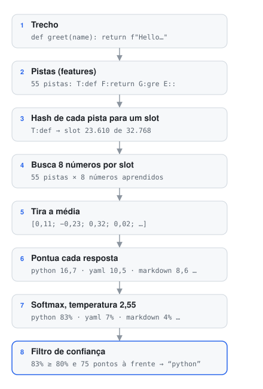
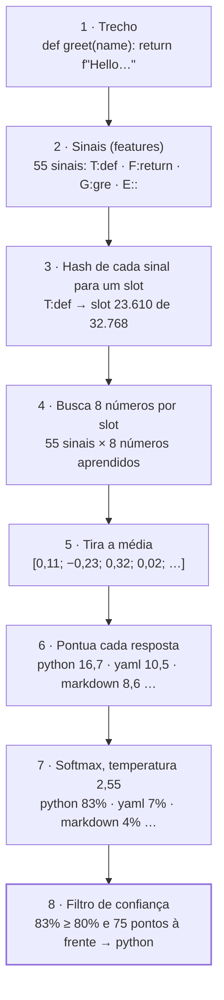
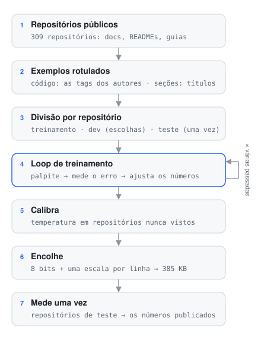
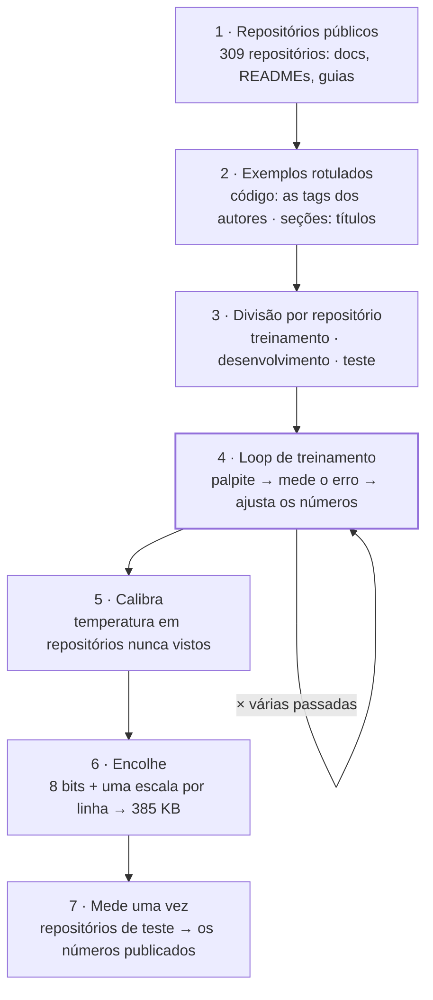

# Como os dois modelos funcionam

O Marksage traz dois pequenos modelos próprios. Um diz a **linguagem de um bloco de código** (21 respostas, de
TypeScript a "não é código"); o outro diz o **tipo de uma seção** do documento, para a Estrutura (13 tipos, mais
"outro"). Os dois têm a mesma arquitetura, o mesmo formato de arquivo e a mesma receita de treinamento. Mais dois foram
treinados do mesmo jeito, para as dicas de formatação e os tipos de conteúdo colado, e não são usados, porque não
se saíram melhor que as regras em texto real (seção 8).

> Esta página não pressupõe nenhum conhecimento de machine learning. Cada termo é explicado na primeira vez que
> aparece, e há um glossário no fim. Os números dos exemplos são reais: vêm dos arquivos de modelo que o app
> baixa. Para saber *para que* servem os modelos e como eles são medidos, veja
> [Como o Smart Assist funciona](SMART-ASSIST.pt-BR.md). Quer as especificações, ou rodar os modelos você mesmo?
> A seção 7 tem uma ficha técnica de cada um.

---

## 1. O que é um classificador

Os dois modelos são **classificadores**: leem um trecho de texto e escolhem uma resposta de uma lista fixa,
dizendo o quanto têm certeza de cada uma. Eles não escrevem texto, não conversam e não "entendem" nada. Pense num
especialista muito rápido e muito focado, que viu dezenas de milhares de exemplos e aprendeu quais detalhes
pequenos combinam com qual resposta.

```text
"def greet(name): …"  →  python 83% · yaml 7% · markdown 4% · ruby 3% · …
```

Eles aprendem por **aprendizado supervisionado**: você mostra muitos exemplos cuja resposta já é conhecida (um
exemplo *rotulado*) e deixa o modelo se ajustar até os palpites dele baterem com os rótulos. Ninguém escreve as
regras: "uma linha que termina em `:` depois de `def` quer dizer Python" é algo que o modelo descobre sozinho, a
partir dos dados.

Por que não escrever regras? O Marksage escreve, e as regras heurísticas são precisas. Mas elas ficam em silêncio
em cerca de três blocos a cada quatro, porque escrever uma regra para cada padrão de 20 linguagens não tem fim. E
por que não um LLM convencional? Ele teria centenas de megabytes, seria lento num notebook, e um modelo
hospedado significaria mandar o seu texto para fora. Um classificador feito para a tarefa tem cerca de
**385 KB**, decide em cerca de **0,1 ms** e é executado inteiramente dentro da página.

## 2. Uma decisão, passo a passo

Isto é tudo o que o modelo de linguagens faz com um trecho de duas linhas:

```python
def greet(name):
    return f"Hello, {name}!"
```

<!-- diagram: inference -->


<details>
<summary>O mesmo diagrama em Mermaid</summary>



</details>

As próximas seções mostram esses passos um de cada vez.

### 2.1 O texto vira sinais (features)

Um modelo só sabe fazer contas, então, primeiramente, o texto precisa se tornar algo possível de se
contabilizar. O Marksage quebra um trecho
em pequenos **sinais**, que em machine learning se chamam **features**. Para código, há sete tipos:

| Tipo | O que captura | No exemplo |
|---|---|---|
| `T:` token | cada palavra e cada símbolo | `T:def`, `T:return`, `T:(` |
| `B:` par | dois tokens vizinhos na mesma linha | `B:def greet`, `B:) :` |
| `F:` primeiro token | como uma linha começa | `F:def`, `F:return` |
| `P:` primeiro par | os dois primeiros tokens de uma linha | `P:return f` |
| `E:` último caractere | como uma linha termina | `E::`, `E:"` |
| `I:` indentação | tabulação, 2, 4 ou 8+ espaços | `I:4` |
| `G:` trigrama | pedaços de três letras de palavras mais longas | `G:gre`, `G:ree`, `G:eet` |

O trecho do exemplo gera **55 sinais**. Um sinal conta uma vez só, não importa quantas vezes apareça; assim, um bloco
longo não abafa um curto. Os trigramas ajudam com nomes que o modelo nunca viu: `greet` é novo, mas `gre` e `eet`
aparecem em muitas palavras.

O modelo de seções lê texto corrido em vez de código, então os sinais dele são outros. Ele usa palavras e pares de
palavras (em minúsculas, sem acentos, então *instalação* e *instalacao* são o mesmo sinal), a primeira palavra de
cada linha, as palavras dentro dos blocos de código e a linguagem de cada bloco. Ele também lê a *forma* da seção:
ela tem uma tabela, uma lista, um prompt de shell, um número de versão, uma data, uma referência a issue? Seções
"Antes de começar", por exemplo, estão cheias de `W:need`, `W:install` e `C:node`.

### 2.2 Os sinais viram números de slot (o truque do hash)

Os dados de treinamento têm cerca de **840.000 sinais diferentes** para código. Guardar um dicionário com todos eles
deixaria o modelo enorme, e um sinal que ele nunca viu não teria entrada nenhuma.

Em vez disso, cada sinal passa por uma **função de hash**: uma conta rápida que transforma qualquer texto num
número grande, sempre o mesmo número para o mesmo texto. O Marksage usa o FNV-1a e fica com o resto da divisão por
32.768:

```text
"T:def"  →  hash 774.298.682  →  774.298.682 mod 32.768  =  slot 23.610
```

Assim, todo sinal cai num dos **32.768 slots**. Isso quer dizer que cerca de 26 sinais diferentes dividem cada
slot, o que se chama *colisão*. Parece ruim, mas funciona: a maioria dos sinais é rara, e os úteis (`T:def`, `E:;`,
`F:$`) aparecem milhares de vezes e dominam o slot deles, e o treinamento aprende a contornar o ruído. Em troca, o
modelo tem tamanho fixo, não precisa de arquivo de dicionário, e palavras novas ainda caem em algum lugar.

### 2.3 Cada slot guarda 8 números (um embedding)

Cada slot tem uma lista curta de **8 números**, chamada de **embedding** ou vetor. Este é o slot de `T:def`, como
está guardado no arquivo:

```text
T:def → [−2,21; −2,61; 0,92; 1,87; −3,01; 3,90; −1,66; 0,52]
```

Os números, um a um, não querem dizer nada: ninguém os escolheu. Eles começaram aleatórios, e o treinamento foi
mexendo neles até que sinais que apontam para a mesma resposta terminassem com listas parecidas. Dá para imaginar
cada lista como um ponto num espaço de 8 dimensões: sinais típicos de Python acabam numa região, sinais típicos
de SQL em outra.

### 2.4 A média dos sinais

As 55 listas do trecho viram uma só lista de 8 números, pela **média**:

```text
[0,114; −0,234; 0,322; 0,023; −0,301; 0,209; −0,068; 0,058]
```

Isso é todo o "entendimento" que o modelo tem do trecho. A média ignora a ordem dos sinais (os sinais de pares e
de primeiro token guardam um pouco da ordem local), e é isso que deixa o modelo pequeno e rápido. Essa arquitetura
vem do **fastText**, uma abordagem conhecida de classificação rápida de texto.

### 2.5 Cada resposta ganha uma pontuação (a camada linear)

Para cada uma das 21 respostas, o modelo tem 8 **pesos** e um **viés** (bias). A pontuação de uma resposta é o
viés mais cada um dos 8 números da média multiplicado pelo seu peso:

```text
pontuação(python) = viés + p₁·0,114 + p₂·(−0,234) + … + p₈·0,058
```

Essas pontuações brutas se chamam **logits**. Para o trecho do exemplo:

| Resposta | Pontuação |
|---|---|
| python | 16,66 |
| yaml | 10,51 |
| markdown | 8,64 |
| ruby | 8,17 |
| bash | 6,89 |
| … | … |
| c | −13,89 |

Essa é a rede inteira: 32.768 × 8 números nos slots, mais 8 × 21 pesos e 21 vieses, **262.333 números** ao todo.
(Para comparar: o modelo de decisão open weight considerado no começo tinha de 322 a 421 milhões.)

### 2.6 As pontuações viram probabilidades (softmax e temperatura)

As pontuações ainda não são porcentagens. A **softmax** transforma essas pontuações em probabilidades que somam
100%: eleva *e* (≈ 2,718) a cada pontuação e divide cada resultado pelo total. Diferenças grandes entre as
pontuações viram probabilidades muito desequilibradas:

```text
softmax com temperatura 1:     python 99,7% · yaml 0,2% · …
```

99,7% parece ótimo, mas modelos treinados assim são **confiantes demais**: quando dizem 99%, acertam bem menos do
que 99% das vezes. Por isso, as pontuações são divididas antes por uma **temperatura**. Uma temperatura acima de 1
aproxima as probabilidades umas das outras:

```text
softmax com temperatura 2,55:  python 82,7% · yaml 7,4% · markdown 3,6% · ruby 3,0% · …
```

A temperatura não é escolhida a olho. Ela é **calibrada**: escolhida para que "80% de certeza" signifique mesmo acertar
cerca de 8 vezes em 10 (a seção 4.3 explica como). O modelo de código tem duas temperaturas: 1,85 para trechos
mais longos e 2,55 para os curtos (3 linhas ou menos), porque, nos trechos curtos, o modelo tende a ser confiante demais. O
modelo de seções usa 1,6.

### 2.7 O filtro de confiança

Por último, a mesma regra de toda sugestão do Smart Assist: ela só aparece se a primeira resposta tiver pelo menos
**80%** de confiança e estiver pelo menos **20 pontos** à frente da segunda. Python com 82,7% contra YAML com 7,4% passa, então
o editor oferece "Adicionar a linguagem `python`". A resposta "não é código" nunca é sugerida, e quando o modelo
não tem certeza, três regras extras ainda podem ajudar:

- **Concordância:** se as regras heurísticas estão confiantes *e* a resposta delas é a primeira opção do próprio
  modelo, a sugestão aparece. Dois métodos independentes que concordam somam sugestões sem somar erros.
- **Regras quase certas (2026-10-30):** se as regras têm pelo menos 99% de certeza, a resposta delas vale mesmo
  quando o modelo discorda. Em trechos curtos, a média do modelo pode abafar alguns sinais decisivos. Por exemplo,
  em `const x: number = 1;` + `function add(a: number, b: number): number { … }`, o par `: number` é o que mais
  empurra para TypeScript (+192), e `) :` e `number` vêm logo depois, mas são 5 de 70 sinais. Os outros 65 são
  compartilhados com JavaScript e puxam para lá (`+`, `function`, `;`, nomes curtos), e o modelo já começa 1,95
  ponto a favor de JavaScript (muito código sem tipos é marcado como `ts`). Resultado: js 63%, enquanto as regras
  diziam ts 99%. No conjunto de desenvolvimento, essa regra acrescentou uma sugestão certa e nenhuma errada; no
  terceiro conjunto de teste, 3 certas e nenhuma errada. Um modelo que guarda o sinal mais forte de cada dimensão
  (mean + max pooling) foi testado como solução geral e não ajudou TypeScript / JavaScript. O motivo: a maior
  parte do código marcado como `ts` não tem nenhuma sintaxe exclusiva de TypeScript (seção 8.1).
- **Duas opções:** se as duas primeiras respostas somam pelo menos 85% (e a segunda tem pelo menos 20%), você
  recebe as duas para escolher: JavaScript ou TypeScript, C ou C++.

Na Estrutura, o filtro é o mesmo; mas, como um selo de tipo não muda nada no seu documento, uma resposta do modelo
de seções entre 60% e 80% ainda aparece, marcada como "provável". A Estrutura também tem três tipos que só vêm dos
títulos: **Explicação** ("Como funciona", "Arquitetura"), que o modelo não conseguiu aprender, e **Glossário** e
**Roadmap**, raros demais nos repositórios de treinamento para ele aprender (veja a ficha técnica dele).

## 3. Como os modelos aprenderam

<!-- diagram: training -->


<details>
<summary>O mesmo diagrama em Mermaid</summary>



</details>

### 3.1 Exemplos com resposta conhecida

**Modelo de código.** A documentação está cheia de blocos de código em que os autores já escreveram a linguagem:
` ```python `. Essas marcações são rótulos de graça. O Marksage coletou cerca de 270.000 blocos de 309
repositórios públicos (documentação, READMEs e guias, inclusive em português), mais trechos de arquivos de código
reais para as linguagens mais raras. O treinamento usou 63.751 deles, no máximo 6.000 por linguagem, para que as mais
comuns não dominem:

| Linguagem | Blocos | Linguagem | Blocos | Linguagem | Blocos |
|---|---|---|---|---|---|
| Python | 6.000 | PHP | 2.843 | CSS | 1.365 |
| Bash | 6.000 | Go | 2.749 | Ruby | 1.132 |
| JavaScript | 6.000 | Rust | 2.582 | Diff | 1.083 |
| TypeScript | 6.000 | Java | 2.238 | Markdown | 944 |
| YAML | 4.525 | C | 2.172 | Dockerfile | 566 |
| SQL | 4.428 | C# | 2.070 | | |
| JSON | 3.127 | C++ | 1.938 | | |
| Não é código | 3.112 | HTML | 2.877 | | |

**Modelo de seções.** Aqui ninguém escreveu rótulos, então eles vêm dos títulos: uma seção com o título
"Instalação" é uma seção de instalação. Só entram títulos que indicam um único tipo sem dúvida (cerca de 27.000
seções). O truque é que o modelo **nunca vê o título**, só o texto abaixo dele. É isso que permite classificar uma
seção cujo título não diz nada, como "Antes de começar". Rótulos feitos assim se chamam *rótulos fracos* (weak
labels): quase sempre certos, mas não conferidos à mão.

Ele também aprende mais uma resposta, **outro**, com seções cujo título não indica tipo nenhum ("Arrays", "Amazon
S3"). A maioria das seções reais é só um assunto. Sem o "outro", a primeira versão forçava um tipo em todas elas, e
só cerca de 2 em 3 das respostas confiantes nessas seções estavam certas. Com o "outro", ele pode recusar, e o
acerto subiu para cerca de 9 em 10.

### 3.2 O loop de treinamento

O treinamento começa com todos os números aleatórios e depois repete um passo pequeno para cada exemplo:

1. **Dá um palpite.** Passa o exemplo pelos passos 2.1–2.6.
2. **Mede o erro.** A **perda** (loss) é −log(probabilidade dada à resposta certa). Deu 90% para a resposta certa?
   Perda 0,11. Deu 30%? Perda 1,20. Deu 1%? Perda 4,6. Os erros confiantes são os que mais custam.
3. **Ajusta os números.** Calcula para que lado cada número deve se mexer para a perda ficar um pouco menor (o
   **gradiente**) e mexe um pouco para lá.

Para esse tipo de modelo, a direção é surpreendentemente simples de calcular. Para cada resposta, pegue *a probabilidade dela
menos 1, se for a resposta certa, ou menos 0, se não for*. Resposta certa com 30% → −0,7: a pontuação dela
precisa subir. Uma resposta errada com 50% → +0,5: a pontuação dela precisa descer. Os 8 pesos de cada resposta, o
viés dela e os 8 números de cada sinal do exemplo se mexem na proporção disso.

O tamanho de cada passo é a **taxa de aprendizado** (learning rate): ela começa em 0,4 e diminui aos poucos até
zero. Assim, os primeiros passos fazem mudanças grandes e os últimos fazem o ajuste fino. Isso é o **gradiente
descendente estocástico** (SGD): estocástico porque aprende com um exemplo por vez, numa ordem embaralhada.

Uma passada por todos os exemplos é uma **época** (epoch). O modelo de código treina por 8 épocas, cerca de 15
segundos em TypeScript puro (com os cinco modelos extras de calibração da seção 4.3, cerca de um minuto), e a
perda média dele cai assim:

| Época | 1 | 2 | 3 | 4 | 5 | 6 | 7 | 8 |
|---|---|---|---|---|---|---|---|---|
| Perda | 1,31 | 0,40 | 0,23 | 0,15 | 0,10 | 0,08 | 0,06 | 0,06 |

Mais dois detalhes:

- **Linguagens raras contam mais.** Há 6.000 blocos de Python e 566 Dockerfiles. A correção que cada exemplo provoca é
  multiplicada por (6.000 ÷ a quantidade da linguagem dele)^0,5, então um Dockerfile conta cerca de 3,3 vezes mais
  que um bloco de Python. Sem isso, o modelo aprenderia a responder só as linguagens comuns.
- **Reproduzível.** O embaralhamento usa uma semente aleatória fixa, então treinar de novo com os mesmos dados gera
  exatamente o mesmo arquivo, byte a byte.

## 4. Números honestos

Um modelo pode parecer ótimo nos exemplos com que aprendeu e mesmo assim falhar nos novos. A maior parte do
trabalho por trás desses modelos é garantir que os números publicados descrevam documentos *novos*.

### 4.1 Divisão por repositório

Blocos do mesmo projeto se parecem: os mesmos nomes de variáveis, o mesmo estilo. Se alguns blocos de um projeto
fossem para o treinamento e outros para o teste, o modelo poderia passar no teste só por lembrar do projeto. Por isso,
cada repositório inteiro vai para exatamente um de três conjuntos:

- **Treinamento**: com o que o modelo aprende;
- **Desenvolvimento**: usado para fazer as escolhas (tamanho do modelo, número de épocas, quais regras manter);
- **Teste**: separado de antemão e rodado **uma vez**, no fim, para gerar os números publicados.

Uma proteção contra vazamento também remove qualquer bloco de treinamento cujo texto, ou cujas três primeiras linhas,
também aparecem num conjunto de teste. E depois que o primeiro conjunto de teste já tinha sido visto, um segundo,
novo, foi montado com 72 repositórios que não foram usados em nenhum outro lugar.

### 4.2 Overfitting

A perda de treinamento sempre cai; isso não quer dizer que o modelo está melhorando. Um modelo de seções antigo, com o
dobro de slots, o dobro de números por slot e 10 épocas, chegou a uma perda de treinamento de 0,05, quase perfeita. Mesmo
assim, ele concordava com os títulos em repositórios novos só 57% das vezes, num arquivo de 1,3 MB. Ele tinha
começado a decorar os exemplos em vez de aprender padrões: isso é **overfitting**. Um modelo menor, treinado por
3 épocas, se saiu tão bem ou melhor no conjunto de desenvolvimento com um terço do tamanho, e foi esse que entrou no app.

### 4.3 Calibração em repositórios que o modelo nunca viu

A temperatura (seção 2.6) é ajustada onde o modelo é honesto: em previsões em repositórios que ficaram fora do
treinamento. No modelo de código, os repositórios de treinamento são divididos em 5 grupos; 5 modelos extras treinam, cada
um, com 4 grupos e preveem o quinto (*validação cruzada*). Isso dá cerca de 7.600 previsões de fora do repositório.
Depois, a temperatura sobe até que, no filtro do app, 95% dessas previsões estejam certas.

O efeito no conjunto de desenvolvimento, com os mesmos números treinados e só a temperatura mudando:

| | Sugestões exibidas (de 280) | Certas quando exibidas |
|---|---|---|
| Sem calibração (temperatura 1) | 210 | 87,6% |
| Calibrado (o que está no app) | 157 | 94,9% |

(Desde 2026-10-30, o app mostra 158, com a mesma precisão, porque também aceita as respostas das regras quando
elas têm ≥ 99% de certeza.)

Menos sugestões, mas as que você vê estão certas com mais frequência: é a troca que o Smart Assist sempre faz. No
conjunto de teste novo, confiança e acerto se alinham assim:

| O modelo disse | Blocos | Certos de fato |
|---|---|---|
| 90–100% | 120 | 93% |
| 80–90% | 38 | 87% |
| 70–80% | 21 | 86% |
| 50–70% | 40 | 55% |
| abaixo de 50% | 65 | 40% |

### 4.4 O que é medido

- **Acurácia**: quantas vezes a primeira resposta está certa, aparecendo ou não;
- **Exibidas**: quantas respostas passam pelo filtro;
- **Certas quando exibidas** (precisão): das sugestões que você vê, quantas estão certas. É a que mais importa:
  uma sugestão que não aparece não custa nada; uma errada custa confiança.

Em 284 blocos de código novos, de 67 repositórios que ele nunca tinha visto, o modelo de código mostra uma sugestão
para 158 (56%), certa 92% das vezes. É mais que o dobro de sugestões úteis das regras (70, com 93% de acerto). O
modelo de seções, em 134 repositórios de teste, classifica com confiança 13,5% das seções e concorda com o título
88,9% das vezes. Tabelas completas: [Como o Smart Assist funciona](SMART-ASSIST.pt-BR.md), seção 4.

## 5. Como o modelo ficou pequeno: números de 8 bits

262.144 números de slot guardados do jeito comum (4 bytes cada) ocupam 1 MB. Em vez disso, os 8 números de cada
slot são guardados como **inteiros de 8 bits** (de −127 a 127) mais uma **escala** compartilhada. Isso se chama
*quantização*:

```text
guardado:     [−72, −85, 30, 61, −98, 127, −54, 17]   escala 0,03067
restaurado:   [−2,21; −2,61; 0,92; 1,87; −3,01; 3,90; −1,66; 0,52]
```

O maior número da linha vira ±127, e os outros são arredondados na mesma proporção. O arredondamento quase não
mexe nas pontuações, e os números publicados são medidos no arquivo de 8 bits, não no original.

O arquivo (394.280 bytes) é organizado assim:

| Parte | Tamanho |
|---|---|
| Assinatura "MSLM", versão, tamanho do cabeçalho | 12 bytes |
| Cabeçalho (respostas, tamanhos, temperaturas, qual leitor de sinais) | ~300 bytes |
| Números dos slots, 8 bits cada | 256 KB |
| Uma escala por slot | 128 KB |
| Pesos e vieses das 21 respostas | ~0,7 KB |

Um terço do arquivo são escalas, uma das próximas coisas a encolher. O app baixa o arquivo uma vez (só depois que
você escolhe *Regras + IA* e confirma), guarda no cache do navegador e roda tudo em JavaScript puro: sem
biblioteca de machine learning, sem GPU, sem worker em segundo plano. Cada decisão são alguns milhares de
multiplicações.

## 6. Os limites, com honestidade

- **Trechos de uma linha só.** Trechos curtos trazem poucos sinais, e o modelo não sabe dizer "curto demais para saber".
  `x = 1` sai como Python com 97% (também é Ruby válido, JavaScript…), e `void main() { printf("hi"); }` como C++
  com 81% (também é C válido). Uma regra de "curto demais para avaliar" é o próximo passo óbvio.
- **Os rótulos têm manias.** Os autores marcam `dotnet build -c Release` como C# e sessões de terminal como
  `text`. O modelo aprende esses hábitos, e alguns dos "erros" dele são, na verdade, discordâncias com um rótulo.
- **A ordem quase não conta.** Tirar a média dos sinais perde quase toda a ordem; um modelo que lê sequências
  captaria mais coisa, com um tamanho muitas vezes maior.
- **Padrões, não significado.** Com 8 números por sinal, ele reconhece a aparência de uma linguagem ou de uma seção.
  Ele não sabe o que o código faz nem o que a seção diz. E também não consegue explicar a resposta.
- **Alguns tipos são fracos.** Seções de "guia" se parecem muito com instalação ou exemplos; o modelo de seções
  raramente classifica uma seção como guia com confiança. Dos tipos que entraram na v2, "desempenho" é o menos confiável (75% de
  concordância no conjunto de teste) e "deploy" teve poucos exemplos para aprender (246).

## 7. Fichas técnicas (model cards)

Uma ficha técnica (*model card*) é a folha de especificações de um modelo: o que entra, o que sai, como foi feito,
quão bem funciona e onde falha. Tudo o que você precisa para usar os arquivos fora do Marksage está aqui.

### 7.1 Modelo de linguagens de código

| Item | Valor |
|---|---|
| **Arquivo** | `lang-v2.bin` — 394.280 bytes, servido junto do app em `/models/lang-v2.bin` |
| **Tarefa** | Dizer a linguagem de um trecho de código |
| **Entrada** | O código em si, sem as linhas ```` ``` ```` do bloco. Só os primeiros 2.000 caracteres são lidos. |
| **Saída** | Uma probabilidade para cada uma das 21 respostas, somando 1 |
| **Respostas, na ordem do arquivo** | `ts` `js` `python` `bash` `json` `html` `css` `sql` `go` `rust` `java` `c` `cpp` `csharp` `ruby` `php` `yaml` `markdown` `diff` `dockerfile` `plaintext` (não é código) |
| **Como lê** | Leitor de sinais 1 (sinais de código, seção 2.1) → hash FNV-1a mod 32.768 → média de 8 números aprendidos por sinal → 8 × 21 pesos + 21 vieses → softmax |
| **Parâmetros** | 262.333 (guardados como números de 8 bits, com uma escala por slot) |
| **Temperatura** | 1,85; 2,55 quando o trecho tem 3 linhas não vazias ou menos |
| **Dados de treinamento** | 63.751 blocos de código de 309 repositórios públicos, rotulados pelas marcações dos autores, no máximo 6.000 por linguagem, mais trechos de arquivos de código reais para as linguagens raras |
| **Treinamento** | 8 épocas de SGD, taxa de aprendizado de 0,4 caindo até 0, linguagens raras com peso (6.000 ÷ quantidade)^0,5, semente 1; temperaturas ajustadas em previsões fora do repositório (5 grupos) para 95% de precisão no filtro |
| **Resultados de teste** (284 blocos, 67 repositórios que ele nunca viu) | A primeira resposta acerta 74,3% das vezes; com o filtro 0,8 / 0,2, ele responde 51% dos blocos e acerta 92,5% das vezes |
| **Velocidade** | Cerca de 0,1 ms por trecho, em JavaScript puro |
| **Serve para** | Adivinhar a linguagem de um trecho curto de código, principalmente em documentação |
| **Não serve para** | Linguagens fora das 20 (ele diz a mais parecida, nunca "não sei"); linhas únicas (`x = 1` sai Python com 97%); qualquer coisa em que um palpite errado importe |
| **Licença** | GNU AGPL-3.0, como o resto do Marksage |

### 7.2 Modelo de seções

| Item | Valor |
|---|---|
| **Arquivo** | `sections-v2.bin` — 394.008 bytes, servido junto do app em `/models/sections-v2.bin` |
| **Tarefa** | Dizer o tipo de uma seção de documentação a partir do texto dela |
| **Entrada** | O Markdown logo abaixo de um título, até o próximo título de qualquer nível, **sem a linha do título**. Só os primeiros 2.000 caracteres são lidos. Seções com menos de 40 caracteres de texto de verdade (depois de tirar tags de template, imagens e destinos de links) não passam pelo modelo. |
| **Saída** | Uma probabilidade para cada uma das 14 respostas, somando 1 |
| **Respostas, na ordem do arquivo** | `overview` `setup` `guide` `reference` `config` `example` `troubleshooting` `changelog` `contributing` `legal` (licença e créditos) `security` `performance` `deployment` `other` (nenhum tipo em particular) |
| **Como lê** | Leitor de sinais 2 (sinais de texto, seção 2.1) → o mesmo hash, a mesma média e a mesma pontuação do modelo de código, com 14 respostas |
| **Parâmetros** | 262.270 |
| **Temperatura** | 1,6 |
| **Dados de treinamento** | 27.250 seções dos mesmos repositórios, rotuladas por títulos sem ambiguidade (o título depois fica escondido do modelo); 7.813 delas são "outro" |
| **Treinamento** | 3 épocas de SGD, taxa de aprendizado de 0,3 caindo até 0, peso por classe 0,5, semente 1; temperatura ajustada nos repositórios de desenvolvimento |
| **Resultados de teste** (134 repositórios que ele nunca viu) | Com o filtro 0,8 / 0,2, ele classifica 13,5% das seções rotuladas e concorda com o título delas 88,9% das vezes (84,5% sem os changelogs); a partir de 0,6, 25,1% e 85,6%. Tipos novos: segurança, 34 de 38 exibidas concordam; desempenho, 45 de 60; deploy, 2 de 2. Os rótulos vêm dos títulos, então isso é concordância, não acurácia conferida à mão. |
| **Velocidade** | Cerca de 0,1 ms por seção |
| **Serve para** | Classificar seções de READMEs e de documentação técnica cujo título não diz o que elas são; ignore o "outro" |
| **Não serve para** | Seções de explicação ("Como funciona", "Arquitetura"): o texto delas se parece com o de qualquer assunto, e um modelo treinado para reconhecê-las não acertou nenhuma nos repositórios de desenvolvimento. Por isso, o Marksage só atribui esse tipo pelo título, assim como glossários e roadmaps (76 e 57 títulos em 381 repositórios: poucos demais). "Guia" também é raramente reconhecido, e "desempenho" é o mais fraco dos tipos da v2. |
| **Licença** | GNU AGPL-3.0, como o resto do Marksage |

### 7.3 Para executar você mesmo

O repositório tem um runner de um arquivo só, `marksage-models.mjs`, na pasta `examples`: sem dependências, roda
no Node 18+ ou em qualquer navegador moderno. Ele é uma cópia do código do próprio app, e a avaliação do Marksage
confere que ele dá exatamente as mesmas probabilidades que o app.

```js
import { loadModel, decide } from './marksage-models.mjs'

const file = await fetch('/models/lang-v2.bin').then((r) => r.arrayBuffer())
const model = loadModel(file)

const probs = model.predict('def greet(name):\n    return f"Hello, {name}!"')
// { python: 0.827, yaml: 0.074, markdown: 0.036, ruby: 0.030, … }

decide(probs)                       // { answer: 'python', confidence: 0.827 } — a regra 0,8 / 0,2 do Marksage
decide(probs, { threshold: 0.6 })  // o nível "provável" da Estrutura
```

O modelo de seções funciona do mesmo jeito: passe para ele o texto abaixo de um título, nunca o título.

Para portar os modelos para outra linguagem (Python, Go…), você precisa de três coisas, todas no runner:

1. **O formato do arquivo.** Little-endian. Ele começa com a assinatura `MSLM`, a versão (1) e o tamanho do
   cabeçalho, 4 bytes cada. Depois vem o cabeçalho em JSON (respostas, número de slots, números por slot,
   temperaturas, leitor de sinais). Em seguida, os números dos slots como inteiros de 8 bits com sinal (slots × 8,
   completados até um múltiplo de 4 bytes) e uma escala float de 32 bits por slot. Por último, os pesos como
   floats de 32 bits (8 × respostas, agrupados por dimensão) e um viés float de 32 bits por resposta.
2. **O leitor de sinais.** As regras exatas que transformam texto em sinais. As expressões regulares importam,
   porque um sinal escrito de outro jeito cai num slot diferente.
3. **O hash.** FNV-1a de 32 bits sobre as unidades de código UTF-16 do sinal, depois o resto da divisão pelo
   número de slots.

Depois disso: tire a média dos números restaurados de cada slot distinto, calcule viés + pesos · média para cada
resposta, divida pela temperatura e aplique a softmax.

## 8. Versões e conjuntos de teste

Cada versão de modelo e cada experimento, com os números em que foram medidos. As datas são as do commit.
"Exibidas" é quantas respostas passam pelo filtro 0,8 / 0,2; "certas" é a precisão quando exibe.

### 8.1 Modelo de linguagens de código

| Versão | Data | Dados de treinamento | O que mudou | Primeiro conjunto de teste (314 blocos) | Conjunto de teste novo (284 blocos) | Terceiro conjunto de teste (842 blocos) | Situação |
|---|---|---|---|---|---|---|---|
| Só regras (as de hoje) | — | — | regras, sem modelo | 57,3% · 76 exibidas · 97,4% certas | 58,5% · 70 exibidas · 92,9% certas | 53,9% · 239 · 92,1% | referência |
| **v1** | 2026-10-23 | ~55.000 blocos, 264 repositórios | primeiro modelo: 8 números por sinal, 32.768 slots, 8 épocas, temperatura 1,85 ajustada no conjunto de desenvolvimento | 75,8% · 141 · 94,3% | 71,5% · 151 · 88,1% | — | substituído pela v2 |
| **v2** | 2026-10-24 | 63.751 blocos, 309 repositórios | +45 repositórios; temperatura vinda de repositórios que ele nunca viu (1,85, trechos curtos 2,55, meta de 95%); no app, concordância com as regras e, desde 2026-10-30, regras quase certas (≥ 99%): nenhuma mudança nos dois primeiros conjuntos de teste, +3 certas no terceiro | 77,4% · 164 · 95,7% | 74,3% · 158 · 91,8% (só o modelo: 74,3% · 146 · 92,5%) | 72,7% · 408 · 93,1% (só o modelo: 72,3% · 326 · 92,6%) | **em uso** |
| Experimento v3: média + máximo | 2026-10-30 | 64.288 blocos (as mesmas fontes, coletadas de novo) | cada dimensão também guarda o sinal mais forte (mean + max pooling), para que um sinal decisivo não se perca na média; números dos sinais limitados (±2), 4 épocas, taxa de aprendizado 0,2; 386 KB (394.972 bytes), mesma velocidade | — | — | 74,6% · 417 · 93,8% (só o modelo: 74,2% · 371 · 93,8%) — seis linguagens dos pares: 103 certas · 88,0%, contra 106 · 89,8% da v2 | **não usado** |

A v1 foi medida uma vez no primeiro conjunto de teste. Como esse conjunto já tinha sido visto, a v2 foi julgada
num segundo conjunto, novo, montado com 72 repositórios que não foram usados em nenhum outro lugar.

A linha das regras mostra as regras de hoje. No dia em que a v1 entrou, as regras tinham 57,3% · 75 exibidas ·
97,3% certas (73 certas) no primeiro conjunto.

**O experimento v3 (2026-10-30, não usado).** O alvo eram as linguagens quase gêmeas, em que a média abafa
alguns sinais decisivos: TypeScript / JavaScript, C++ / C, C# / Java, JSON com comentários. O critério de aprovação foi escrito
antes de rodar o terceiro conjunto de teste (uma vez). Nessas seis linguagens juntas: mais sugestões certas *e*
precisão pelo menos igual à da v2. No geral: precisão pelo menos igual à da v2. As duas coisas valiam para o
modelo sozinho e para a combinação do app com as regras. A média + máximo atendeu à parte geral (mais sugestões
certas, mais precisão). Ela foi claramente melhor em C# / Java (44 certas · 3 erradas, contra 28 · 1), em JSON
com comentários (26 · 0 contra 8 · 0) e em código C++ com sintaxe exclusiva de C++ (81% contra 67% de acurácia).
Mas, nas seis linguagens juntas, foi menos precisa, e em TypeScript / JavaScript foi pior (22 certas · 5 erradas,
contra 33 · 4). Então ela não atendeu ao critério de aprovação.

O motivo está nos rótulos, não no modelo: só **42% do código marcado como `ts` no treinamento tem alguma sintaxe
exclusiva de TypeScript** (anotações de tipo, `interface`, genéricos, `as`…). O resto é código sem tipos que
também é JavaScript válido, e a marcação dele diz de que projeto ele veio. Nenhum jeito de combinar sinais
consegue separar esses casos. As escolhas foram feitas no conjunto de desenvolvimento e em previsões fora do repositório (cinco grupos
de repositórios dos dados de treinamento, 64.288 blocos). Como controle, a média simples foi ajustada do mesmo
jeito, com os mesmos dados. O máximo também precisou de duas mudanças no treinamento para funcionar: sem elas, os números dele
cresciam sem limite. Detalhes: `training/README.md`.

### 8.2 Modelo de seções

| Versão | Data | Dados de treinamento | O que mudou | Teste | Situação |
|---|---|---|---|---|---|
| Rascunho sem "outro" | 2026-10-24 | ~17.000 seções rotuladas | só 10 tipos | desenvolvimento: 87% de acerto quando exibe nas seções rotuladas, mas cerca de 2 em 3 em seções com títulos que não dizem nada | não entrou no app |
| **v1** | 2026-10-24 | 26.105 seções (7.832 "outro") | acrescenta o "outro"; 8 números por sinal, 32.768 slots, 3 épocas, temperatura 1,6 | a partir de 0,8: 15,1% com tipo, 91,5% concordam com o título · a partir de 0,6: 27,4%, 87,1% (133 repositórios) | substituído pela v2 |
| Experimento de explicação | 2026-10-25 | + 748, depois 1.283 seções de explicação | um 11º tipo, rotulado pelos títulos e depois também por pastas no estilo `concepts/` | desenvolvimento: 0 respostas de explicação certas quando exibe, em todas as configurações testadas | não entrou no app — Explicação vem só dos títulos |
| **v2** | 2026-10-27 | 27.250 seções (7.813 "outro") | + segurança, desempenho, deploy; títulos de segurança deixam de contar como licença e créditos; mesmas configurações da v1 (escolhidas de novo no conjunto de desenvolvimento) | a partir de 0,8: 13,5% com tipo, 88,9% concordam · a partir de 0,6: 25,1%, 85,6% (134 repositórios) · v1 no mesmo conjunto: 14,5%, 89,6% | **em uso** |

### 8.3 Modelo de formatação (testado, não usado)

A pergunta: "esta linha mal formatada é um item de lista ou um título?", com duas respostas, *não* e *sim*. O
leitor de sinais 3 lê a linha: o marcador, as palavras depois dele, a forma dela (flags, permissões do `ls -l`,
hashtags, um fim de frase, dois-pontos…). Ele também lê a categoria das duas linhas antes e depois (em branco, item
de lista, o mesmo erro, título, código, texto corrido…). Mesmo tamanho e mesmas configurações do modelo de seções
(8 números por sinal, 32.768 slots, 3 épocas, taxa de aprendizado 0,3; peso por classe 1, completo), temperatura 1,55.

| Versão | Data | Dados de treinamento | Desenvolvimento (212 linhas) | Teste novo (227 linhas) | Situação |
|---|---|---|---|---|---|
| Regras | 2026-10-28 | — | 115 exibidas · 97,4% certas | 140 exibidas · 88,6% certas · 124 de 132 linhas verdadeiras | **em uso** |
| **v1** | 2026-10-28 | 66.076 linhas dos 381 repositórios: itens e títulos reais transformados em erros (sim), coisas reais parecidas vindas de texto e de blocos de código, mais algumas linhas sintéticas de hashtags e assinaturas (não) | modelo 64 · 93,8% · regras + modelo ≥ 95%: 116 · 97,4% | modelo 76 · 90,8% · 69 linhas verdadeiras; regras + modelo ≥ 95%: 141 · 88,7% · 125 | não usado |

A combinação foi escolhida no conjunto de desenvolvimento antes da rodada de teste e atendeu ao critério de aprovação (a precisão das regras, pelo menos as
mesmas linhas verdadeiras) por uma linha: pouco demais para um download de 385 KB. As regras e o modelo erram
linhas diferentes, então a próxima tentativa é uma versão em que os dois precisam concordar, num conjunto de teste
novo. Não dá para aprender linhas em negrito dessa forma: os exemplos "não" são linhas em negrito reais, e muitas
delas são títulos.

### 8.4 Modelo de tipos de conteúdo colado (testado, não usado)

A pergunta: "que tipo de texto é este que foi colado?", com os sete tipos do copia & cola inteligente. O leitor de
sinais 4 lê a forma do que foi colado: se é JSON válido, tabulações e células separadas por vírgula (e o quanto
são consistentes), colunas alinhadas, marcadores, linhas curtas, texto quebrado em linhas, frases, estrutura de
código. Ele também lê o primeiro token e o último caractere de cada linha. Mesmo tamanho dos outros modelos; 5 épocas
(escolhidas no conjunto de desenvolvimento), taxa de aprendizado 0,3, peso por classe 0,5, temperatura 1,05.

| Versão | Data | Dados de treinamento | Desenvolvimento (27 colagens) | Teste novo (53 colagens) | Situação |
|---|---|---|---|---|---|
| Regras | — | — | 19 exibidas · 100% certas | 41 exibidas · 97,6% certas | **em uso** |
| **v1** | 2026-10-28 | 16.977 colagens a partir dos blocos de código reais dos repositórios, JSON, tabelas Markdown (como CSV, texto de planilha e de terminal), listas e parágrafos | 17 exibidas · 94,1% | 44 exibidas · 90,9% | não usado |

### 8.5 Conjuntos de teste

| Conjunto | O que é | Tamanho | Regra |
|---|---|---|---|
| Escrito | exemplos escritos junto com as regras | código 42 · colagem 15 · formatação 41 · títulos 65 · documentos 6 | detecta regressões; notas perto de 100% por construção |
| Desenvolvimento | documentos reais, usados para fazer escolhas | código 280 · colagem 27 · formatação 212 (36, mais 176 linhas de issues e wikis em 2026-10-28) · seções de 27 repositórios | ajuste aqui, nunca nos conjuntos de teste |
| Primeiro conjunto de teste (2026-10-23) | documentos reais, nunca usados para ajuste | código 314 · colagem 31 · formatação 30 | roda uma vez por versão; o juiz da v1 |
| Conjunto de teste novo (2026-10-24) | código de 72 repositórios que não foram usados em nenhum outro lugar | código 284 (67 repositórios) | montado uma vez para a v2, depois congelado |
| Terceiro conjunto de teste (2026-10-30) | código de 158 repositórios que não foram usados em nenhum outro lugar, montado antes de qualquer treinamento da v3 | código 842: ≤ 30 por linguagem, até 60 para TypeScript, JavaScript, C, C++, C# e Java, mais 40 blocos de JSON com comentários | montado uma vez para a v3, depois congelado; rodado uma vez em 2026-10-30 (experimento v3, v2, regras) |
| Teste de seções (2026-10-24) | seções dos repositórios de teste do modelo de código, mais os novos | 133 repositórios (134 a partir da v2: os tipos novos rotulam seções em mais um) | roda uma vez por modelo de seções |
| Teste de formatação (2026-10-28) | linhas mal formatadas de issues, pull requests e comentários do GitHub de 43 repositórios que não foram usados em nenhum outro lugar, rotuladas à mão | 227 linhas | montado uma vez para o modelo de formatação, depois congelado |
| Teste de colagem (2026-10-28) | colagens reais de 19 fontes de fora do corpus: arquivos de dados, cópias de planilha, saída de comandos, arquivos de código, configurações, READMEs | 53 colagens | montado uma vez para o modelo de colagem, depois congelado |
| Links (2026-10-28) | links sozinhos na linha, com o texto que os autores escolheram | desenvolvimento 2.842 (28 repositórios) · teste 5.058 (138) | julga a regra do texto de links (SMART-ASSIST §4.6) |

## 9. Glossário

| Termo | Significado |
|---|---|
| **Calibração** | Ajustar a confiança para que "80% de certeza" signifique acertar cerca de 80% das vezes. |
| **Classificador** | Um modelo que escolhe uma resposta de uma lista fixa. |
| **Colisão** | Dois sinais diferentes que caem no mesmo slot de hash. |
| **Conjunto de desenvolvimento** | Exemplos usados para fazer as escolhas durante a construção; nunca usados no treinamento. |
| **Conjunto de teste** (held-out) | Exemplos separados de antemão e rodados uma vez, para os números publicados. |
| **Embedding** | A lista de números aprendidos (aqui, 8) que representa um sinal. |
| **Época** (epoch) | Uma passada por todos os exemplos de treinamento. |
| **Gradiente** | A direção em que cada número deve se mexer para reduzir a perda. |
| **Logit** | A pontuação bruta de uma resposta, antes da softmax. |
| **Overfitting** | Decorar os exemplos de treinamento em vez de aprender padrões que valem para casos novos. |
| **Parâmetro** | Um dos números aprendidos (este modelo tem 262.333). |
| **Perda** (loss) | O quanto um palpite errou: −log(probabilidade da resposta certa). |
| **Precisão** | Das respostas exibidas, a parte que está certa. |
| **Quantização** | Guardar números com menos bits (aqui, 8 em vez de 32). |
| **Rótulo** (label) | A resposta certa conhecida de um exemplo de treinamento. |
| **Rótulo fraco** (weak label) | Um rótulo gerado por uma regra (aqui, o título), e não conferido à mão. |
| **SGD** | Gradiente descendente estocástico: aprender com um exemplo por vez, mexendo os números na direção do gradiente. |
| **Sinal** (feature) | Algo extraído da entrada (`T:def`, `E:;`). |
| **Softmax** | Transforma pontuações em probabilidades que somam 100%. |
| **Taxa de aprendizado** (learning rate) | O tamanho de cada passo do treinamento. |
| **Temperatura** | Um divisor aplicado às pontuações antes da softmax; quanto maior, menos confiante. |
| **Truque do hash** | Mapear sinais para um número fixo de slots com uma função de hash, em vez de um dicionário. |
| **Validação cruzada** | Dividir os dados de treinamento em grupos e prever cada grupo com um modelo treinado nos outros. |
| **Viés** (bias) | Um número por resposta somado à pontuação dela, seja qual for a entrada. |

---

O código de treinamento, as fontes de dados e todos os resultados estão no repositório, no
[GitHub](https://github.com/PabloFLPs/Marksage): a pasta `training` tem o seu próprio README.
