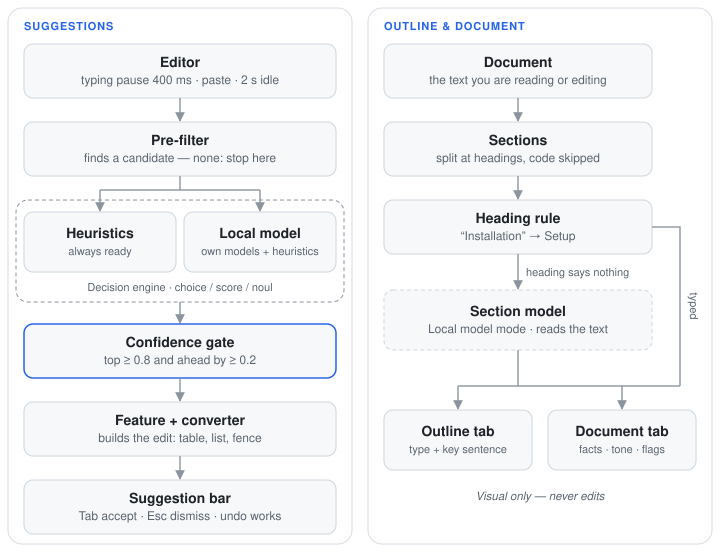
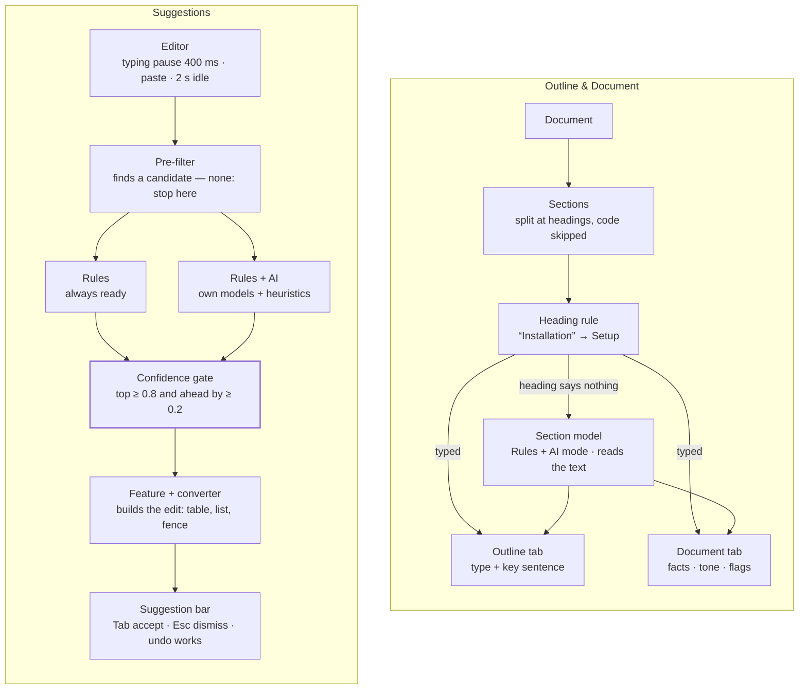

# Smart Assist — Technical Documentation

Smart Assist is the local "writing radar" of Marksage — on by default in its *Rules* mode, and one click to
turn off. It watches the
editor, detects a small set of fixable situations, and **suggests** an edit the user can accept
(`Tab`) or dismiss (`Esc`). Nothing is sent over the network and nothing is ever applied
automatically.

> This page is for the curious: how the assistant decides, why it stays quiet, and how
> Marksage's own little models were trained. Some familiarity with programming helps, but you don't need the source code — it's on
> [GitHub](https://github.com/PabloFLPs/Marksage) if you want to dig in.

---

## 1. Why "decision models"

Smart Assist is built around **decision models** rather than generative models. A decision model
answers a *typed question over a set of answers fixed up front*:

| Decision type | Question shape | Returns |
|---|---|---|
| `choice` | "Which of these options?" | the chosen key + a probability per option |
| `score` | "Where on this ordered scale?" | an index + a probability per step |
| `noul` | "Is this statement true?" | a single probability in `[0, 1]` |

Because the answer space is closed, the output can never be malformed. The guiding rule:

> **The engine decides; our TypeScript code acts.** If you can't list the possible answers up
> front, it's not a Smart Assist job.

This is also why the project explicitly avoids generative autocomplete, rewriting, and "AI
spell-check" (deterministic tools such as `nspell`/`remark-lint` are the right tool there).

### 1.1 Why not a generative model

In September 2026, TypeSafe AI released **Jev**, a closed model built to answer typed questions (`choice`,
`score`, `noul`) instead of writing text, and with it the term *decision model* reached a wide audience. The
idea isn't new — classifiers, categorizers and structured-output models have done narrower versions of it
for years — but Jev gave it a clear shape. Three days later, Convai Innovations released **Laya**, an
open-weights model (Apache 2.0) that answers the same three question types and can run on your own machine.
Smart Assist takes the path one step further, with tiny models of its own, trained for exactly its questions.

The reason is engineering, not novelty: a model that only has to *pick* from a known list is a much smaller,
cheaper and more predictable thing than one that has to *write*.

| | Generative model (chatbot, autocomplete) | Decision model (Jev, Laya) | Marksage's own models |
|---|---|---|---|
| Output | free text, token by token | one of the listed answers + probabilities | one of the listed answers + probabilities |
| Work per answer | one pass of the model *per generated token* | one pass, whatever the answer | a few thousand multiplications |
| Size and where it runs | from hundreds of millions to billions of parameters; usually a GPU or a hosted API | Jev: hosted API · Laya: 322–421 M parameters, on your machine | ~262 thousand parameters, 385 KB, plain JavaScript in the page |
| Time per decision | seconds, or a network round trip when hosted | a network round trip (Jev) or a fraction of a second locally (Laya) | about 0.1 ms |
| Cost per decision | GPU time or a per-call API bill | a per-token price (Jev) or local compute (Laya) | effectively zero |
| How it fails | can invent, ramble or return something unparseable | can pick the wrong option | can pick the wrong option |
| Can it be measured? | hard: many acceptable outputs | yes: right or wrong against a label | yes: right or wrong against a label |
| Privacy | hosted means your text leaves the device | Jev is hosted; Laya runs locally | runs locally |

A specialised model is contained: it can't say anything outside its list, its confidence can be calibrated,
and its accuracy can be measured on held-out data before it ships. For "which language is this block?" or
"what kind of section is this?", that's everything the job needs — and generating text would add cost,
latency and new ways to fail without making the answer any better.

*Jev is a product of TypeSafe AI and Laya of Convai Innovations. Marksage isn't affiliated with either, and
uses neither today.*

### 1.2 The smallest tool that works

Every Smart Assist question climbs the same ladder, and stops at the first step that's good enough:

1. **Rules** (the heuristics) — instant, transparent, precise; tried first for every feature.
2. **A tiny purpose-trained model** — only where the rules stay too quiet *and* real labelled data exists.
   Both of Marksage's models are here. Each had to prove, on repositories it never saw, that it adds answers
   the rules can't give. The code model shows more than twice as many suggestions at about the same
   precision; the section model types sections whose heading says nothing. Two more were trained and
   measured the same way — structure hints and paste types — and didn't do better than the rules on real
   text, so they aren't used (section 4.6).
3. **A general decision model** — Laya preferably, because it runs on your device. Reserved for questions
   with no training data to learn from; no feature needs it yet.
4. **A generative or hosted model** — not used by the built-in features: if the possible answers can't be
   listed up front, it isn't a Smart Assist feature. Coming next: an optional *bring your own key* (BYOK)
   mode to connect a hosted model with your own key — off by default, clearly marked, and documented here
   when it ships.

### 1.3 Two modes

Smart Assist has two modes besides *Off*. **Rules** answers every question with rules: instant, nothing
to download. **Rules + AI** uses Marksage's own models where they beat the rules on real text, and the rules
everywhere else:

| Question | Rules | Rules + AI |
|---|---|---|
| Code-block language | rules | model ✦ — or the rules when the model's first pick agrees |
| Smart paste (what kind of text) | rules | rules — a pasted code block's language as above |
| Structure hints | rules | rules |
| Readability | rules (LIX) | rules (LIX) |
| Outline section types | heading rule | heading rule, then the section model ✦ for headings that don't say |

A third mode where *only* models decide was considered and dropped: readability and the heading rule have no
labels a model could learn from but their own output (a model trained on LIX scores would just copy LIX), and
the structure and paste models didn't do better than the rules (section 4.6). Such a mode would have been
weaker than Rules + AI without being any more honest.

**Rules is the default.** A first visit starts in *Rules*: it runs on your device, downloads nothing and only
suggests, so being on costs nothing — and the start screen says what it does. Choosing *Off* (or *Rules + AI*)
is remembered. "AI" in *Rules + AI* means Marksage's two small trained models (section 4), not a chatbot or
anything hosted. (Until 2026-10-28 the modes were called *Heuristics* and *Hybrid*, and Smart Assist started
off; the stored values — `heuristics`, `model` — didn't change, so nobody's choice was reset.)

---

## 2. Architecture

Two independent flows share the same building blocks: **suggestions** while you edit, and the **Outline panel**, which only reads the document.

<!-- diagram: architecture -->


<details>
<summary>The same diagram in Mermaid</summary>



</details>

### 2.1 Building blocks

| Piece | What it does |
|---|---|
| **Pre-filter** | Cheap, deterministic checks that find *candidates* (an untagged code block, a multi-line paste, a near-miss heading). No candidate → nothing else runs. |
| **Decision engine** | Answers the typed question for a candidate. Two interchangeable engines: *heuristics* and *Rules + AI* (Marksage's own models for code-block languages and Outline section types + heuristics for the rest). |
| **Confidence gate** | Drops any answer that isn't clearly ahead of the alternatives. |
| **Features** | Turn a confident decision into a concrete, reversible edit (the four suggestion features below; the Outline and Document tab only read). |
| **Converters** | Plain code that performs the edit — building a table, a list, a fenced block. The engine never writes text. |
| **Suggestion bar** | Shows one suggestion at a time; you accept or dismiss it. Its icon says what kind of fix it is (code-block language, table, list, JSON, heading, link); a ✦ means the local model made the call. Clicking the card scrolls to the spot and flashes it in the preview. |
| **Outline panel** | Visual only: sections typed by the heading rule, then (in *Rules + AI* mode) by the section model; its Document tab sums the whole file up; its Suggestions tab lists every fixable spot. |
| **Evaluation set** | Hand-labelled examples used to measure each feature before it ships. |

### 2.2 The engine contract

```ts
interface DecisionEngine {
  readonly kind: 'heuristic' | 'model'
  ready(): Promise<void>
  choice<T extends string>(state: string, q: string, options: Record<T, string>): Promise<Decision<T>>
  score(state: string, q: string, scale: string[]): Promise<{ value: number; probs: number[] }>
  noul(state: string, statement: string): Promise<number>
}
```

Both engines implement the same interface, so features never know which one answered.
`q` is a stable id (e.g. `fence.language`): the heuristic engine uses it to pick a scorer, and the
*Rules + AI* engine uses it to decide which questions its own models answer.

### 2.3 The confidence gate

A suggestion is shown only when the engine is sure:

```ts
passesGate(probs, threshold = 0.8, minMargin = 0.2)
// top probability ≥ 0.8  AND  top − second ≥ 0.2
```

| Feature | Gate |
|---|---|
| Code-block language, smart paste | 0.8 / 0.2 |
| Structure hints (`noul`) | p ≥ 0.8 (implies margin 0.6 over "false") |
| Readability | 0.5 / 0.15 (it's a passive hint, not an edit) |
| Outline section types (section model) | 0.8 / 0.2 for a badge; from 0.6 as "probably" (a label, not an edit) |

Silence is the default: a missed suggestion costs nothing, a wrong one costs trust.

### 2.4 Safety guarantees

- **Suggest-only.** Every `Suggestion` carries an `edit` (`from`, `to`, `insert`) and an
  `expected` string. On accept, the hook re-checks that `text.slice(from, to) === expected`;
  if the user has typed since, the stale suggestion is dropped.
- **Undo works.** Edits are applied with `document.execCommand('insertText')`, so they enter the
  browser's native undo stack (`⌘/Ctrl Z`); a controlled `onChange` is the fallback.
- **Never per keystroke.** Analysis is debounced (400 ms), readability waits for 2 s idle, and
  the pre-filter must find a candidate before any engine call.
- **Cancellation.** Each run owns an `AbortController`; new input aborts stale runs.
- **Dismissals stick** for the session (keyed by a content hash), so the same hint never nags. Changing the
  mode (or turning Smart Assist off and on) is a fresh start: dismissed suggestions are offered again.
- **Off means off.** With the mode set to *Off*, no handlers are attached to the textarea.

---

## 3. Features and their heuristics

### Code-block language (`choice`)

**Trigger.** A *closed* fenced block (```` ``` ```` or `~~~`) with an empty info string, body ≥ 3
chars, and the cursor **outside** the block (you've finished writing it). The nearest such fence
is evaluated first (max 3 per run).

**Options.** 20 languages + `plaintext`: ts, js, python, bash, json, html, css, sql, go, rust,
java, c, cpp, csharp, ruby, php, yaml, markdown, diff, dockerfile.

**Heuristic**. Each language has weighted regex rules that behave like
logits — each matching rule adds its weight once:

- *Distinctive* evidence gets high weights (`package main` → Go +4, `<?php` → PHP +6,
  `if err != nil` → Go +4, `#!/bin/bash` → Bash +5, `@@ -1,2 +1,2 @@` → diff +5).
- *Shared* syntax (braces, `=>`, `import … from`) gets small weights across languages.
- *Negative* rules subtract contradicting evidence (e.g. TS type annotations penalise plain JS).
- *Structural overrides:* content that parses as JSON → json +6 — including the relaxed
  "JSON with comments / trailing commas" dialect used by config files (+5); TS vs JS is decided by TS-only evidence
  (type annotations, `interface`, `import type`, `as const`), since TS is a superset of JS.
- `plaintext` is scored from a **code-likeness** ratio (symbol density vs. words, minus sentence
  punctuation), so prose in any language (including pt-BR) stays untagged.

Scores go through `softmax` → probabilities → gate. **Action:** insert the language id right after
the opening fence marker.

**Two options.** With *Rules + AI*, when no language passes the gate but the top two together hold
≥ 85 % (the second ≥ 20 %), the bar offers both — `Tab` (or a click) takes the first, `Alt+2` the second.
Typical pairs: JavaScript/TypeScript, JSON/YAML, C/C++. The rule was set on the dev set; on the two
held-out sets it made 15 and 17 offers, and the right language was one of the two every time. (Only the
model's probabilities are calibrated well enough for this, so heuristics mode doesn't offer pairs.)

### Smart paste (`choice`)

**Trigger.** A `paste` into the editor with ≥ 2 non-empty lines, or a single line of JSON (≤ 50 k chars), that doesn't
already start as Markdown structure (tables, fences, headings, lists). **The paste always lands
untouched**; the suggestion offers to convert the pasted range afterwards.

**Options.** `prose | table | csv | tsv | list | code | json`.

**Heuristic**:

| Kind | Evidence |
|---|---|
| `json` | parses as JSON (strict, or with comments / trailing commas — even comment lines before the object) — also a single-line, minified payload |
| `tsv` | a tab on every line (strong on its own — prose never has that), more so when the counts agree; runs of tabs count as one |
| `csv` | consistent comma-cell count (quote-aware, quoted cells may span lines; a header with one column more or less is fine), short cells; penalised by sentences and "wordy" cells (> 5 words) |
| `table` | column gutters shared by every line — terminal / `kubectl`-style output. `----` rule rows are skipped; 1-space gutters (right-aligned columns like `rails routes`) count when every row also has a wider gap |
| `list` | bullet markers (`•`, `–`, `1)`, `a.`…), ≥ 3 short lines without terminal punctuation, or ≥ 3 lines copied from a web page list — one item per line, no blank lines between, no sentence carrying on to the next line |
| `code` | reuses the code-block language scores + structural code shape (lines ending in `{ } ;`, indentation) |
| `prose` | lines with sentence punctuation and ≥ 8 words |

**Action**: CSV/TSV/aligned → GFM table (first row = header, `|` escaped); list →
`- item` (existing bullets normalised); JSON → ```` ```json ```` (minified JSON is pretty-printed first; JSON with comments gets ```` ```jsonc ````); code → fenced block, tagged with
the detected language only if *that* decision also passes the gate. `prose` never suggests anything.

### Structure hints (`noul`)

**Trigger.** Near-miss Markdown on a line that is **not** the one being typed, outside code —
fenced blocks, indented code blocks and raw HTML (`<pre>`, `<style>`, …) are skipped:

| Candidate | Fix |
|---|---|
| `**Title**` alone on a line after a blank line | `## Title` |
| `#Heading` (no space) — but not `#tag` single words or `#fff` colours | `# Heading` |
| `== Title ==` (wiki style) | heading, level from the `=` count |
| `-item`, `*item`, `+item` | `- item` |
| `• item`, `– item`, `✔️ item` — a typographic bullet, as pasted from a document, a web page or a chat | `- item` (a check mark stays: `- ✔️ item`) |
| `1)item`, `1.item` | `1) item` |
| `1- item`, `1 - item` | `1. item` |
| `[text] (https://…)` — the space breaks the link | `[text](https://…)` |

**Heuristic**. The engine gets the ±2 lines of context and a statement
such as *"The line "**Installation**" is meant to be a section heading."*. The probability starts
from a per-kind prior and is adjusted by evidence:

- **Bold lines** that are long, end like a sentence (`.` `!` `?`, also `。` `！` `？` and other scripts),
  end with a colon (`**Returns:**`), start with a callout word (`Note`, `Warning`, `Tip`, `Q`/`A`,
  `Nota`, `Atenção`, `Dica`, …) or are just a link are labels or emphasis, not headings. So are bold lines
  right above an image (a caption: `**Before**`) and bold identifiers (`**android.permission.CAMERA**`).
- **`#` lines** made only of hashtags (`#CLT #Remoto #React`), issue references (`#123 fixed …`) or code
  (`#include`, `#!/bin/sh`, `#[derive]`) aren't headings; neither is a separator like `=== === ===`.
- **Dash lines** that look like CLI flags (`-s, --search`), flag sets (`+SIMD +AVX`), CSS
  (`-webkit-line-clamp: 2;`), negative numbers (`-5 degrees`) or `ls -l` output (`-rw-r--r-- 1 …`) aren't
  list items; `*word*` is emphasis.
- **List fixes** need company: neighbouring list items raise confidence; a lone `*line` is more
  often a footnote than a bullet, so it stays quiet. A lone `-line` is suggested only when it reads as plain
  prose (three or more words, nothing code-like such as `/`, `:` or `=`): "-this should be a list item" yes,
  "-verbose" or "-su cd: /opt/app: Permission denied" no.
- **Typographic bullets** need company too: a lone `• line` stays quiet, a line with several bullets is a
  separator bar (`• English • Русский • Français`), and `— Name` alone signs a quote. **`1 - item`** needs a
  numbered neighbour: `3 - 2` alone is a range, `31- zone 2 passed` is test output.
- **A link broken by a space** is always offered (0.9): Markdown never reads `[text] (url)` as a link.

### Readability (`score`)

**Trigger.** 2 s idle; one decision per `##` section with ≥ 30 words.

**Heuristic**. **LIX**, chosen because it is language-agnostic
(works for English and Portuguese, unlike Flesch variants tuned to English syllables):

```text
LIX = words / sentences + 100 × longWords / words      (long = more than 6 letters)
```

Markdown is stripped first (code, links, tables; list items and headings count as sentences).
The value is mapped onto a 5-step scale — *very easy · easy · moderate · hard · very hard*
(bucket centres 25/35/45/55/65) — with a sharpness that grows with section length, so short
sections produce flat distributions and stay silent.

**Action.** A small coloured dot next to the section's heading in the preview, with a tooltip.
Marks are only re-rendered when a score actually changes.

### Outline — section types

**Trigger.** While the Outline panel is open; recomputed as you type.

**Heuristic.** Every heading (`#` style or underlined; code blocks and front matter skipped) is
matched against English and Portuguese phrases for sixteen types — *overview, setup, guide, reference,
configuration, example, troubleshooting, changelog, contributing, license & credits, security, performance,
deployment, explanation, glossary, roadmap*. Explanation completes the four kinds of documentation in the
Diátaxis framework (tutorials, how-to guides, reference, explanation) and covers "How it works",
"Architecture", "Concepts". Security covers "Security", "Reporting a vulnerability", "Segurança"; performance,
"Benchmarks", "Desempenho"; deployment, "Deploy to …", "Hosting", "Implantação"; glossary, "Terminology";
roadmap, "Future plans", "Planos futuros":

- the phrase must cover at least half the heading — "Basic usage" → guide, while "Perform the first
  migration" says nothing;
- a longer phrase beats one inside it — "How to fix it" → troubleshooting, not guide;
- phrases of two different types cancel out — "Usage examples" is left to the text;
- release headings (`v1.4.0 (2025-11-19)`, `[2.0.0] - 2024-01-01`) are changelog;
- navigation ("See also", "Next steps", "Veja também") is never typed;
- broad words ("Features", "Background", "Production", "Todo") only count when they are the whole heading.

With *Rules + AI*, sections the heading rule leaves untyped are read by the section model
(section 4.4).

**Key sentence.** Picked from the section, not written: the sentence that shares the most words with
the rest of its section (stop-words removed, in both languages), nudged towards the start; a sentence
from a paragraph wins over a list item.

**Action.** Visual only: a panel with every section, its type and key sentence. Click to jump there (the
clicked section stays highlighted until you scroll yourself), hover to tint the whole section in the preview.
Nothing in the document changes.

### Document tab

**Trigger.** While the panel's *Document* tab is open; recomputed as you type.

**What it shows**, all worked out from the text on your device:

- **Looks like** — README, changelog, guide or tutorial, reference, article or notes. The file name decides
  when it says so (`README.md`, `CHANGELOG.md`, `guide.md`); otherwise the Outline's section types do
  (Installation + Usage + License → README; mostly Reference/Configuration → reference), with the sections
  that led there shown as the reason. With too little evidence (fewer than three typed sections, or under a
  quarter of them), it says there's no clear pattern rather than guess.
- **At a glance** — words, reading time (230 words a minute, code not counted), sections, code blocks by
  language, tables, links, images and the language of the text (English, Portuguese or mixed).
- **Readability** — the same LIX scale as the readability dots, for the whole document, plus the hardest section.
- **Tone** — formal, neutral or conversational, from signals that are counted and shown: contractions (they
  count half — modern style guides recommend them), exclamation marks, emoji, informal words, and who the text
  talks to ("you", "we", "I" or nobody). Signals, not a verdict.
- **Worth a look** — heading level jumps (H2 → H4), extra top-level titles, empty sections, repeated
  headings under the same parent, code blocks without a language, images without alt text, links that say
  "here", very long sections and sentences over 40 words. Click one to jump there. Changelogs that give every
  release its own `#` title aren't flagged for it.


### Suggestions tab

**Trigger.** While the panel is open and Smart Assist is on (its count shows on the tab); recomputed 600 ms
after you stop typing.

**What it lists:** every spot of the document that would get a suggestion, in document order — code blocks
without a language (same question, same gate and two-option rule as in the editor) and near-miss headings,
lists and links (same rules as the structure hints). Each row has the fix's icon, its line, the code's first line or
what changes into what, the confidence and a ✦ when the local model decided. Pastes aren't listed: they're
offered at the moment you paste. Dismissed suggestions (`Esc`) leave the list until the mode changes.

**Action.** None in the panel. A click opens the editor if needed, puts the caret on the spot and shows that
suggestion in the normal bar; it stays there until you move the caret or type. `Tab` accepts, `Esc`
dismisses, undo works — the same guarded edit as everywhere else.
---

## 4. Marksage's own models

> New to machine learning? [How the two models work](MODELS.md) walks through every step — clues, hashing,
> training, calibration — with real numbers from the model files, plus a model card and the full version
> history of each model.

### 4.1 What it is

*Rules + AI* mode adds a small language classifier trained for exactly one job: naming the
language of an untagged code block (and of a pasted block of code). Everything else keeps
using the heuristics. It isn't a chatbot or an LLM — it reads a snippet and picks one of the 21
answers, like the rest of Smart Assist.

- **Size and speed:** 385 KB; one decision takes about 0.1 ms in plain JavaScript — no ML runtime,
  no WebGPU, no worker needed.
- **Private:** downloaded once from the same site as the app — only after you pick the mode and
  confirm a short notice — then kept in your browser's cache (removable any time in About → Privacy
  & storage). Your text never leaves the page.
- **How it reads code:** the snippet becomes a set of small clues — words and symbols, pairs of
  neighbouring tokens, how lines start and end, the indentation style, and three-letter pieces of
  longer words. Each clue has a learned 8-number vector; the model averages them and turns the
  average into one probability per language.
- **Careful on purpose:** its confidence is tuned on predictions for repositories it never saw in
  training (short snippets separately — they're easier to over-trust), aiming at about 95 % right
  when it speaks. The same confidence gate as the heuristics (0.8 / 0.2) decides whether you see anything.
- **Two opinions:** when the model isn't sure but the heuristics are, the suggestion still appears —
  only if the model's own first guess agrees.

### 4.2 How it was trained

- **Data:** about 270,000 code blocks from 309 public repositories (docs, READMEs, guides —
  including Portuguese ones), labelled with the language the *original authors* tagged them with,
  plus snippets of real source files for rarer languages.
- **Fair split:** whole repositories go to training, tuning (dev) or the final test — never the same
  project in two places — and any training block that looks like a test block is removed.
- **Training:** about 64,000 blocks, a few seconds per pass, done in TypeScript with the same code
  the app uses to read snippets, so what the model saw in training is exactly what it sees here.
- **Chosen on dev, measured once:** size, settings and how to combine it with the heuristics were
  decided on the dev set; each held-out set was run once at the end. The current model is the second
  version — the first one is described in the results below.

### 4.3 Results

Version 2 was measured on a **fresh** set: 284 code blocks from 67 repositories that no version of the
model, nor any tuning, had ever touched (up to 15 per language):

| Engine | Accuracy | Suggestions shown | Right when shown | Right / wrong suggestions |
|---|---|---|---|---|
| Rules | 59 % | 70 (25 %) | 93 % | 65 / 5 |
| Model v1 | 72 % | 151 (53 %) | 88 % | 133 / 18 |
| **Model v2 (current)** | **74 %** | **158 (56 %)** | **92 %** | **145 / 13** |

On the first set (314 blocks, the one v1 was measured on) v2 reaches 77 % accuracy, 164 shown and
96 % right when shown (v1: 76 %, 141, 94 %; heuristics: 57 %, 76, 97 %).

So: more than twice the useful suggestions of the heuristics, and better than v1 on every count — but
still about a point less precise than the heuristics on unfamiliar repositories, which is why it stays an
opt-in mode. About half of its misses are really labelling quirks (`dotnet build -c Release` tagged as
C#), the rest are one-liners that fit several languages (`void main() { … }` is valid Java *and* C++).

### 4.4 The section model

With *Rules + AI*, the Outline also types sections whose heading doesn't say — "Before you begin",
"Bug fixes", "Theming" — by reading the text under the heading.

- **Same recipe, other clues:** the same kind of model and file format (385 KB, ~0.1 ms per section),
  reading prose instead of code. Its clues are words and word pairs (accents folded, so *instalação* =
  *instalacao*), how lines start and the words inside code. It also reads the shape of the section: code
  blocks and their languages, tables, lists, shell prompts, version numbers, dates, issue references.
- **Labels from headings, without the headings:** about 27,000 sections from the same public
  repositories, labelled by the heading rule above (a stricter version that only trusts unambiguous
  headings). The model never sees the heading, only the text under it — that's what lets it type the
  sections whose heading says nothing.
- **Allowed to decline:** most real sections are just topics ("Arrays", "Amazon S3"), so one more
  answer, *other*, is learned from sections whose heading names no type. When *other* wins, the
  section stays untyped.
- **Three types stay with the headings:** a version trained to recognise explanation sections too (with
  extra examples from Diátaxis-style `concepts/` and `architecture/` folders) got none right on the dev
  repositories — explanatory prose uses the same words as any topic. Glossaries and roadmaps are too rare to
  learn from (76 and 57 headings in 381 repositories). These three are typed from their heading only; the
  model answers the other thirteen.
- **Fair split:** the dev and test repositories of the language model (plus the 72 fresh ones) are held
  out; settings were chosen on dev and the test set was run once.

Held-out results — 6,339 typed sections from 134 repositories. The labels come from headings, so
"agrees" means the model, reading only the text, named the type the heading names:

| Confidence | Sections typed | Agrees with the heading | "Other" sections given a type |
|---|---|---|---|
| ≥ 0.8 — badge with ✦ | 858 (14 %) | 88.9 % | 4.2 % |
| ≥ 0.6 — includes "probably" | 1,588 (25 %) | 85.6 % | 10.4 % |

Changelog sections are the easy, common case; without them, agreement at ≥ 0.8 is about 85 %. The last
column is an upper bound on mistakes — some "other" sections really are a setup or a reference. A hand
check of its confident answers on sections whose heading names no type came out the same, roughly
9 in 10 right. A type badge changes nothing in your document, so the Outline uses the model from 0.6:
between 0.6 and 0.8 it shows a muted "Configuration?" badge with the confidence on hover.

**Version 2 (2026-10-27)** added security, performance and deployment. On the held-out set, 34 of the 38
security answers shown agree with the heading, 45 of 60 for performance (the weakest type) and 2 of 2 for
deployment (it had only 246 training examples). Against version 1 on the same set: v1 types 14.5 % at
89.6 %, v2 13.5 % at 88.9 % — about level overall; v2 shows fewer changelog sections and adds the three new
types. Every version is listed in [How the two models work](MODELS.md), section 8.

### 4.5 And Jev and Laya?

**Laya** — Convai Innovations' open-weights decision model (322–421 M parameters) that natively answers
`choice` / `score` / `noul`, like TypeSafe AI's hosted **Jev** — was the original plan for this mode, chosen
over Jev because it can run on your device. For code-block languages a purpose-trained model
turned out to be the better fit: thousands of times smaller, instant, and measurable on real data.
The section model followed the same path. Laya stays an option for future questions where no such training data exists. By default, whatever
runs, runs on your device; anything hosted, like the planned BYOK mode, will be opt-in and clearly marked.

### 4.6 Tried, not used: structure hints, paste types, link text

Three more questions went through the same process in October 2026 — trained (or written) on the public
repositories, every choice made on a dev set, then measured once on held-out real text — and none did better
than the rules. They're written down so the next attempt starts from the numbers.

**A structure model** — "is this near-miss line a list item or a heading?" (yes / no), same recipe and size as
the other two, reading the line and two lines around it. It learned from 66,076 lines: real list items and
headings from the 381 repositories with the near-miss put back in (`- item` → `-item` or `• item`, `## Title` →
`##Title` or `**Title**`), against real look-alikes (CLI help, `ls -l` output, diff lines, CSS, `#include`,
footnotes, bold labels). It was judged on 227 hand-labelled lines from issues, pull requests and comments of 43
repositories it never saw — unpolished text, where these near-misses really happen:

| Held-out (227 lines, run once) | Shown | Right when shown | True lines found (of 132) |
|---|---|---|---|
| Rules | 140 | 88.6 % | 124 |
| Model alone | 76 | 90.8 % | 69 |
| Rules + the model's ≥ 95 % answers where the rules stay quiet | 141 | 88.7 % | 125 |

The combination met the bar set beforehand — the rules' precision, at least as many true lines — by one line
in 227: not worth a download. The two make different mistakes: the rules wrongly flag hashtag lines,
`+20K estudantes` and diff lines, which the model gets right; the model wrongly flags signatures (`-Jake`) and
`#32 will fix this`, which the rules get right. A version where both must agree is the natural next try, on a
fresh held-out set. Bold lines stay with the rules for good reason: the model's "no" examples were real bold
lines, and many real bold lines *are* headings, so it learned "bold → no" (5 of 80 shown).

**A paste-type model** — "what kind of text is this paste?" (the seven kinds of smart paste), trained on 16,977
pastes made from real files: code and JSON blocks as their authors wrote them, real Markdown tables turned back
into CSV, spreadsheet and terminal text, lists and paragraphs as a browser copies them. It was judged on 53 real
pastes from 19 sources outside its data (data files, spreadsheet copies, `pip` and `kubectl` output, source
files, configs, READMEs in English and Portuguese):

| Held-out (53 pastes, run once) | Shown | Right when shown |
|---|---|---|
| Rules | 41 | 97.6 % |
| Model | 44 | 90.9 % |

It took `kubectl` output, a list of commands and two JSON files for code.

**Link text for a pasted URL** — offline, the text can only come from the URL itself. Measured against 2,842
links that stand alone on their line in the dev repositories, what authors write is a title or a name: the URL's
last segment matches it 10 % of the time, the domain never, `owner/repo` 28 %. Only GitHub issue and pull
request links (`owner/repo#123`) matched often on dev (90 %) — and 32 % on the held-out repositories, where each
project has its own habit ("BUG #523", "Pull Request", a title). Without fetching the page there's no good text
to offer, so a pasted URL stays as it is (GitHub-flavoured Markdown shows it as a link anyway).

---

## 5. How it's measured

Every feature is checked against a hand-labelled set of examples — code snippets in many
languages, real-world pastes (CSV, spreadsheet cells, terminal output, JSON), near-miss lines —
including Portuguese prose and mixed-language text. For each feature we track:

- **Accuracy** — how often the top answer is right;
- **Shown** — how many suggestions pass the confidence gate;
- **Precision when shown** — how often a suggestion you actually *see* is right (the number that matters most);
- **Calibration** — whether "90 % confident" really means ~90 % correct;
- **Latency** per decision.

There are two kinds of examples. The **written** set was made alongside the rules — it catches
regressions, but scores near 100 % by construction. The **real-world** set is taken from real
documentation, GitHub wikis, community translations, data files and terminal output (Portuguese
included), and the rules are never tuned against it — so it's the honest number:

| Feature | Real-world examples | Accuracy | Shown | Precision when shown |
|---|---|---|---|---|
| Code-block language | 314 | 57 % | 76 | 97 % |
| Smart paste | 31 | 94 % | 23 | 100 % |
| Smart paste, fresh set (2026-10-28) | 53 | 94 % | 41 | 98 % |
| Structure hints | 30 | 93 % | 14 | 86 % |
| Structure hints, fresh set (2026-10-28) | 227 | 89 % | 140 | 89 % |

The fresh sets were built for the models of section 4.6 and run once: 53 pastes from real files, and 227 lines
from GitHub issues, pull requests and comments — unpolished text, where the near-misses really happen. On the
dev set they were tuned against (212 lines from other repositories), the structure rules reach 97 %; the
held-out 89 % is the honest number.

Read it like this: when a suggestion appears it's almost always right; the cost of that caution
is that many real code blocks get no language suggestion at all. Heuristic decisions take well under
a millisecond. With *Rules + AI*, code-block language on the same 314 blocks reaches **77 % accuracy, 164 shown, 96 %
precision**, and 74 % / 158 / 92 % on a second, fresh set (section 4.3).

---

## 6. Dig deeper

Curious how a specific rule works, or want to contribute a new one? The full source — engine,
heuristics, evaluation set and contributor notes — is on [GitHub](https://github.com/PabloFLPs/Marksage).
