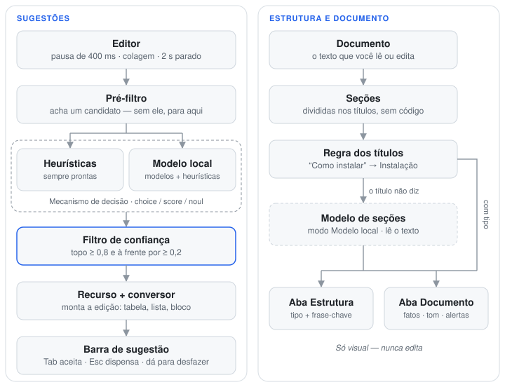
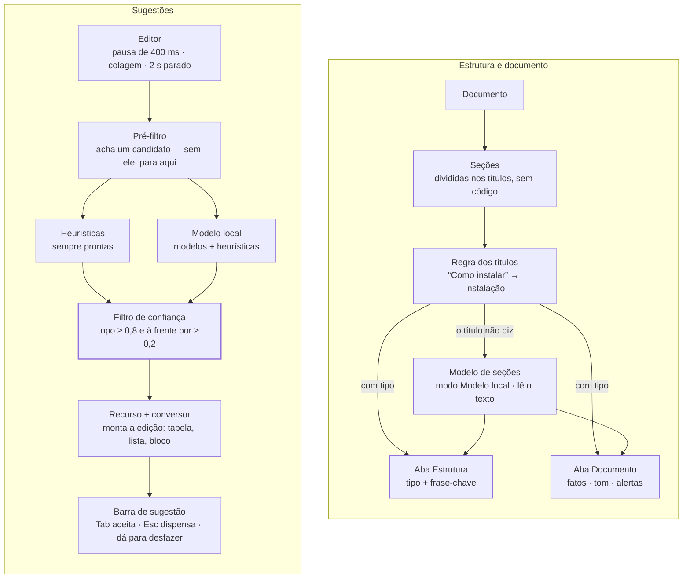

# Smart Assist — Documentação técnica

O Smart Assist é o "radar de escrita" opcional e local do Marksage. Ele observa o
editor, detecta um pequeno conjunto de situações corrigíveis e **sugere** uma edição que você pode
aceitar (`Tab`) ou dispensar (`Esc`). Nada é enviado pela rede e nada é aplicado automaticamente.

> Esta página é para os curiosos: como o assistente decide, por que ele fica em silêncio e como
> os pequenos modelos próprios do Marksage foram treinados. Alguma familiaridade com programação ajuda, mas você não precisa do código-fonte —
> ele está no [GitHub](https://github.com/PabloFLPs/Marksage) se quiser se aprofundar.

---

## 1. Por que "modelos de decisão"

O Smart Assist é construído sobre **modelos de decisão**, e não sobre modelos generativos. Um modelo
de decisão responde a uma *pergunta tipada sobre um conjunto de respostas definido de antemão*:

| Tipo de decisão | Formato da pergunta | Retorna |
|---|---|---|
| `choice` | "Qual destas opções?" | a opção escolhida + uma probabilidade por opção |
| `score` | "Em que ponto desta escala ordenada?" | um índice + uma probabilidade por degrau |
| `noul` | "Esta afirmação é verdadeira?" | uma probabilidade em `[0, 1]` |

Como o espaço de respostas é fechado, a saída nunca vem malformada. A regra que guia tudo:

> **O mecanismo decide; o nosso código TypeScript age.** Se não dá para listar as respostas
> possíveis de antemão, não é um trabalho para o Smart Assist.

Por isso o projeto evita, de propósito, autocompletar generativo, reescrita e "corretor ortográfico
com IA" (ferramentas determinísticas como `nspell`/`remark-lint` são as certas para isso).

### 1.1 Por que não um modelo generativo

Em setembro de 2026, a TypeSafe AI lançou o **Jev**, um modelo fechado feito para responder perguntas tipadas
(`choice`, `score`, `noul`) em vez de escrever texto, e com ele o termo *modelo de decisão* chegou a um público
grande. A ideia não é nova — classificadores, categorizadores e modelos de saída estruturada fazem versões mais
estreitas dela há anos —, mas o Jev deu a ela uma forma clara. Três dias depois, a Convai Innovations lançou o
**Laya**, um modelo com pesos abertos (Apache 2.0) que responde os mesmos três tipos de pergunta e pode rodar na
sua própria máquina. O Smart Assist leva o caminho um passo adiante, com modelos minúsculos próprios, treinados
exatamente para as suas perguntas.

O motivo é de engenharia, não de novidade: um modelo que só precisa *escolher* numa lista conhecida é muito
menor, mais barato e mais previsível que um que precisa *escrever*.

| | Modelo generativo (chatbot, autocompletar) | Modelo de decisão (Jev, Laya) | Modelos próprios do Marksage |
|---|---|---|---|
| Saída | texto livre, token a token | uma das respostas listadas + probabilidades | uma das respostas listadas + probabilidades |
| Trabalho por resposta | uma passada do modelo *por token gerado* | uma passada, seja qual for a resposta | alguns milhares de multiplicações |
| Tamanho e onde roda | de centenas de milhões a bilhões de parâmetros; em geral GPU ou API hospedada | Jev: API hospedada · Laya: 322–421 M de parâmetros, na sua máquina | ~262 mil parâmetros, 385 KB, JavaScript puro na página |
| Tempo por decisão | segundos, ou uma ida e volta pela rede quando hospedado | uma ida e volta pela rede (Jev) ou uma fração de segundo localmente (Laya) | cerca de 0,1 ms |
| Custo por decisão | tempo de GPU ou uma conta de API por chamada | um preço por token (Jev) ou processamento local (Laya) | praticamente zero |
| Como falha | pode inventar, divagar ou devolver algo impossível de interpretar | pode escolher a opção errada | pode escolher a opção errada |
| Dá para medir? | difícil: muitas saídas aceitáveis | sim: certo ou errado contra um rótulo | sim: certo ou errado contra um rótulo |
| Privacidade | hospedado quer dizer que seu texto sai do dispositivo | o Jev é hospedado; o Laya roda localmente | roda localmente |

Um modelo especializado é contido: não consegue dizer nada fora da sua lista, a confiança dele pode ser
calibrada e a acurácia pode ser medida em dados de fora antes de ir ao ar. Para "que linguagem é este bloco?"
ou "que tipo de seção é esta?", isso é tudo de que a tarefa precisa — e gerar texto só somaria custo, demora e
novas formas de falhar, sem deixar a resposta melhor.

*O Jev é um produto da TypeSafe AI e o Laya, da Convai Innovations. O Marksage não tem vínculo com nenhuma das
duas e não usa nenhum dos dois hoje.*

### 1.2 A menor ferramenta que resolve

Toda pergunta do Smart Assist sobe a mesma escada e para no primeiro degrau que basta:

1. **Regras** (as heurísticas) — instantâneas, transparentes, precisas; tentadas primeiro em todo recurso.
2. **Um modelo minúsculo treinado para a tarefa** — só onde as regras ficam quietas demais *e* existem dados
   rotulados reais. Os dois modelos do Marksage estão aqui. Cada um precisou provar, em repositórios que nunca
   tinha visto, que traz respostas que as regras não dão. O modelo de código mostra mais que o dobro de
   sugestões com quase a mesma precisão; o modelo de seções identifica seções cujo título não diz nada.
3. **Um modelo de decisão geral** — de preferência o Laya, porque roda no seu dispositivo. Reservado para
   perguntas sem dados de treino para aprender; nenhum recurso precisa dele ainda.
4. **Um modelo generativo ou hospedado** — não é usado pelos recursos embutidos: se não dá para listar as
   respostas possíveis de antemão, não é um recurso do Smart Assist. Em breve: um modo opcional *traga sua
   própria chave* (BYOK) para conectar um modelo hospedado com a sua chave — desligado por padrão, bem
   sinalizado e documentado aqui quando sair.

---

## 2. Arquitetura

Dois fluxos independentes usam as mesmas peças: as **sugestões** enquanto você edita e o **painel Estrutura**, que só lê o documento.

<!-- diagram: architecture -->


<details>
<summary>O mesmo diagrama em Mermaid</summary>



</details>

### 2.1 Peças

| Peça | O que faz |
|---|---|
| **Pré-filtro** | Verificações baratas e determinísticas que encontram *candidatos* (um bloco de código sem linguagem, uma colagem de várias linhas, um título quase certo). Sem candidato → nada mais roda. |
| **Mecanismo de decisão** | Responde a pergunta tipada sobre o candidato. Dois mecanismos intercambiáveis: *heurísticas* e *Modelo local* (os modelos próprios do Marksage na linguagem dos blocos de código e nos tipos de seção da Estrutura + heurísticas no resto). |
| **Filtro de confiança** | Descarta qualquer resposta que não esteja claramente à frente das alternativas. |
| **Recursos** | Transformam uma decisão confiante numa edição concreta e reversível (os quatro recursos de sugestão abaixo; a Estrutura e a aba Documento só leem). |
| **Conversores** | Código comum que faz a edição — monta a tabela, a lista, o bloco de código. O mecanismo nunca escreve texto. |
| **Barra de sugestão** | Mostra uma sugestão por vez; você aceita ou dispensa. O ícone diz que tipo de correção é (linguagem do bloco de código, tabela, lista, JSON, título); um ✦ quer dizer que o modelo local decidiu. Clicar no cartão rola até o ponto e o destaca na pré-visualização. |
| **Painel Estrutura** | Só visual: seções identificadas pela regra dos títulos e depois (no modo *Modelo local*) pelo modelo de seções; a aba Documento resume o arquivo inteiro; a aba Sugestões lista cada ponto que dá para corrigir. |
| **Conjunto de avaliação** | Exemplos rotulados à mão usados para medir cada recurso antes de ele ir ao ar. |

### 2.2 O contrato do mecanismo

```ts
interface DecisionEngine {
  readonly kind: 'heuristic' | 'model'
  ready(): Promise<void>
  choice<T extends string>(state: string, q: string, options: Record<T, string>): Promise<Decision<T>>
  score(state: string, q: string, scale: string[]): Promise<{ value: number; probs: number[] }>
  noul(state: string, statement: string): Promise<number>
}
```

Os dois mecanismos implementam a mesma interface, então os recursos nunca sabem quem respondeu.
`q` é um id estável (ex.: `fence.language`): o mecanismo heurístico usa o id para escolher o
pontuador, e o mecanismo do *Modelo local* usa para decidir quais perguntas o seu modelo responde.

### 2.3 O filtro de confiança

Uma sugestão só aparece quando o mecanismo tem certeza:

```ts
passesGate(probs, threshold = 0.8, minMargin = 0.2)
// maior probabilidade ≥ 0,8  E  maior − segunda ≥ 0,2
```

| Recurso | Filtro |
|---|---|
| Linguagem do bloco de código, colagem inteligente | 0,8 / 0,2 |
| Dicas de estrutura (`noul`) | p ≥ 0,8 (implica margem de 0,6 sobre "falso") |
| Legibilidade | 0,5 / 0,15 (é uma dica passiva, não uma edição) |
| Tipos de seção da Estrutura (modelo de seções) | 0,8 / 0,2 para o selo; a partir de 0,6 como "provável" (um rótulo, não uma edição) |

O silêncio é o padrão: uma sugestão perdida não custa nada; uma errada custa confiança.

### 2.4 Garantias de segurança

- **Só sugere.** Toda `Suggestion` carrega uma `edit` (`from`, `to`, `insert`) e uma string
  `expected`. Ao aceitar, o hook confere se `text.slice(from, to) === expected`; se você digitou
  algo depois, a sugestão velha é descartada.
- **Desfazer funciona.** As edições usam `document.execCommand('insertText')`, então entram na
  pilha nativa de desfazer (`⌘/Ctrl Z`); um `onChange` controlado é o plano B.
- **Nunca a cada tecla.** A análise tem debounce (400 ms), a legibilidade espera 2 s ociosos e o
  pré-filtro precisa achar um candidato antes de qualquer chamada ao mecanismo.
- **Cancelamento.** Cada execução tem seu `AbortController`; novas digitações abortam execuções
  antigas.
- **Dispensas permanecem** durante a sessão (por hash do conteúdo), para a mesma dica não insistir. Trocar o
  modo (ou desligar e ligar o Smart Assist) recomeça do zero: as sugestões dispensadas voltam a aparecer.
- **Desligado é desligado.** No modo *Desligado*, nenhum handler é ligado ao textarea.

---

## 3. Recursos e suas heurísticas

### Linguagem do bloco de código (`choice`)

**Gatilho.** Um bloco *fechado* (```` ``` ```` ou `~~~`) sem linguagem, com corpo ≥ 3 caracteres,
e o cursor **fora** do bloco (você terminou de escrever). O bloco mais próximo é avaliado primeiro
(no máximo 3 por execução).

**Opções.** 20 linguagens + `plaintext`: ts, js, python, bash, json, html, css, sql, go, rust,
java, c, cpp, csharp, ruby, php, yaml, markdown, diff, dockerfile.

**Heurística**. Cada linguagem tem regras regex com pesos que funcionam
como logits — cada regra que casa soma seu peso uma vez:

- Evidências *distintivas* têm peso alto (`package main` → Go +4, `<?php` → PHP +6,
  `if err != nil` → Go +4, `#!/bin/bash` → Bash +5, `@@ -1,2 +1,2 @@` → diff +5).
- Sintaxe *compartilhada* (chaves, `=>`, `import … from`) tem peso pequeno em várias linguagens.
- Regras *negativas* subtraem evidências contraditórias (ex.: anotações de tipo TS penalizam JS).
- *Ajustes estruturais:* conteúdo que é JSON → json +6 — inclusive o dialeto "JSON com
  comentários / vírgulas sobrando" usado em arquivos de configuração (+5); TS vs JS é decidido por evidência exclusiva
  de TS (anotações de tipo, `interface`, `import type`, `as const`), já que TS é superconjunto de JS.
- `plaintext` é pontuado por uma **razão de "cara de código"** (densidade de símbolos vs. palavras,
  menos pontuação de frase), então prosa em qualquer idioma (inclusive pt-BR) fica sem tag.

As pontuações passam por `softmax` → probabilidades → filtro. **Ação:** inserir o id da linguagem
logo após o marcador de abertura.

**Duas opções.** Com o *Modelo local*, quando nenhuma linguagem passa no filtro mas as duas primeiras
somam ≥ 85 % (a segunda ≥ 20 %), a barra oferece as duas — `Tab` (ou um clique) escolhe a primeira,
`Alt+2` a segunda. Pares típicos: JavaScript/TypeScript, JSON/YAML, C/C++. A regra foi definida no
conjunto dev; nos dois conjuntos separados ela fez 15 e 17 ofertas, e a linguagem certa estava entre as
duas em todas. (Só as probabilidades do modelo são calibradas o bastante para isso, então o modo
heurístico não oferece pares.)

### Colagem inteligente (`choice`)

**Gatilho.** Um `paste` no editor com ≥ 2 linhas não vazias, ou uma única linha de JSON (≤ 50 mil caracteres), que ainda não
comece como estrutura Markdown (tabelas, blocos, títulos, listas). **A colagem sempre entra
intacta**; a sugestão oferece converter o trecho colado depois.

**Opções.** `prose | table | csv | tsv | list | code | json`.

**Heurística**:

| Tipo | Evidência |
|---|---|
| `json` | é JSON (estrito, ou com comentários / vírgulas sobrando — inclusive linhas de comentário antes do objeto) — também numa única linha minificada |
| `tsv` | uma tabulação em todas as linhas (forte por si só — prosa nunca tem isso), ainda mais quando as contagens batem; tabulações seguidas contam como uma |
| `csv` | quantidade consistente de células por vírgula (respeitando aspas, células entre aspas podem ter quebra de linha; cabeçalho com uma coluna a mais ou a menos não atrapalha), células curtas; penalizado por frases e células "longas" (> 5 palavras) |
| `table` | colunas alinhadas em todas as linhas — saída de terminal / estilo `kubectl`. Linhas de traços `----` são ignoradas; colunas separadas por 1 espaço (alinhadas à direita, como `rails routes`) contam quando toda linha também tem um espaço maior |
| `list` | marcadores (`•`, `–`, `1)`, `a.`…), ≥ 3 linhas curtas sem pontuação final, ou ≥ 3 linhas copiadas de uma lista de página web — um item por linha, sem linhas em branco, sem frase continuando na linha seguinte |
| `code` | reaproveita as pontuações de linguagem dos blocos de código + formato de código (linhas terminando em `{ } ;`, indentação) |
| `prose` | linhas com pontuação de frase e ≥ 8 palavras |

**Ação**: CSV/TSV/alinhado → tabela GFM (primeira linha = cabeçalho, `|` escapado);
lista → `- item` (marcadores existentes normalizados); JSON → ```` ```json ```` (JSON minificado é formatado antes; JSON com comentários vira ```` ```jsonc ````); código → bloco,
com a linguagem detectada apenas se *essa* decisão também passar no filtro. `prose` nunca sugere nada.

### Dicas de estrutura (`noul`)

**Gatilho.** Markdown "quase certo" numa linha que **não** é a que está sendo digitada, fora de código —
blocos cercados, blocos de código indentados e HTML bruto (`<pre>`, `<style>`, …) são ignorados:

| Candidato | Correção |
|---|---|
| `**Título**` sozinho numa linha após uma linha em branco | `## Título` |
| `#Título` (sem espaço) — mas não `#tag` de uma palavra nem cores `#fff` | `# Título` |
| `== Título ==` (estilo wiki) | título, nível pela quantidade de `=` |
| `-item`, `*item`, `+item` | `- item` |
| `1)item`, `1.item` | `1) item` |

**Heurística**. O mecanismo recebe ±2 linhas de contexto e uma
afirmação como *"A linha "**Instalação**" deveria ser um título de seção."*. A probabilidade parte
de um valor inicial por tipo e é ajustada pelas evidências:

- **Linhas em negrito** longas, que terminam como frase (`.` `!` `?`, também `。` `！` `？` e outras
  escritas), terminam com dois-pontos (`**Retorno:**`), começam com uma palavra de aviso (`Nota`,
  `Atenção`, `Dica`, `Note`, `Warning`, `P`/`R`, …) ou são só um link são rótulos ou ênfase, não títulos.
- **Linhas com traço** que parecem flags de linha de comando (`-s, --search`), conjuntos de flags
  (`+SIMD +AVX`), CSS (`-webkit-line-clamp: 2;`) ou números negativos (`-5 graus`) não são itens de
  lista; `*palavra*` é ênfase.
- **Correções de lista** precisam de companhia: itens de lista vizinhos aumentam a confiança; uma
  linha `*solta` costuma ser nota de rodapé, não marcador, então fica em silêncio. Uma linha `-solta` só é
  sugerida quando parece texto comum (três palavras ou mais, nada com cara de código como `/`, `:` ou `=`):
  "-isto deveria ser um item de lista" sim; "-verbose" ou "-su cd: /opt/app: Permission denied" não.

### Legibilidade (`score`)

**Gatilho.** 2 s ocioso; uma decisão por seção `##` com ≥ 30 palavras.

**Heurística**. **LIX**, escolhido por ser independente de idioma
(funciona em português e inglês, ao contrário das variantes de Flesch ajustadas às sílabas do inglês):

```text
LIX = palavras / frases + 100 × palavrasLongas / palavras      (longa = mais de 6 letras)
```

O Markdown é removido antes (código, links, tabelas; itens de lista e títulos contam como frases).
O valor é mapeado numa escala de 5 degraus — *muito fácil · fácil · moderada · difícil · muito
difícil* (centros 25/35/45/55/65) — com uma nitidez que cresce com o tamanho da seção, então seções
curtas geram distribuições planas e ficam em silêncio.

**Ação.** Um pontinho colorido ao lado do título da seção na pré-visualização, com dica ao passar
o mouse. As marcas só são redesenhadas quando uma pontuação muda de fato.

### Estrutura — tipos de seção

**Gatilho.** Enquanto o painel Estrutura está aberto; recalculado conforme você digita.

**Heurística.** Cada título (estilo `#` ou sublinhado; blocos de código e front matter ignorados) é
comparado com frases em português e inglês para dezesseis tipos — *visão geral, instalação, guia,
referência, configuração, exemplo, solução de problemas, mudanças, contribuição, licença e créditos,
segurança, desempenho, implantação, explicação, glossário, roadmap*. Explicação completa os quatro tipos de
documentação do Diátaxis (tutoriais, guias práticos, referência, explicação) e cobre "Como funciona",
"Arquitetura", "Conceitos". Segurança cobre "Segurança", "Política de segurança", "Reporting a
vulnerability"; desempenho, "Desempenho", "Benchmarks"; implantação, "Implantação", "Deploy to …",
"Hospedagem"; glossário, "Terminologia"; roadmap, "Planos futuros", "Future plans":

- a frase precisa cobrir pelo menos metade do título — "Uso básico" → guia, enquanto "Faça a primeira
  migração" não diz nada;
- uma frase mais longa vence a que está dentro dela — "How to fix it" → solução de problemas, não guia;
- frases de dois tipos diferentes se anulam — "Usage examples" fica para o texto decidir;
- títulos de versão (`v1.4.0 (2025-11-19)`, `[2.0.0] - 2024-01-01`) são mudanças;
- navegação ("Veja também", "Próximos passos", "See also") nunca recebe tipo;
- palavras amplas ("Recursos", "Background", "Produção", "Todo") só contam quando são o título inteiro.

Com o *Modelo local*, as seções que a regra dos títulos deixa sem tipo são lidas pelo modelo de seções
(seção 4.4).

**Frase-chave.** Escolhida da própria seção, não escrita: a frase que mais compartilha palavras com o
resto da seção (sem palavras vazias, nos dois idiomas), com preferência pelo começo; uma frase de
parágrafo vence um item de lista.

**Ação.** Só visual: um painel com cada seção, seu tipo e sua frase-chave. Clique para ir até ela (a seção
clicada fica destacada até você rolar por conta própria), passe o mouse para destacar a seção inteira na
pré-visualização. Nada no documento muda.

### Aba Documento

**Gatilho.** Enquanto a aba *Documento* do painel está aberta; recalculado conforme você digita.

**O que mostra**, tudo calculado a partir do texto, no seu dispositivo:

- **Parece** — README, registro de mudanças, guia ou tutorial, referência, artigo ou anotações. O nome do
  arquivo decide quando diz (`README.md`, `CHANGELOG.md`, `guide.md`); senão, decidem os tipos de seção da
  Estrutura (Instalação + Uso + Licença → README; quase tudo Referência/Configuração → referência), com as
  seções que levaram até ali mostradas como motivo. Com pouca evidência (menos de três seções com tipo, ou
  menos de um quarto delas), diz que não há um padrão claro em vez de chutar.
- **Resumo** — palavras, tempo de leitura (230 palavras por minuto, sem contar código), seções, blocos de
  código por linguagem, tabelas, links, imagens e o idioma do texto (inglês, português ou misto).
- **Legibilidade** — a mesma escala LIX dos pontinhos de legibilidade, para o documento inteiro, mais a seção
  mais difícil.
- **Tom** — formal, neutro ou conversacional, a partir de sinais contados e mostrados: contrações (valem
  metade — guias de estilo modernos as recomendam), pontos de exclamação, emoji, palavras informais e com
  quem o texto fala ("você", "nós", "eu" ou ninguém). Sinais, não um veredito.
- **Vale uma olhada** — saltos de nível de título (H2 → H4), títulos principais a mais, seções vazias,
  títulos repetidos sob o mesmo pai, blocos de código sem linguagem, imagens sem texto alternativo, links
  que dizem "aqui", seções muito longas e frases com mais de 40 palavras. Clique para ir até lá. Registros de
  mudanças que dão a cada versão seu próprio título `#` não são marcados por isso.


### Aba Sugestões

**Gatilho.** Enquanto o painel está aberto e o Smart Assist está ligado (a contagem aparece na aba);
recalculada 600 ms depois que você para de digitar.

**O que lista:** cada ponto do documento que receberia uma sugestão, na ordem do documento — blocos de código
sem linguagem (mesma pergunta, mesmo filtro e mesma regra das duas opções do editor) e títulos ou listas quase
certos (mesmas regras das dicas de estrutura). Cada linha tem o ícone da correção, a linha do documento, a
primeira linha do código ou o que vira o quê, a confiança e um ✦ quando o modelo local decidiu. Colagens não
entram: elas são oferecidas na hora em que você cola. Sugestões dispensadas (`Esc`) saem da lista até o modo mudar.

**Ação.** Nenhuma no painel. Um clique abre o editor se preciso, põe o cursor no ponto e mostra aquela
sugestão na barra de sempre; ela fica ali até você mover o cursor ou digitar. `Tab` aceita, `Esc` dispensa,
dá para desfazer — a mesma edição protegida de sempre.
---

## 4. Os modelos próprios do Marksage

> Nunca treinou um modelo? [Como os dois modelos funcionam](MODELS.pt-BR.md) percorre cada passo — pistas,
> hash, treino, calibração — com números reais dos arquivos dos modelos, mais uma ficha técnica e o histórico
> completo de versões de cada modelo.

### 4.1 O que é

O modo *Modelo local* adiciona um pequeno classificador treinado para uma única tarefa: dizer a
linguagem de um bloco de código sem linguagem (e de um bloco de código colado). O
resto continua com as heurísticas. Não é um chatbot nem um LLM — ele lê um trecho e escolhe uma das
21 respostas, como todo o Smart Assist.

- **Tamanho e velocidade:** 385 KB; uma decisão leva cerca de 0,1 ms em JavaScript puro — sem
  runtime de ML, sem WebGPU, sem worker.
- **Privado:** baixado uma vez do mesmo site do app — só depois de você escolher o modo e confirmar
  um aviso curto — e guardado no cache do navegador (removível a qualquer momento em Sobre →
  Privacidade e armazenamento). Seu texto nunca sai da página.
- **Como ele lê código:** o trecho vira um conjunto de pistas — palavras e símbolos, pares de tokens
  vizinhos, como as linhas começam e terminam, o estilo de indentação e pedaços de três letras das
  palavras mais longas. Cada pista tem um vetor aprendido de 8 números; o modelo tira a média e
  transforma essa média numa probabilidade por linguagem.
- **Cuidadoso de propósito:** a confiança é ajustada com previsões para repositórios que ele nunca viu
  no treino (trechos curtos à parte — é mais fácil confiar demais neles), mirando cerca de 95 % de acerto
  quando ele sugere. O mesmo filtro de confiança das heurísticas (0,8 / 0,2) decide se você vê alguma coisa.
- **Duas opiniões:** quando o modelo não tem certeza mas as heurísticas têm, a sugestão aparece mesmo
  assim — só se o primeiro palpite do próprio modelo concordar.

### 4.2 Como foi treinado

- **Dados:** cerca de 270 mil blocos de código de 309 repositórios públicos (documentação, READMEs,
  guias — incluindo em português), rotulados com a linguagem que os *próprios autores* marcaram,
  mais trechos de código-fonte real para as linguagens mais raras.
- **Divisão justa:** repositórios inteiros vão para treino, ajuste (dev) ou teste final — nunca o
  mesmo projeto em dois lugares — e todo bloco de treino parecido com um bloco de teste é removido.
- **Treino:** cerca de 64 mil blocos, poucos segundos por passada, feito em TypeScript com o mesmo
  código que o app usa para ler os trechos — o que o modelo viu no treino é exatamente o que ele vê aqui.
- **Escolhido no dev, medido uma vez:** tamanho, configurações e como combinar com as heurísticas
  foram decididos no conjunto dev; cada conjunto separado foi rodado uma única vez, no fim. O modelo
  atual é a segunda versão — a primeira aparece nos resultados abaixo.

### 4.3 Resultados

A versão 2 foi medida num conjunto **novo**: 284 blocos de código de 67 repositórios que nenhuma versão
do modelo, nem nenhum ajuste, tinha tocado (até 15 por linguagem):

| Mecanismo | Acurácia | Sugestões exibidas | Certas quando exibidas | Sugestões certas / erradas |
|---|---|---|---|---|
| Heurísticas | 59 % | 70 (25 %) | 93 % | 65 / 5 |
| Modelo v1 | 72 % | 151 (53 %) | 88 % | 133 / 18 |
| **Modelo v2 (atual)** | **74 %** | **158 (56 %)** | **92 %** | **145 / 13** |

No primeiro conjunto (314 blocos, onde a v1 foi medida) a v2 chega a 77 % de acurácia, 164 exibidas e
96 % de acerto quando exibe (v1: 76 %, 141, 94 %; heurísticas: 57 %, 76, 97 %).

Ou seja: mais que o dobro de sugestões úteis das heurísticas, e melhor que a v1 em todos os números —
mas ainda cerca de um ponto menos precisa que as heurísticas em repositórios desconhecidos, por isso
continua sendo um modo opcional. Cerca de metade dos erros são, na verdade, rótulos estranhos
(`dotnet build -c Release` marcado como C#); o resto são linhas únicas que servem para várias
linguagens (`void main() { … }` é Java *e* C++ válidos).

### 4.4 O modelo de seções

Com o *Modelo local*, a Estrutura também identifica seções cujo título não diz — "Before you begin",
"Bug fixes", "Tema" — lendo o texto sob o título.

- **Mesma receita, outras pistas:** o mesmo tipo de modelo e formato de arquivo (385 KB, ~0,1 ms por
  seção), lendo texto em vez de código. As pistas são palavras e pares de palavras (sem acentos, então
  *instalação* = *instalacao*), como as linhas começam e as palavras dentro do código. Também conta o formato
  da seção: blocos de código e suas linguagens, tabelas, listas, prompts de terminal, números de versão,
  datas, referências a issues.
- **Rótulos pelos títulos, sem os títulos:** cerca de 27 mil seções dos mesmos repositórios públicos,
  rotuladas pela regra dos títulos acima (uma versão mais rígida, que só confia em títulos sem
  ambiguidade). O modelo nunca vê o título, só o texto sob ele — é isso que permite identificar as
  seções cujo título não diz nada.
- **Pode recusar:** a maioria das seções reais é só um assunto ("Arrays", "Amazon S3"), então uma
  resposta a mais, *outro*, é aprendida com seções cujo título não nomeia tipo. Quando *outro*
  vence, a seção fica sem tipo.
- **Três tipos ficam com os títulos:** uma versão treinada para reconhecer também seções de explicação
  (com exemplos extras de pastas no estilo Diátaxis, como `concepts/` e `architecture/`) não acertou nenhuma
  nos repositórios de ajuste — texto explicativo usa as mesmas palavras de qualquer assunto. Glossários e
  roadmaps são raros demais para aprender (76 e 57 títulos em 381 repositórios). Esses três recebem tipo só
  pelo título; o modelo responde os outros treze.
- **Divisão justa:** os repositórios de ajuste e de teste do modelo de linguagem (mais os 72 novos)
  ficam de fora do treino; as configurações foram escolhidas no ajuste e o teste rodou uma vez.

Resultados em repositórios de fora — 6.339 seções com tipo, de 134 repositórios. Os rótulos vêm dos
títulos, então "concorda" quer dizer que o modelo, lendo só o texto, chegou ao tipo que o título diz:

| Confiança | Seções com tipo | Concorda com o título | Seções "outro" que receberam tipo |
|---|---|---|---|
| ≥ 0,8 — selo com ✦ | 858 (14 %) | 88,9 % | 4,2 % |
| ≥ 0,6 — inclui "provável" | 1.588 (25 %) | 85,6 % | 10,4 % |

Seções de mudanças são o caso fácil e comum; sem elas, a concordância em ≥ 0,8 fica em cerca de 85 %. A
última coluna é um limite superior de erros — algumas seções "outro" são mesmo uma instalação ou uma
referência. Uma checagem à mão das respostas confiantes em seções cujo título não nomeia tipo deu o
mesmo resultado, umas 9 em 10 certas. Um selo de tipo não muda nada no documento, então a Estrutura usa
o modelo a partir de 0,6: entre 0,6 e 0,8 mostra um selo discreto "Configuração?" com a confiança ao
passar o mouse.

**Versão 2 (2026-10-27)** acrescentou segurança, desempenho e implantação. Nos repositórios de fora, 34 das
38 respostas de segurança mostradas concordam com o título, 45 de 60 em desempenho (o tipo mais fraco) e 2 de
2 em implantação (que teve só 246 exemplos de treino). Contra a versão 1 no mesmo conjunto: a v1 dá tipo a
14,5 % com 89,6 %, a v2 a 13,5 % com 88,9 % — praticamente empatadas no geral; a v2 mostra menos seções de
mudanças e acrescenta os três tipos novos. Todas as versões estão em
[Como os dois modelos funcionam](MODELS.pt-BR.md), seção 8.

### 4.5 E o Jev e o Laya?

O **Laya** — o modelo de decisão com pesos abertos da Convai Innovations (322–421 M de parâmetros), que responde
nativamente perguntas `choice` / `score` / `noul`, como o **Jev** hospedado da TypeSafe AI — era o plano
original para este modo, escolhido no lugar do Jev porque pode rodar no seu dispositivo. Para a
linguagem dos blocos de código, um modelo treinado para a tarefa se mostrou a melhor escolha: milhares de vezes menor, instantâneo e
mensurável em dados reais. O modelo de seções seguiu o mesmo caminho. O Laya continua sendo uma opção para perguntas futuras em que não existam
dados de treino assim. Por padrão, o que rodar, roda no seu dispositivo;
qualquer coisa hospedada, como o modo BYOK planejado, será opcional e bem sinalizada.

---

## 5. Como é medido

Cada recurso é verificado contra um conjunto de exemplos rotulados à mão — trechos de código em
várias linguagens, colagens reais (CSV, células de planilha, saída de terminal, JSON), linhas
quase certas — incluindo prosa em português e texto em idiomas misturados. Para cada recurso
acompanhamos:

- **Acurácia** — com que frequência a primeira resposta está certa;
- **Exibidas** — quantas sugestões passam pelo filtro de confiança;
- **Precisão quando exibida** — com que frequência uma sugestão que você *vê* está certa (o número que mais importa);
- **Calibração** — se "90 % de confiança" significa mesmo ~90 % de acerto;
- **Latência** por decisão.

Há dois tipos de exemplo. O conjunto **escrito** foi feito junto com as regras — pega regressões,
mas fica perto de 100 % por construção. O conjunto **do mundo real** vem de documentação real,
wikis do GitHub, traduções da comunidade, arquivos de dados e saída de terminal (português
incluído), e as regras nunca são ajustadas contra ele — então é o número honesto:

| Recurso | Exemplos reais | Acurácia | Exibidas | Precisão quando exibida |
|---|---|---|---|---|
| Linguagem do bloco de código | 314 | 57 % | 76 | 97 % |
| Colagem inteligente | 31 | 94 % | 23 | 100 % |
| Dicas de estrutura | 30 | 93 % | 14 | 86 % |

Leia assim: quando uma sugestão aparece, ela quase sempre está certa; o preço dessa cautela é que
muitos blocos de código reais ficam sem sugestão de linguagem. As decisões heurísticas levam bem menos de um
milissegundo. Com o *Modelo local*, a linguagem dos blocos de código nos mesmos 314 blocos chega a **77 % de
acurácia, 164 exibidas e 96 % de precisão**, e 74 % / 158 / 92 % num segundo conjunto novo (seção 4.3).

---

## 6. Para se aprofundar

Curioso sobre como uma regra específica funciona, ou quer contribuir com uma nova? O código
completo — mecanismo, heurísticas, conjunto de avaliação e notas para quem contribui — está no
[GitHub](https://github.com/PabloFLPs/Marksage).
