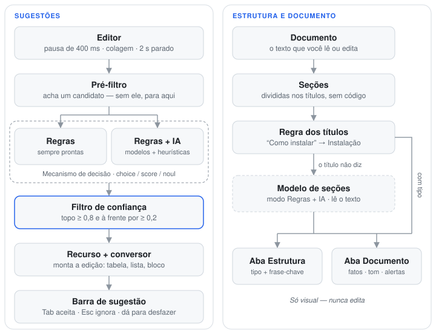
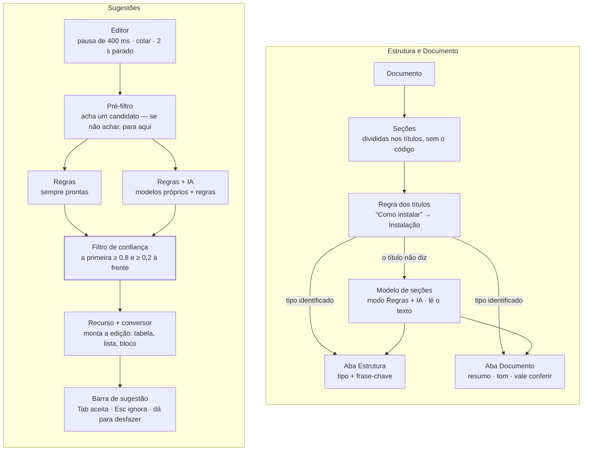

# Smart Assist — Documentação técnica

O Smart Assist é o "radar de escrita" local do Marksage. Ele já vem ligado, no modo *Regras*, e desliga com um
clique. Ele acompanha o editor, detecta um pequeno conjunto de situações que dá para corrigir e **sugere** uma
edição, que você aceita (`Tab`) ou ignora (`Esc`). Nada vai para a rede e nada é aplicado sozinho.

> Esta página é para quem tem curiosidade: como o assistente decide, por que ele fica quieto e como os pequenos
> modelos do próprio Marksage foram treinados. Ter alguma familiaridade com programação ajuda, mas você não
> precisa do código-fonte. Se quiser ir mais fundo, ele está no [GitHub](https://github.com/PabloFLPs/Marksage).

---

## 1. Por que "modelos de decisão"

O Smart Assist é construído sobre **modelos de decisão**, e não sobre modelos generativos. Um modelo de decisão
responde a uma *pergunta tipada, com um conjunto de respostas definido antes*:

| Tipo de decisão | Formato da pergunta | Retorna |
|---|---|---|
| `choice` | "Qual destas opções?" | a opção escolhida + uma probabilidade por opção |
| `score` | "Em que ponto desta escala ordenada?" | um índice + uma probabilidade por degrau |
| `noul` | "Esta afirmação é verdadeira?" | uma única probabilidade em `[0, 1]` |

Como as respostas possíveis são fechadas, a saída nunca vem num formato inesperado. A regra que guia tudo:

> **A engine decide; o nosso código TypeScript age.** Se não dá para listar as respostas possíveis antes, não
> é um trabalho para o Smart Assist.

É também por isso que o projeto evita, de propósito, autocompletar com IA generativa, reescrita de texto e
"corretor ortográfico com IA". Para isso, as ferramentas certas são as determinísticas, como `nspell` e
`remark-lint`.

### 1.1 Por que não um modelo generativo

Em setembro de 2026, a TypeSafe AI lançou o **Jev**, um modelo fechado feito para responder perguntas tipadas
(`choice`, `score`, `noul`) em vez de escrever texto. Com ele, o termo *modelo de decisão* chegou a um público
grande. A ideia não é nova: classificadores, categorizadores e modelos de saída estruturada fazem versões mais
restritas dela há anos. Mas o Jev deu a ela uma forma clara. Três dias depois, a Convai Innovations lançou o
**Laya**, um modelo open weight (Apache 2.0) que responde os mesmos três tipos de pergunta e pode rodar na sua
própria máquina. O Smart Assist leva essa ideia um passo adiante, com pequenos modelos próprios, treinados
exatamente para as perguntas dele.

O motivo é de engenharia, não de novidade: um modelo que só precisa *escolher* numa lista conhecida é muito
menor, mais barato e mais previsível do que um que precisa *escrever*.

| | Modelo generativo (chatbot, autocompletar) | Modelo de decisão (Jev, Laya) | Modelos próprios do Marksage |
|---|---|---|---|
| Saída | texto livre, token a token | uma das respostas da lista + probabilidades | uma das respostas da lista + probabilidades |
| Trabalho por resposta | uma passada do modelo *para cada token gerado* | uma passada, seja qual for a resposta | alguns milhares de multiplicações |
| Tamanho e onde roda | de centenas de milhões a bilhões de parâmetros; em geral, GPU ou API hospedada | Jev: API hospedada · Laya: 322–421 M de parâmetros, na sua máquina | ~262 mil parâmetros, 385 KB, JavaScript puro na página |
| Tempo por decisão | segundos, ou uma ida e volta pela rede quando é hospedado | uma ida e volta pela rede (Jev) ou uma fração de segundo localmente (Laya) | cerca de 0,1 ms |
| Custo por decisão | tempo de GPU ou uma cobrança de API por chamada | um preço por token (Jev) ou processamento local (Laya) | praticamente zero |
| Como falha | pode inventar, se alongar ou devolver algo que o código não consegue ler | pode escolher a opção errada | pode escolher a opção errada |
| Dá para medir? | é difícil: muitas saídas são aceitáveis | sim: certo ou errado contra um rótulo | sim: certo ou errado contra um rótulo |
| Privacidade | hospedado quer dizer que o seu texto sai do dispositivo | o Jev é hospedado; o Laya roda localmente | roda localmente |

Um modelo especializado tem limites claros: ele não consegue dizer nada fora da lista dele, a confiança dele
pode ser calibrada e a acurácia pode ser medida num conjunto de teste antes de ele entrar no app. Para "em que
linguagem está este bloco?" ou "que tipo de seção é esta?", isso é tudo de que a tarefa precisa. Gerar texto só
somaria custo, demora e novas formas de errar, sem deixar a resposta melhor.

*O Jev é um produto da TypeSafe AI, e o Laya, da Convai Innovations. O Marksage não tem vínculo com nenhuma das
duas e, hoje, não usa nenhum dos dois.*

### 1.2 Começa pela solução mais simples

Para cada pergunta, o Smart Assist tenta as opções abaixo, nesta ordem, e fica com a primeira que satisfaz:

1. **Regras heurísticas**: padrões escritos à mão que o código confere diretamente. Por exemplo: uma linha que
   começa com `def` e termina com `:` indica Python. São instantâneas, cada decisão pode ser explicada e elas
   erram pouco. Todo recurso do Smart Assist (a linguagem dos blocos de código, o copia & cola inteligente, as
   dicas de formatação) tenta primeiro as regras heurísticas.
2. **Um pequeno modelo, treinado para aquela pergunta**: entra só quando as regras deixam muita coisa sem
   resposta *e* existem exemplos reais com a resposta certa já conhecida (dados rotulados). É aqui que entram os
   dois modelos do Marksage. Cada um teve que provar, em repositórios que nunca viu, que traz respostas que as
   regras não dão. O modelo de código acerta cerca do dobro de sugestões das regras (1,7–2,2× em três conjuntos
   de teste), com praticamente a mesma precisão. O modelo de seções dá tipo a seções cujo título não diz nada.
   Outros dois foram treinados e medidos do mesmo jeito, para dicas de formatação e tipos de conteúdo colado. Em texto
   real, não superaram as regras, então ficaram de fora (seção 4.6).
3. **Um modelo de decisão geral**: para perguntas sem dados de treino, que um modelo pequeno não tem como
   aprender. Nenhum recurso precisa disso ainda. O candidato hoje é o Laya, um modelo open weight que roda
   localmente, mas que ainda não foi testado no navegador (seção 4.5).

E o que não cabe numa lista de respostas? Isso fica fora do Smart Assist: os recursos que já vêm no Marksage
nunca usam um modelo generativo. A próxima ideia é a **conexão com outros modelos de IA (BYOK, *bring your own
key*)**: um agente de IA, com o modelo e a chave que você escolher, para ajudar com o que precisar dentro do
Marksage. Vai ser opcional e desligada por padrão, e o texto só vai para o provedor que você escolher. Quando
chegar, fica documentada aqui.

### 1.3 Dois modos

Além do *Desligado*, o Smart Assist tem dois modos. O **Regras** responde todas as perguntas com regras heurísticas:
instantâneo, sem nada para baixar. O **Regras + IA** usa os modelos do próprio Marksage onde eles superam as
regras em texto real, e as regras em todo o resto:

| Pergunta | Regras | Regras + IA |
|---|---|---|
| Linguagem do bloco de código | regras | modelo de IA ✦ — ou as regras, quando a primeira opção do modelo concorda ou quando elas têm ≥ 99% de certeza |
| Copia & cola inteligente (que tipo de texto é) | regras | regras — a linguagem de um bloco de código colado, como acima |
| Dicas de formatação | regras | regras |
| Legibilidade | regras (LIX) | regras (LIX) |
| Tipos de seção na Estrutura | regras (pelo título) | regras (pelo título), depois o modelo de IA de seções de texto ✦ quando o título não diz |

Um terceiro modo, em que *só* modelos decidem, foi considerado e descartado. A legibilidade e a regra dos títulos
não têm rótulos de que um modelo pudesse aprender além da própria saída delas: um modelo treinado com notas LIX
só copiaria o LIX. E os modelos de formatação e de colagem não se saíram melhor que as regras (seção 4.6). Um
modo assim seria mais fraco que o Regras + IA, sem ser mais honesto.

**O padrão é o Regras.** Na primeira visita, o Smart Assist começa no modo *Regras*: ele roda no seu
dispositivo, não baixa nada e só sugere, então estar ligado não custa nada. A tela inicial explica o que ele faz.
Se você escolher *Desligado* (ou *Regras + IA*), o Marksage lembra. O "IA" de *Regras + IA* são os dois pequenos
modelos treinados do Marksage (seção 4), não um chatbot nem nada hospedado. (Até 2026-10-29, os modos se
chamavam *Heurísticas* e *Híbrido*, e antes de 2026-10-28, *Modelo local*; o Smart Assist começava desligado. Os
valores guardados, `heuristics` e `model`, não mudaram, então a escolha de ninguém foi perdida.)

---

## 2. Arquitetura

Dois fluxos independentes usam as mesmas peças: as **sugestões**, enquanto você edita, e o **painel Estrutura**,
que só lê o documento.

<!-- diagram: architecture -->


<details>
<summary>O mesmo diagrama em Mermaid</summary>



</details>

### 2.1 As peças

| Peça | O que faz |
|---|---|
| **Pré-filtro** | Verificações baratas e determinísticas que acham *candidatos* (um bloco de código sem linguagem, uma colagem de várias linhas, um título mal formatado). Sem candidato, nada mais roda. |
| **Engine de decisão** | Responde à pergunta tipada sobre um candidato. São duas engines intercambiáveis: a de *regras heurísticas* e a do *Regras + IA* (os modelos próprios do Marksage para a linguagem dos blocos de código e os tipos de seção da Estrutura, mais as regras para o resto). |
| **Filtro de confiança** | Descarta qualquer resposta que não esteja claramente à frente das outras. |
| **Recursos** | Transformam uma decisão confiante em uma edição concreta e reversível (os quatro recursos de sugestão abaixo; a Estrutura e a aba Documento só leem). |
| **Conversores** | Código comum que faz a edição: monta a tabela, a lista, o bloco de código. A engine nunca escreve texto. |
| **Barra de sugestão** | Mostra uma sugestão por vez, que você aceita ou ignora. O ícone mostra o tipo de correção (linguagem do bloco de código, tabela, lista, JSON, título, link); o ✦ indica que quem decidiu foi o modelo de IA local. Clicar no card rola até o ponto e destaca o trecho na pré-visualização. |
| **Painel Estrutura** | Só visual: as seções recebem tipo pela regra dos títulos e, no modo *Regras + IA*, pelo modelo de seções. A aba Documento resume o arquivo inteiro; a aba Sugestões lista todos os pontos que dá para corrigir. |
| **Conjunto de avaliação** | Exemplos rotulados à mão, usados para medir cada recurso antes de ele entrar no app. |

### 2.2 O contrato da engine

```ts
interface DecisionEngine {
  readonly kind: 'heuristic' | 'model'
  ready(): Promise<void>
  choice<T extends string>(state: string, q: string, options: Record<T, string>): Promise<Decision<T>>
  score(state: string, q: string, scale: string[]): Promise<{ value: number; probs: number[] }>
  noul(state: string, statement: string): Promise<number>
}
```

As duas engines implementam a mesma interface, então os recursos nunca sabem qual delas respondeu. O id da
pergunta, `q`, é estável (por exemplo, `fence.language`): a engine de regras usa o id para escolher quem pontua,
e a engine do *Regras + IA* usa o id para decidir quais perguntas os modelos dela respondem.

### 2.3 O filtro de confiança

Uma sugestão só aparece quando a engine tem certeza:

```ts
passesGate(probs, threshold = 0.8, minMargin = 0.2)
// probabilidade da primeira ≥ 0.8  E  primeira − segunda ≥ 0.2
```

| Recurso | Filtro |
|---|---|
| Linguagem do bloco de código, copia & cola inteligente | 0,8 / 0,2 |
| Dicas de formatação (`noul`) | p ≥ 0,8 (o que já dá uma margem de 0,6 sobre "falso") |
| Legibilidade | 0,5 / 0,15 (é uma dica passiva, não uma edição) |
| Tipos de seção na Estrutura (modelo de seções) | 0,8 / 0,2 para o selo de tipo; a partir de 0,6, como "provável" (um rótulo, não uma edição) |

O padrão é ficar em silêncio: uma sugestão que não aparece não custa nada; uma sugestão errada custa confiança.

### 2.4 Garantias de segurança

- **Só sugere.** Toda `Suggestion` leva uma `edit` (`from`, `to`, `insert`) e uma string `expected`. Ao aceitar,
  o hook confere de novo se `text.slice(from, to) === expected`; se você digitou alguma coisa nesse meio-tempo,
  a sugestão desatualizada é descartada.
- **Dá para desfazer.** As edições são aplicadas com `document.execCommand('insertText')`, então entram na pilha
  de desfazer do próprio navegador (`⌘/Ctrl Z`); um `onChange` controlado fica de reserva.
- **Nunca a cada tecla.** A análise espera uma pausa (400 ms), a legibilidade espera 2 s parado, e o pré-filtro
  precisa achar um candidato antes de qualquer chamada à engine. A Estrutura se refaz sobre o texto adiado e
  guarda as respostas de cada seção (tipo, frase-chave) entre uma reconstrução e outra. Assim, uma tecla só faz
  reler a seção que ela mudou.
- **Cancelamento.** Cada execução tem o seu `AbortController`; uma entrada nova cancela as execuções antigas.
- **O que você ignora continua ignorado** durante a sessão (pelo hash do conteúdo), então a mesma dica não volta
  a incomodar. Trocar de modo (ou desligar e ligar o Smart Assist) começa do zero: as sugestões ignoradas voltam a
  ser oferecidas.
- **Desligado é desligado.** No modo *Desligado*, nenhum handler é ligado ao textarea.

---

## 3. Os recursos e as regras heurísticas deles

### Linguagem do bloco de código (`choice`)

**Quando aparece.** Um bloco de código *fechado* (```` ``` ```` ou `~~~`) sem linguagem, com pelo menos 3
caracteres de conteúdo e com o cursor **fora** do bloco (ou seja, você terminou de escrever). O bloco mais
próximo é avaliado primeiro (no máximo 3 por execução).

**Opções.** 20 linguagens + `plaintext`: ts, js, python, bash, json, html, css, sql, go, rust, java, c, cpp,
csharp, ruby, php, yaml, markdown, diff, dockerfile.

**Regra heurística.** Cada linguagem tem regras de regex com pesos, que funcionam como logits: cada regra que
casa soma o peso dela uma vez.

- Pistas *distintivas* têm peso alto (`package main` → Go +4, `<?php` → PHP +6, `if err != nil` → Go +4,
  `#!/bin/bash` → Bash +5, `@@ -1,2 +1,2 @@` → diff +5).
- Sintaxe *compartilhada* (chaves, `=>`, `import … from`) tem peso baixo em várias linguagens.
- Regras *negativas* subtraem pistas que contradizem (por exemplo, anotações de tipo do TS penalizam JS puro).
- *Ajustes estruturais:* conteúdo que é JSON válido → json +6, inclusive o dialeto mais solto, "JSON com
  comentários e vírgulas sobrando", usado em arquivos de configuração (+5). TS contra JS é decidido por pistas que
  só existem em TS (anotações de tipo, `interface`, `import type`, `as const`), porque TS é um superconjunto de JS.
- `plaintext` é pontuado por uma taxa de **cara de código** (densidade de símbolos em relação a palavras, menos a
  pontuação de frases), para que texto corrido em qualquer idioma (inclusive em português) fique sem linguagem.

As pontuações passam por `softmax` → probabilidades → filtro. **Ação:** inserir o id da linguagem logo depois
das crases que abrem o bloco.

**Duas opções.** No *Regras + IA*, quando nenhuma linguagem passa pelo filtro, mas as duas primeiras somam
≥ 85% (e a segunda tem ≥ 20%), a barra oferece as duas: `Tab` (ou um clique) fica com a primeira, `Alt+2` com a
segunda. Pares comuns: JavaScript/TypeScript, JSON/YAML, C/C++. A regra foi definida no conjunto de dev. Nos três
conjuntos de teste, ela fez 15, 17 e 81 ofertas, e a linguagem certa estava entre as duas em 15, 17 e 75 delas
(107 de 113). Só as probabilidades do modelo são calibradas o bastante para isso; por isso, no editor, o modo
*Regras* não oferece pares.

### Copia & cola inteligente (`choice`)

**Quando aparece.** Ao colar no editor algo com pelo menos 2 linhas não vazias, ou uma única linha de JSON
(até 50 mil caracteres), que ainda não comece como estrutura Markdown (tabelas, blocos de código, títulos,
listas). **O que você colou sempre entra do jeito que veio**; depois, a sugestão oferece converter o trecho
colado.

**Opções.** `prose | table | csv | tsv | list | code | json`.

**Regra heurística**:

| Tipo | Pistas |
|---|---|
| `json` | é JSON válido (estrito, ou com comentários e vírgulas sobrando, até com linhas de comentário antes do objeto), inclusive um conteúdo minificado de uma linha só |
| `tsv` | uma tabulação em todas as linhas (já é forte sozinha, porque texto corrido nunca tem isso), mais ainda quando as contagens batem; várias tabulações seguidas contam como uma |
| `csv` | o mesmo número de células separadas por vírgula (respeitando aspas; células entre aspas podem ocupar várias linhas; um cabeçalho com uma coluna a mais ou a menos é aceito), células curtas; perde pontos com frases e células "com muitas palavras" (mais de 5) |
| `table` | colunas alinhadas em todas as linhas, como na saída de terminal ou do `kubectl`. Linhas de traços `----` são ignoradas; colunas separadas por 1 espaço (alinhadas à direita, como no `rails routes`) contam quando toda linha também tem um espaço maior |
| `list` | marcadores de lista (`•`, `–`, `1)`, `a.`…), ≥ 3 linhas curtas sem pontuação no fim, ou ≥ 3 linhas copiadas de uma lista de página web (um item por linha, sem linhas em branco entre eles, sem uma frase continuando na linha seguinte) |
| `code` | reaproveita as pontuações de linguagem do bloco de código + a forma de código (linhas terminando em `{ } ;`, indentação) |
| `prose` | linhas com pontuação de frase e ≥ 8 palavras |

**Ação**: CSV/TSV/alinhado → tabela GFM (a primeira linha vira cabeçalho, `|` escapado); lista → `- item` (os
marcadores existentes são normalizados). JSON → ```` ```json ```` (JSON minificado é formatado antes; JSON com
comentários vira ```` ```jsonc ````). Código → bloco de código, com a linguagem detectada só se *essa* decisão
também passar pelo filtro. Texto corrido (`prose`) nunca gera sugestão.

### Dicas de formatação (`noul`)

**Quando aparece.** Markdown quase certo, fora de código, numa linha que **não** é a que você está digitando.
Depois de uma pausa de 2 s sem mais nada para sugerir, a linha do cursor também conta (assim, um `#Título`
sozinho ganha a dica dele). Blocos de código, código indentado e HTML puro (`<pre>`, `<style>`, …) ficam de fora:

| Candidato | Correção |
|---|---|
| `**Título**` sozinho numa linha, depois de uma linha em branco | um nível abaixo do título acima dele: `### Título` sob um `##`; `## Título` quando não há nenhum (ou só o título `#`) |
| `#Título` (sem espaço), mas não palavras `#tag` em minúsculas nem cores como `#fff` | `# Título` |
| `== Título ==` (estilo wiki) | título no mesmo nível, como no MediaWiki: `== Título ==` → `## Título`, `=== Título ===` → `### Título` |
| `-item`, `*item`, `+item` | `- item` |
| `• item`, `– item`, `✔️ item`: um marcador tipográfico, como vem ao colar de um documento, de uma página web ou de um chat | `- item` (um ✔️ continua: `- ✔️ item`) |
| `1)item`, `1.item` | `1) item` |
| `1- item`, `1 - item` | `1. item` |
| `[texto] (https://…)`: o espaço quebra o link | `[texto](https://…)` |

**Regra heurística.** A engine recebe ±2 linhas de contexto e uma afirmação como *"A linha "**Instalação**"
deveria ser um título de seção."*. A probabilidade parte de um valor inicial por tipo e é ajustada pelas pistas:

- **Linhas em negrito** longas, que terminam como frase (`.` `!` `?`, e também `。` `！` `？` e outros sistemas
  de escrita), que terminam com dois-pontos (`**Retorna:**`), que começam com uma palavra de aviso (`Note`,
  `Warning`, `Tip`, `Q`/`A`, `Nota`, `Atenção`, `Dica`, …) ou que são só um link são rótulos ou ênfase, não
  títulos. O mesmo vale para linhas em negrito logo acima de uma imagem (uma legenda: `**Antes**`) e para
  identificadores em negrito (`**android.permission.CAMERA**`).
- **Linhas com `#`** feitas só de hashtags (`#CLT #Remoto #React`), referências a issues (`#123 corrigido …`) ou
  código (`#include`, `#!/bin/sh`, `#[derive]`) não são títulos; um separador como `=== === ===` também não. Uma
  única palavra com maiúscula (`#Instalação`) só é título quando está sozinha: com uma linha em branco antes e
  sem hashtags em volta. Um `#Remoto` sozinho embaixo de uma vaga de emprego continua sendo tag.
- **Linhas com traço** que parecem flags de linha de comando (`-s, --search`), conjuntos de flags
  (`+SIMD +AVX`), CSS (`-webkit-line-clamp: 2;`), números negativos (`-5 graus`) ou saída de `ls -l`
  (`-rw-r--r-- 1 …`) não são itens de lista; `*palavra*` é ênfase.
- **Correções de lista** precisam de companhia: itens de lista por perto aumentam a confiança. Uma `*linha`
  sozinha costuma ser nota de rodapé, não item de lista, então fica quieta. Uma `-linha` sozinha só é sugerida
  quando parece texto comum (três palavras ou mais, nada com cara de código, como `/`, `:` ou `=`): "-isto
  deveria ser um item de lista", sim; "-verbose" ou "-su cd: /opt/app: Permission denied", não.
- **Marcadores tipográficos** também precisam de companhia: um `• linha` sozinho fica quieto, uma linha com
  vários marcadores é uma barra separadora (`• English • Русский • Français`) e um `— Nome` sozinho assina uma
  citação. **`1 - item`** precisa de um vizinho numerado: `3 - 2` sozinho é um intervalo, `31- zone 2 passed` é
  saída de teste.
- **Um link quebrado por um espaço** é sempre oferecido (0,9): o Markdown nunca lê `[texto] (url)` como link.

### Legibilidade (`score`)

**Quando aparece.** Depois de 2 s parado; uma decisão por seção `##` com pelo menos 30 palavras.

**Regra heurística.** **LIX**, escolhido porque não depende do idioma (funciona para inglês e português, ao
contrário das variantes de Flesch, ajustadas às sílabas do inglês):

```text
LIX = palavras / frases + 100 × palavrasLongas / palavras      (longa = mais de 6 letras)
```

Primeiro o Markdown é removido (código, links, tabelas; itens de lista e títulos contam como frases). O valor
vai para uma escala de 5 degraus, *muito fácil · fácil · moderada · difícil · muito difícil* (centros das faixas
em 25/35/45/55/65), com uma nitidez que cresce com o tamanho da seção. Assim, seções curtas dão distribuições
achatadas e ficam em silêncio.

**Ação.** Um pontinho colorido ao lado do título da seção, na pré-visualização, com uma dica ao passar o mouse.
As marcas só são desenhadas de novo quando uma nota muda de fato.

### Estrutura — tipos de seção

**Quando aparece.** Enquanto o painel Estrutura está aberto; é recalculado enquanto você digita.

**Regra heurística.** Cada título é comparado com frases em inglês e português de dezesseis tipos (vale o estilo
`#` ou sublinhado; blocos de código e front matter ficam de fora). Os tipos: *visão geral, instalação, guia, referência,
configuração, exemplo, solução de problemas, changelog, contribuição, licença e créditos, segurança, desempenho,
deploy, explicação, glossário, roadmap*. Explicação completa os quatro tipos de documentação do framework
Diátaxis (tutoriais, guias práticos, referência, explicação) e cobre "Como funciona", "Arquitetura",
"Conceitos". Segurança cobre "Security", "Reporting a vulnerability", "Segurança"; desempenho, "Benchmarks",
"Desempenho"; deploy, "Deploy to …", "Hosting", "Implantação"; glossário, "Terminologia"; roadmap, "Future
plans", "Planos futuros":

- a frase precisa cobrir pelo menos metade do título: "Basic usage" → guia, enquanto "Perform the first
  migration" não diz nada;
- uma frase mais longa ganha de outra contida nela: "How to fix it" → solução de problemas, não guia;
- frases de dois tipos diferentes se anulam: "Exemplos de uso" fica para o texto decidir;
- títulos de versão (`v1.4.0 (2025-11-19)`, `[2.0.0] - 2024-01-01`) são changelog;
- navegação ("See also", "Next steps", "Veja também") nunca recebe tipo;
- palavras amplas ("Features", "Background", "Production", "Todo") só contam quando são o título inteiro.

No *Regras + IA*, as seções que a regra dos títulos deixa sem tipo são lidas pelo modelo de seções (seção 4.4).

**Frase-chave.** Escolhida dentro da seção, não escrita: é a frase que mais compartilha palavras com o resto da
seção (sem as palavras vazias, nos dois idiomas), com um empurrão em direção ao começo. Uma frase de parágrafo
ganha de um item de lista.

**Ação.** Só visual: um painel com todas as seções, o tipo e a frase-chave de cada uma. Clique para ir até a
seção (ela fica destacada até você mesmo rolar a página); passe o mouse para colorir a seção inteira na
pré-visualização (de ponta a ponta, com cantos retos, quando o editor está aberto ao lado). Nada no documento
muda.

### Aba Documento

**Quando aparece.** Enquanto a aba *Documento* do painel está aberta; é recalculada enquanto você digita.

**O que mostra**, tudo calculado a partir do texto, no seu dispositivo:

- **Tipo de documento**: README, changelog, guia ou tutorial, referência, documentação técnica, artigo ou
  anotações. O nome do arquivo decide quando diz (`README.md`, `CHANGELOG.md`, `guide.md`, `ARCHITECTURE.md`).
  Se não diz, decidem os tipos de seção da Estrutura, e as seções que levaram até lá aparecem como motivo:
  Instalação + Uso + Licença → README; quase tudo Referência/Configuração → referência; quase tudo Explicação,
  Referência, Configuração, Desempenho ou Segurança → documentação técnica. Documentação técnica costuma dar às
  seções o nome do próprio assunto ("O filtro de confiança"), que nenhuma regra nem modelo consegue classificar.
  Por isso ela também é reconhecida pela forma: mais de 800 palavras de texto corrido, mais de 8 seções em pelo
  menos dois níveis de título e três ou mais tabelas ou blocos de código apoiando o texto. Com poucas pistas
  (menos de três seções com tipo, ou menos de um quarto delas, e nenhuma forma clara), ela diz que ainda não há
  um padrão claro, em vez de chutar. O mesmo tipo aparece na barra acima de todo documento renderizado (clique
  nele para abrir esta aba); sem tipo, a barra mostra o nome do arquivo.
- **Resumo**: palavras, tempo de leitura (230 palavras por minuto, sem contar código), seções, blocos de código
  por linguagem, tabelas, links, imagens e o idioma do texto (inglês, português ou misto).
- **Legibilidade**: a mesma escala LIX dos pontinhos de legibilidade, para o documento inteiro, mais a seção mais
  difícil.
- **Tom**: formal, neutro ou conversacional, a partir de sinais contados e mostrados: contrações (contam pela
  metade, porque os guias de estilo atuais as recomendam), pontos de exclamação, emojis, palavras informais e com
  quem o texto fala ("você", "nós", "eu" ou ninguém). São indícios, não um veredito.
- **Tipos de seção**: quantas seções de cada tipo a Estrutura achou (sem contar as marcadas como "provável").
  Clique num tipo para ir até a seção; se houver várias, cada clique leva à próxima.
- **Vale conferir**: hierarquia de títulos quebrada (H2 → H4), mais de um título principal, seções vazias, títulos
  repetidos sob o mesmo pai, blocos de código sem linguagem, imagens sem texto alternativo, links que dizem só
  "aqui", seções muito longas e frases com mais de 40 palavras. Clique em um item para ir até ele. Quando um item
  tem mais de seis ocorrências, aparecem as seis primeiras e um botão *+N mais* para o resto (*Mostrar menos*
  esconde de novo). Changelogs que dão a cada versão o seu próprio título `#` não são marcados por isso.

### Aba Sugestões

**Quando aparece.** Enquanto o painel está aberto e o Smart Assist está ligado (a contagem aparece na aba); é
recalculada 600 ms depois que você para de digitar.

**O que lista:** todos os pontos do documento que receberiam uma sugestão, na ordem do documento. Ou seja,
blocos de código sem linguagem (mesma pergunta, mesmo filtro e mesma regra das duas opções do editor) e títulos,
listas e links mal formatados (mesmas regras das dicas de formatação). Cada linha mostra o ícone da correção, a
linha, a primeira linha do código ou o que vira o quê, a confiança e um ✦ quando quem decidiu foi o modelo de IA local.
Um bloco de código em que nenhuma linguagem passa pelo filtro também aparece, apagado e marcado como *sem
certeza*: a aba nunca esconde um bloco sem linguagem que a aba Documento conta. O clique nele abre uma escolha em
vez de uma correção: as duas linguagens mais prováveis da engine e depois *Texto simples* (marca o bloco como
`text`). `Tab` fica com a primeira, `Alt+2` e `Alt+3` com as outras. Duas, e não três: nos 920 blocos dos
fixtures, uma terceira linguagem só traria a resposta certa para mais 4–6% dos blocos sem certeza, menos que o
*Texto simples* (7–13%). Essas escolhas só aparecem pela aba, nunca enquanto você digita. Colagens não aparecem
na lista: elas são oferecidas na hora em que você cola. As sugestões ignoradas (`Esc`) saem da lista até o modo
mudar.

**Ação.** Nenhuma no painel. Um clique abre o editor, se precisar, põe o cursor no ponto e mostra a sugestão na
barra normal; ela fica lá até você mover o cursor ou digitar. `Tab` aceita, `Esc` ignora e dá para desfazer: é
a mesma edição protegida de todo o resto.

---

## 4. Os modelos próprios do Marksage

> Nunca mexeu com machine learning? [Como os dois modelos funcionam](MODELS.pt-BR.md) explica cada passo (pistas,
> hash, treino, calibração) com números reais dos arquivos dos modelos, além da ficha técnica e do histórico
> completo de versões de cada modelo.

### 4.1 O que é

O modo *Regras + IA* adiciona um pequeno classificador de linguagens treinado para uma única tarefa: dizer em que
linguagem está um bloco de código sem linguagem (inclusive um bloco de código colado). Todo o resto continua com
as regras heurísticas. Não é um chatbot nem um LLM: ele lê um trecho e escolhe uma das 21 respostas, como o resto
do Smart Assist.

- **Tamanho e velocidade:** 385 KB; uma decisão leva cerca de 0,1 ms em JavaScript puro, sem runtime de ML, sem
  WebGPU e sem worker.
- **Privado:** baixado uma vez do mesmo site do app, só depois que você escolhe o modo e confirma um aviso curto.
  Depois fica no cache do navegador (dá para remover quando quiser em Sobre → Privacidade e armazenamento). O seu
  texto nunca sai da página. Durante o download, o botão Assist mostra a porcentagem e uma linha fina de
  progresso; enquanto isso, as regras respondem. Se o download falhar, o botão mostra *Assist: Regras* em âmbar,
  e o menu dele explica o motivo, com **Tentar de novo**.
- **Como ele lê código:** o trecho vira um conjunto de pequenas pistas: palavras e símbolos, pares de tokens
  vizinhos, como as linhas começam e terminam, o estilo de indentação e pedaços de três letras de palavras mais
  longas. Cada pista tem um vetor aprendido de 8 números; o modelo tira a média deles e transforma essa média em
  uma probabilidade por linguagem.
- **Cuidadoso de propósito:** a confiança dele é ajustada com previsões para repositórios que ele nunca viu no
  treino (os trechos curtos à parte, porque é mais fácil confiar demais neles), com a meta de acertar cerca de 95%
  das vezes em que se manifesta. O mesmo filtro de confiança das regras (0,8 / 0,2) decide se você vê alguma coisa.
- **Duas opiniões:** quando o modelo não tem certeza mas as regras têm, a sugestão aparece mesmo assim, se a
  primeira opção do próprio modelo concordar ou se as regras tiverem pelo menos 99% de certeza. (Em trechos
  curtos, as poucas pistas decisivas do modelo podem se perder na média; veja Como os modelos funcionam, §2.7.)

### 4.2 Como foi treinado

- **Dados:** cerca de 270.000 blocos de código de 309 repositórios públicos (documentação, READMEs, guias,
  inclusive em português), rotulados com a linguagem que os *próprios autores* indicaram, mais trechos de
  arquivos de código reais para as linguagens mais raras.
- **Divisão justa:** cada repositório inteiro vai para o treino, para o ajuste (dev) ou para o teste final,
  nunca o mesmo projeto em dois lugares. E qualquer bloco de treino parecido com um bloco de teste é removido.
- **Treino:** cerca de 64.000 blocos, poucos segundos por passada, feito em TypeScript com o mesmo código que o
  app usa para ler os trechos. Assim, o que o modelo viu no treino é exatamente o que ele vê aqui.
- **Escolhido no dev, medido uma vez:** tamanho, configurações e o jeito de combinar com as regras foram
  decididos no conjunto de dev; cada conjunto de teste rodou uma única vez, no fim. O modelo atual é a segunda
  versão; a primeira aparece nos resultados abaixo.

### 4.3 Resultados

A versão 2 foi medida num conjunto **novo**: 284 blocos de código de 67 repositórios que nenhuma versão do
modelo, nem nenhum ajuste, tinha tocado (até 15 por linguagem):

| Engine | Acurácia | Sugestões exibidas | Certas quando exibidas | Sugestões certas / erradas |
|---|---|---|---|---|
| Regras | 59% | 70 (25%) | 93% | 65 / 5 |
| Modelo v1 | 72% | 151 (53%) | 88% | 133 / 18 |
| **Modelo v2 (atual)** | **74%** | **158 (56%)** | **92%** | **145 / 13** |

No primeiro conjunto (314 blocos, o mesmo em que a v1 foi medida), a v2 chega a 77% de acurácia, 164 exibidas e
96% de acerto quando exibe (v1: 76%, 141, 94%; regras: 57%, 76, 97%). Num terceiro conjunto novo (842 blocos de
158 repositórios, 2026-10-30), o *Regras + IA* mostra 408 sugestões com 93,1% de acerto, contra 239 com 92,1% das
regras: 1,7× as certas, com um pouco mais de precisão.

Ou seja: cerca do dobro de sugestões úteis das regras (1,7–2,2× nos três conjuntos de teste) e melhor que a v1 em
todos os números. A precisão fica a cerca de um ponto da das regras: um pouco abaixo nos dois primeiros
conjuntos, um pouco acima no terceiro. É um modo opcional porque baixa um arquivo e o guarda no navegador. Cerca
de metade dos erros vem, na verdade, de rótulos estranhos (`dotnet build -c Release` marcado como C#); o resto são
linhas únicas que servem para várias linguagens (`void main() { … }` é Java válido *e* C++ válido).

### 4.4 O modelo de seções

No *Regras + IA*, a Estrutura também dá tipo a seções cujo título não diz nada ("Antes de começar", "Correções
de bugs", "Temas"), lendo o texto que vem abaixo do título.

- **Mesma receita, outras pistas:** o mesmo tipo de modelo e de arquivo (385 KB, ~0,1 ms por seção), lendo texto
  corrido em vez de código. As pistas são palavras e pares de palavras (sem acentos, então *instalação* =
  *instalacao*), como as linhas começam e as palavras dentro do código. Ele também lê a forma da seção: blocos de
  código e as linguagens deles, tabelas, listas, prompts de shell, números de versão, datas, referências a issues.
- **Rótulos vindos dos títulos, sem os títulos:** cerca de 27.000 seções dos mesmos repositórios públicos,
  rotuladas pela regra dos títulos (numa versão mais rígida, que só confia em títulos sem ambiguidade). O modelo
  nunca vê o título, só o texto abaixo dele. É isso que permite dar tipo às seções cujo título não diz nada.
- **Pode recusar:** a maioria das seções reais é só um assunto ("Arrays", "Amazon S3"), então ele aprende mais
  uma resposta, *outro*, com seções cujo título não indica tipo nenhum. Quando *outro* ganha, a seção fica sem
  tipo.
- **Três tipos ficam com os títulos:** uma versão treinada para também reconhecer seções de explicação (com
  exemplos extras de pastas `concepts/` e `architecture/`, no estilo Diátaxis) não acertou nenhuma nos
  repositórios de dev, porque um texto explicativo usa as mesmas palavras de qualquer assunto. Glossários e
  roadmaps são raros demais para aprender (76 e 57 títulos em 381 repositórios). Esses três tipos vêm só do
  título; o modelo responde os outros treze.
- **Divisão justa:** os repositórios de dev e de teste do modelo de linguagens (mais os 72 novos) ficam de fora
  do treino; as configurações foram escolhidas no dev e o conjunto de teste rodou uma vez.

Resultados no conjunto de teste: 6.339 seções com tipo, de 134 repositórios. Os rótulos vêm dos títulos, então
"concorda" quer dizer que o modelo, lendo só o texto, deu o mesmo tipo que o título indica:

| Confiança | Seções com tipo | Concorda com o título | Seções "outro" que receberam tipo |
|---|---|---|---|
| ≥ 0,8 — selo com ✦ | 858 (14%) | 88,9% | 4,2% |
| ≥ 0,6 — inclui o "provável" | 1.588 (25%) | 85,6% | 10,4% |

Seções de changelog são o caso fácil e comum; sem elas, a concordância com ≥ 0,8 fica em cerca de 85%. A última
coluna é um teto para os erros: algumas seções "outro" são mesmo de instalação ou de referência. Uma conferência à
mão das respostas confiantes em seções cujo título não indica tipo deu o mesmo resultado: cerca de 9 em 10 certas.
Um selo de tipo não muda nada no seu documento, então a Estrutura usa o modelo a partir de 0,6: entre 0,6 e 0,8,
ela mostra um selo apagado, "Configuração?", com a confiança ao passar o mouse.

**A versão 2 (2026-10-27)** acrescentou segurança, desempenho e deploy. No conjunto de teste, 34 das 38 respostas
de segurança exibidas concordam com o título; 45 de 60 em desempenho (o tipo mais fraco); e 2 de 2 em deploy (que
tinha só 246 exemplos de treino). Contra a versão 1, no mesmo conjunto: a v1 dá tipo a 14,5% com 89,6%, e a v2 a
13,5% com 88,9%, praticamente empatadas no geral. A v2 mostra menos seções de changelog e acrescenta os três tipos
novos. Todas as versões estão em [Como os dois modelos funcionam](MODELS.pt-BR.md), seção 8.

### 4.5 E o Jev e o Laya?

O **Laya**, da Convai Innovations, é um modelo de decisão open weight (322–421 M de parâmetros) que responde
nativamente perguntas `choice` / `score` / `noul`, como o **Jev**, da TypeSafe AI, que é hospedado. O Laya era o
plano original para este modo, escolhido no lugar do Jev porque pode rodar na sua máquina. Para a linguagem dos
blocos de código, um modelo treinado para a tarefa encaixou melhor: mais de mil vezes menor (cerca de 262 mil
parâmetros), instantâneo e fácil de medir em dados reais. A ficha técnica dele está em
[Como os modelos funcionam](MODELS.pt-BR.md), seção 7. O modelo de seções seguiu o mesmo caminho. O Laya continua sendo o candidato para
perguntas futuras sem dados de treino assim. Ele ainda não foi testado no navegador: o tamanho do download, a
velocidade e a memória que usaria ali são perguntas em aberto. Por padrão, o que roda, roda no seu dispositivo;
qualquer coisa hospedada, como a futura conexão com outros modelos de IA (BYOK), vai ser opcional e bem
sinalizada.

### 4.6 Testados, não usados: dicas de formatação, tipos de conteúdo colado, texto de links

Em outubro de 2026, mais três perguntas passaram pelo mesmo processo: treino (ou regras escritas) nos repositórios
públicos, todas as escolhas feitas num conjunto de dev e uma única medição em texto real de teste. Nenhuma se saiu
melhor que as regras. Elas ficam registradas aqui para que a próxima tentativa já comece pelos números.

**Um modelo de formatação**: "esta linha mal formatada é um item de lista ou um título?" (sim / não), com a
mesma receita e o mesmo tamanho dos outros dois, lendo a linha e duas linhas em volta. Ele aprendeu com 66.076
linhas. As linhas "sim" são itens de lista e títulos reais dos 381 repositórios, com o erro colocado de volta
(`- item` → `-item` ou `• item`, `## Título` → `##Título` ou `**Título**`). As linhas "não" são coisas reais
parecidas (ajuda de linha de comando, saída de `ls -l`, linhas de diff, CSS, `#include`, notas de rodapé, rótulos
em negrito). Ele foi avaliado em 227 linhas rotuladas à mão, tiradas de issues, pull requests e comentários de 43
repositórios que ele nunca viu: texto sem revisão, onde esses erros acontecem de verdade.

| Teste (227 linhas, rodado uma vez) | Exibidas | Certas quando exibidas | Linhas verdadeiras achadas (de 132) |
|---|---|---|---|
| Regras | 140 | 88,6% | 124 |
| Só o modelo | 76 | 90,8% | 69 |
| Regras + respostas do modelo com ≥ 95% onde as regras ficam quietas | 141 | 88,7% | 125 |

A combinação passou pela régua definida antes (a precisão das regras, pelo menos as mesmas linhas verdadeiras)
por uma linha em 227: pouco para valer um download. Os dois erram em lugares diferentes. As regras marcam por
engano linhas de hashtags, `+20K estudantes` e linhas de diff, que o modelo acerta; o modelo marca por engano
assinaturas (`-Jake`) e `#32 will fix this`, que as regras acertam. O próximo passo natural é uma versão em que
os dois precisam concordar, num conjunto de teste novo. As linhas em negrito ficam com as regras por um bom
motivo: os exemplos "não" do modelo eram linhas em negrito reais, e muitas linhas em negrito reais *são* títulos.
Então ele aprendeu "negrito → não" (5 de 80 exibidas).

**Um modelo de tipos de conteúdo colado**: "que tipo de texto é este que foi colado?" (os sete tipos do copia &
cola inteligente). Ele foi treinado com 16.977 colagens feitas a partir de arquivos reais. Entram blocos de código
e de JSON como os autores escreveram, tabelas Markdown reais transformadas de volta em CSV, texto de planilha e de
terminal, e listas e parágrafos do jeito que o navegador copia. Ele foi avaliado em 53 colagens reais de 19 fontes
de fora dos dados dele (arquivos de dados, cópias de planilha, saída de `pip` e `kubectl`, arquivos de código,
configurações, READMEs em inglês e em português):

| Teste (53 colagens, rodado uma vez) | Exibidas | Certas quando exibidas |
|---|---|---|
| Regras | 41 | 97,6% |
| Modelo | 44 | 90,9% |

Ele achou que eram código uma saída de `kubectl`, uma lista de comandos e dois arquivos JSON.

**Texto do link para uma URL colada**: sem internet, o texto só pode vir da própria URL. Foram medidos 2.842 links
que aparecem sozinhos na linha nos repositórios de dev. O que os autores escrevem é um título ou um nome: o último
pedaço da URL bate com ele em 10% das vezes, o domínio nunca, `dono/repo` em 28%. Só os links de issues e pull
requests do GitHub (`dono/repo#123`) bateram com frequência no dev (90%), e em 32% nos repositórios de teste, onde
cada projeto tem o seu costume ("BUG #523", "Pull Request", um título). Sem buscar a página, não há um bom texto
para oferecer, então uma URL colada fica como está (o Markdown no padrão do GitHub já a mostra como link).

---

## 5. Como é medido

Cada recurso é conferido contra um conjunto de exemplos rotulados à mão: trechos de código em várias linguagens,
colagens reais (CSV, células de planilha, saída de terminal, JSON) e linhas mal formatadas. Entram também texto
em português e texto misturando idiomas. Para cada recurso, acompanhamos:

- **Acurácia**: quantas vezes a primeira resposta está certa;
- **Exibidas**: quantas sugestões passam pelo filtro de confiança;
- **Precisão quando exibe**: quantas vezes uma sugestão que você *vê* está certa (o número que mais importa);
- **Calibração**: se "90% de confiança" quer dizer mesmo ~90% de acerto;
- **Latência** por decisão.

Há dois tipos de exemplo. O conjunto **escrito** foi feito junto com as regras: ele pega regressões, mas tem
notas perto de 100% por construção. O conjunto **do mundo real** vem de documentação real, wikis do GitHub,
traduções da comunidade, arquivos de dados e saída de terminal (inclusive em português), e as regras nunca são
ajustadas contra ele. Por isso, ele dá o número honesto:

| Recurso | Exemplos reais | Acurácia | Exibidas | Precisão quando exibe |
|---|---|---|---|---|
| Linguagem do bloco de código | 314 | 57% | 76 | 97% |
| Copia & cola inteligente | 31 | 94% | 23 | 100% |
| Copia & cola inteligente, conjunto novo (2026-10-28) | 53 | 94% | 41 | 98% |
| Dicas de formatação | 30 | 93% | 14 | 86% |
| Dicas de formatação, conjunto novo (2026-10-28) | 227 | 89% | 140 | 89% |

Os conjuntos novos foram montados para os modelos da seção 4.6 e rodaram uma vez: 53 colagens de arquivos reais e
227 linhas de issues, pull requests e comentários do GitHub. É texto sem revisão, onde os erros de formatação
acontecem de verdade. No conjunto de dev contra o qual foram ajustadas (212 linhas de outros repositórios), as
regras de formatação chegam a 97%; os 89% do conjunto de teste são o número honesto.

Leia assim: quando uma sugestão aparece, ela quase sempre está certa. O custo dessa cautela é que muitos blocos de
código reais não recebem sugestão de linguagem nenhuma. As decisões das regras levam bem menos de um
milissegundo. No *Regras + IA*, a linguagem do bloco de código, nos mesmos 314 blocos, chega a **77% de
acurácia, 164 exibidas e 96% de precisão**; 74% / 158 / 92% num segundo conjunto, novo; e 73% / 408 / 93% num
terceiro (seção 4.3).

---

## 6. Para ir mais fundo

Quer saber como uma regra específica funciona, ou contribuir com uma nova? O código-fonte completo (engine,
regras heurísticas, conjunto de avaliação e notas para quem quer contribuir) está no
[GitHub](https://github.com/PabloFLPs/Marksage).
